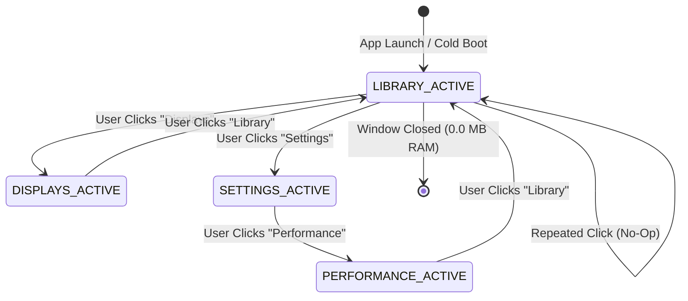

# Navigation & View Routing Specification
**Document ID:** `KW-SHL-002`  
**Deliverable:** B (Navigation and Routing Specification)  
**Parent Document:** [README.md](file:///e:/Projects/All%20working%20projects/App%20projects%20working/KinetiWall%20Engine%20(working)/docs/application_shell/README.md)  
**Classification:** Frontend Navigation & Routing Standard  

---

## 1. Centralized Navigation Registry

Navigation destinations in KinetiWall are governed by a single, authoritative configuration module (`src-ui/routes.ts`):

```typescript
import { LayoutGrid, Monitor, Gauge, Settings, DownloadCloud } from 'lucide-react';

export type RouteKey = 'library' | 'displays' | 'performance' | 'settings' | 'workshop';

export interface NavRouteDefinition {
  key: RouteKey;
  label: string;
  description: string;
  icon: React.ComponentType<{ className?: string }>;
  isAvailable: boolean;
  disabledTooltip?: string;
  badge?: string;
}

export const NAVIGATION_ROUTES: NavRouteDefinition[] = [
  {
    key: 'library',
    label: 'Library',
    description: 'Browse, manage, and apply local live wallpapers',
    icon: LayoutGrid,
    isAvailable: true,
  },
  {
    key: 'displays',
    label: 'Displays',
    description: 'Multi-monitor layout, spanning, and display targeting',
    icon: Monitor,
    isAvailable: true,
  },
  {
    key: 'performance',
    label: 'Performance',
    description: 'Real-time GPU, VRAM, and decoder diagnostics',
    icon: Gauge,
    isAvailable: true,
  },
  {
    key: 'settings',
    label: 'Settings',
    description: 'Engine startup, battery thresholds, and general options',
    icon: Settings,
    isAvailable: true,
  },
  {
    key: 'workshop',
    label: 'Online Hub',
    description: 'Online community wallpaper repository (Cloud feature)',
    icon: DownloadCloud,
    isAvailable: false,
    disabledTooltip: 'Online features are disabled in local-first V1.0 release',
    badge: 'Offline',
  },
];
```

---

## 2. Navigation State Machine & Lifecycle Invariants

Navigation state is maintained in a lightweight, reactive Zustand store (`src-ui/stores/routerStore.ts`):



### 2.1 Navigation Invariants
1. **Single Active Destination:** Exactly one navigation route is active at all times (`activeRoute: RouteKey`).
2. **Anti-Thrashing Invariance (`Principle I`):** Clicking the currently active route key (e.g. clicking "Library" while already viewing the library) is a strict no-op. It must not reset scroll positions, re-fetch thumbnails, or re-render child components.
3. **Honest Availability Guardrail (`Principle D`):** Clicking a route with `isAvailable === false` (e.g. `workshop`) is blocked at the router boundary. It emits an audible or visual tooltip explaining that the feature is disabled, and **never** navigates to an unintended view.
4. **Context Preservation (`Principle E`):** Switching from `Library` to `Settings` preserves the user's active search query, selected category tags, and scroll offset in `libraryStore.ts`. Returning to `Library` instantly restores the exact visual viewport state.

---

## 3. Active Styling & Visual Feedback Matrix

Navigation items in `NavigationSidebar` render with rich visual feedback adhering to the Neon Glass design system:

| State | Background Surface | Border Delineation | Icon / Text Color | Glow & Indicator Accent |
| :--- | :--- | :--- | :--- | :--- |
| **Default (Inactive)** | Transparent | None | `#94A3B8` (Slate 400) | None |
| **Hover** | `#1A1D2E` ($20\%$ opacity) | 1px `#23283E` | `#FFFFFF` (Pure White) | Subtle cyan luminescence |
| **Active (Selected)** | `#161926` (Solid Acrylic) | 1px `#00F0FF` (Neon Cyan) | `#00F0FF` (Neon Cyan) | **Left Border Strip (3px Cyan)** + Ambient Shadow |
| **Focus-Visible (Keyboard)**| `#1A1D2E` | 2px `#00F0FF` | `#FFFFFF` | Visible 2px outline offset |
| **Disabled / Unavailable** | Transparent | None | `#475569` ($40\%$ opacity)| `cursor-not-allowed`, "Offline" pill |

---

## 4. Keyboard Navigation & Tab Sequence

The navigation rail implements strict WCAG 2.1 AA keyboard navigation:
1. **Semantic Landmark:** Enclosed in `<nav aria-label="Main Navigation">` with `<ul role="menubar">`.
2. **Keyboard Activation:** Navigation items are rendered as native `<button role="menuitem">` elements, activating on `Enter` or `Space`.
3. **Active Page ARIA Contract:** The active route declares `aria-current="page"`, providing programmatic feedback to screen readers (Windows Narrator).
4. **Arrow Key Navigation:** Users can cycle through navigation destinations using `ArrowUp` and `ArrowDown` keys without tabbing through internal controls.

