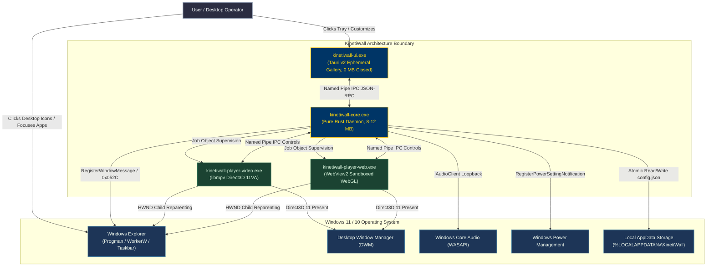
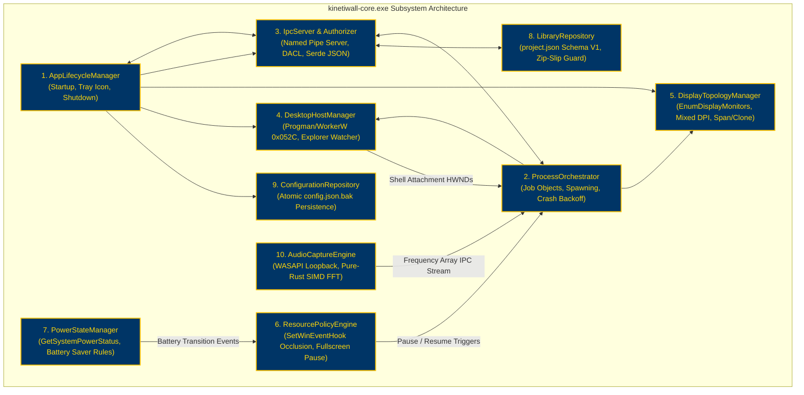
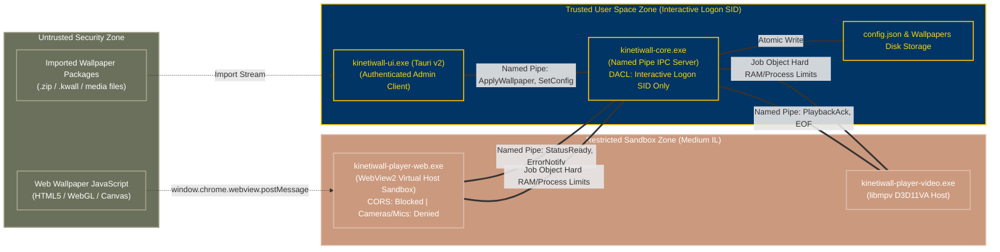
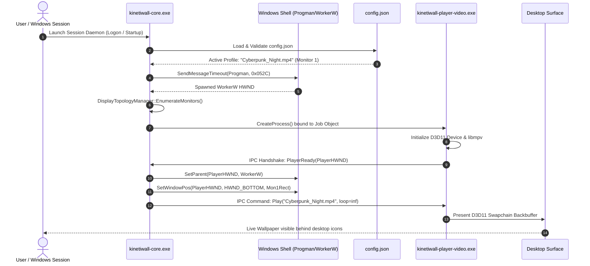
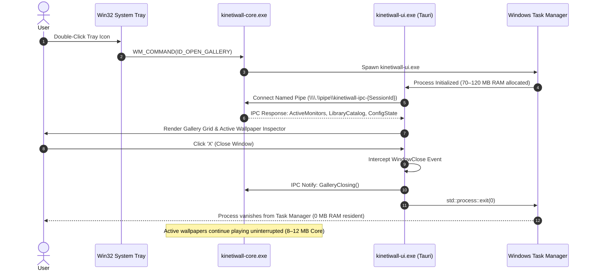
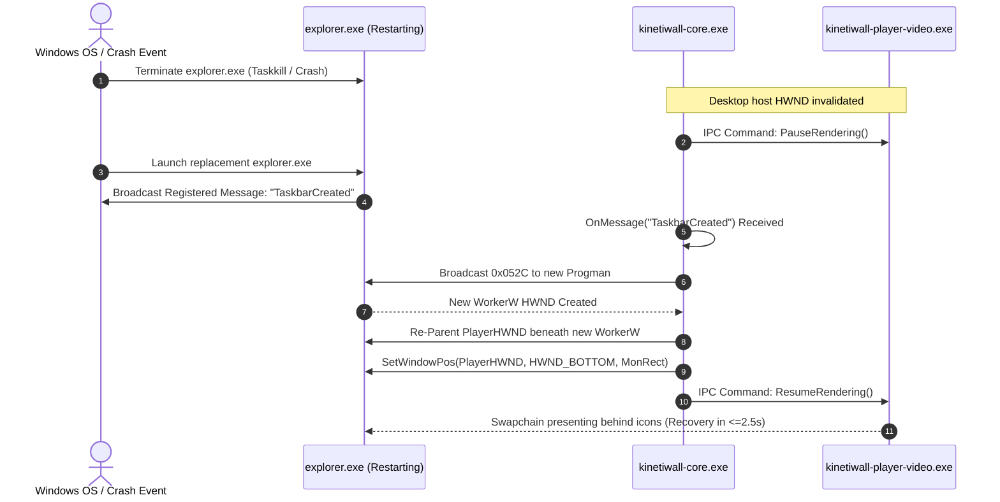

# KinetiWall — System Architecture Diagrams
**Document ID:** `KW-ARC-002`  
**Deliverable:** Deliverable B — Architecture Diagrams  
**Phase:** 2 — System Architecture & Technical Decisions  
**Step:** 7 of 90 — System Architecture & Architecture Decision Records  
**Status:** COMPLETE (Auditable Mermaid Visual Models)  
**Authority:** Principal Software Architect & Rust Systems Lead  
**Date:** 2026-11-10  

---

## 1. System Context Diagram (C4 Level 1)

Visualizes KinetiWall in relation to the Windows operating system, display hardware, local filesystem, and user interactions.



---

## 2. Container & Process Topology Diagram (C4 Level 2)

Details the multi-process layout, IPC communication channels, Windows Job Object containment, and memory budgets.

```mermaid
graph TD
    subgraph ControllerContainer["Process 1: Core Controller Daemon (Session ID >= 1)"]
        DAEMON["kinetiwall-core.exe\n(Pure Rust Background Daemon)\nRAM: 8–12 MB | Idle CPU: <=0.10%"]
        TRAY["Win32 Shell Notify Icon\n(Tray Context Menu & Events)"]
        IPCSERVER["Named Pipe Server\n(\\\\.\\pipe\\kinetiwall-ipc-{SessionId})\nDACL: Local Interactive Logon SID"]
        SUPERVISOR["Process Supervisor\n(Windows Job Object Creator)"]
    end

    subgraph UIContainer["Process 2: On-Demand Gallery UI (Ephemeral)"]
        TAURI["kinetiwall-ui.exe (Tauri v2)\nRAM: 70–120 MB Active | 0 MB Closed\nAction: std::process::exit(0) on close"]
        IPCCLIENT["Named Pipe Client (IPC Caller)"]
        FRONTEND["Web Frontend (Svelte/React + Tailwind)\nWallpaper Grid, Settings, Property Sliders"]
    end

    subgraph JobSandbox["Windows Job Object Container (JOB_OBJECT_LIMIT_KILL_ON_JOB_CLOSE)"]
        subgraph VideoProcess["Process 3: Isolated Video Player"]
            VEXEC["kinetiwall-player-video.exe\nRAM: 45–90 MB | D3D11VA HW Looping"]
            MPV["libmpv-2.dll (LGPL v2.1+ Dynamic Link)\nvo=gpu-next, hwdec=d3d11va"]
        end

        subgraph WebProcess["Process 4: Isolated Web Player"]
            WEXEC["kinetiwall-player-web.exe\nRAM: 120–250 MB | Quota: 500 MB Limit"]
            WEBVIEW["Microsoft Edge WebView2 Evergreen\nVirtual Host: https://kinetiwall.local/"]
        end
    end

    DAEMON --- TRAY
    DAEMON --- IPCSERVER
    DAEMON --- SUPERVISOR

    TAURI --- IPCCLIENT
    TAURI --- FRONTEND

    IPCCLIENT <==>|Authenticated JSON-RPC Messages| IPCSERVER
    SUPERVISOR ==>|Spawns & Binds to Job Object| VEXEC
    SUPERVISOR ==>|Spawns & Binds to Job Object| WEXEC
    
    IPCSERVER <==>|IPC Controls (Play/Pause/Volume)| VEXEC
    IPCSERVER <==>|IPC Controls & Dynamic Props| WEXEC
    
    VEXEC --- MPV
    WEXEC --- WEBVIEW

    classDef daemon fill:#003566,stroke:#ffc300,stroke-width:2px,color:#ffd60a;
    classDef ui fill:#d90429,stroke:#ef233c,stroke-width:2px,color:#ffffff;
    classDef job fill:#14213d,stroke:#fca311,stroke-width:2px,color:#ffffff;
    classDef player fill:#1b4332,stroke:#2d6a4f,stroke-width:2px,color:#d8f3dc;

    class ControllerContainer,DAEMON,TRAY,IPCSERVER,SUPERVISOR daemon;
    class UIContainer,TAURI,IPCCLIENT,FRONTEND ui;
    class JobSandbox job;
    class VideoProcess,VEXEC,MPV,WebProcess,WEXEC,WEBVIEW player;
```

---

## 3. Component Responsibility Diagram (C4 Level 3)

Deconstructs `kinetiwall-core.exe` into its 10 cohesive internal subsystem modules.



---

## 4. IPC Architecture & Trust Boundaries Diagram

Illustrates security zoning, authorization gates, and data isolation between trusted and untrusted components.



---

## 5. Sequence Diagram 1: Startup & Wallpaper Presentation



---

## 6. Sequence Diagram 2: Ephemeral Gallery UI Lifecycle



---

## 7. Sequence Diagram 3: Explorer Crash & Automated Re-Attachment



---

## 8. Sequence Diagram 4: Fullscreen Game Occlusion & Instant Pause

```mermaid
sequenceDiagram
    autonumber
    actor User as User
    participant Game as 3D Game (e.g. Cyberpunk 2077)
    participant WinHook as Win32 SetWinEventHook
    participant Core as kinetiwall-core.exe
    participant Player as kinetiwall-player-video.exe

    User->>Game: Focus Fullscreen 3D Game
    Game->>WinHook: EVENT_SYSTEM_FOREGROUND (GameHWND)
    WinHook->>Core: Callback(EVENT_SYSTEM_FOREGROUND, GameHWND)
    Core->>Core: ResourcePolicyEngine::EvaluateOcclusion(GameHWND)
    Note over Core: GameHWND rect covers Display 1 (Fullscreen detected)
    Core->>Player: IPC Command: Pause(Immediate, FreezeFrame=true)
    Player->>Player: Halt D3D11 Present Loop; Freeze Swapchain
    Note over Player: Player GPU load drops to 0.00% in <=50ms
    User->>Game: Plays game with 0.00% KinetiWall contention
    User->>Game: Alt+Tab or Exit Game
    Game->>WinHook: EVENT_SYSTEM_FOREGROUND (Desktop / Taskbar)
    WinHook->>Core: Callback(Desktop Expose)
    Core->>Player: IPC Command: Resume()
    Player->>Player: Resume D3D11 Present (Resume latency <=16.6ms)
```

