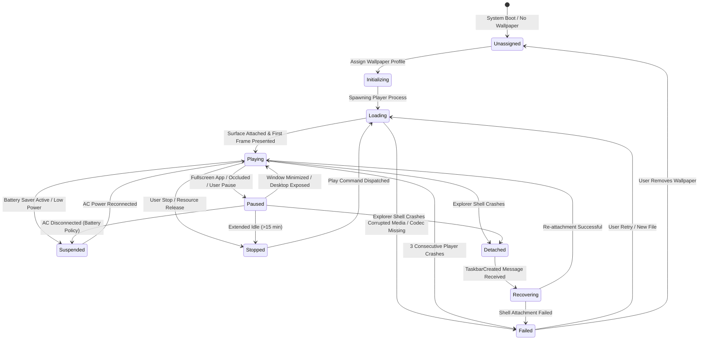

# KinetiWall — Process Lifecycle & State Machine Architecture
**Document ID:** `KW-ARC-005`  
**Deliverable:** Deliverable E — Process Lifecycle and State Model  
**Phase:** 2 — System Architecture & Technical Decisions  
**Step:** 7 of 90 — System Architecture & Architecture Decision Records  
**Status:** COMPLETE (Auditable Lifecycle & State Specifications)  
**Authority:** Principal Software Architect & Rust Systems Lead  
**Date:** 2026-11-10  

---

## 1. Process Lifecycle Models

KinetiWall coordinates four distinct process lifecycles across the background controller, on-demand UI, and sandboxed player subprocesses:

```
┌─────────────────────────────────────────────────────────────────────────────┐
│                    KINETIWALL LIFECYCLE COORDINATION                        │
├─────────────────────┬─────────────────────┬─────────────────────────────────┤
│ Core Daemon         │ Ephemeral Gallery   │ Isolated Players                │
├─────────────────────┼─────────────────────┼─────────────────────────────────┤
│ • Continuous Logon  │ • On-Demand Launch  │ • Per-Wallpaper Execution       │
│ • Single-Instance   │ • Connects to Pipe  │ • Windows Job Object Sandbox    │
│ • Owns Tray & IPC   │ • Syncs State       │ • Sub-50ms Pause Freeze         │
│ • Supervises Child  │ • Terminate to 0 MB │ • Bounded Auto-Restart (Max 3)  │
└─────────────────────┴─────────────────────┴─────────────────────────────────┘
```

---

## 2. Exhaustive Process Lifecycle Specifications

### 2.1 Application Startup Lifecycle (`kinetiwall-core.exe`)
1. **Mutex & Single-Instance Acquisition:** Attempts to acquire named Win32 mutex `Global\KinetiWall_Core_SingleInstance`. If mutex is already held, connects to active Named Pipe, sends `OpenGalleryCommand`, and terminates immediately with exit code 0.
2. **Configuration Bootstrap:** Reads `%LOCALAPPDATA%\KinetiWall\config.json`. If corrupted, auto-restores from `config.json.bak`.
3. **IPC Server Initialization:** Creates Named Pipe `\\.\pipe\kinetiwall-ipc-{SessionId}` with explicit logon SID DACL (`WinLocalSystemSid` + current user SID).
4. **Desktop Shell Discovery:** Broadcasts message `0x052C` to `Progman`. Verifies desktop icon visibility; determines primary `WorkerW` or fallback `Progman` attachment mode (`DEC-PLT-001`).
5. **Display & Hardware Topology Enumeration:** Invokes `EnumDisplayMonitors`. Constructs coordinate map for all active physical displays.
6. **Win32 Event Hook Registration:** Registers `SetWinEventHook` for `EVENT_SYSTEM_FOREGROUND` and `EVENT_OBJECT_LOCATIONCHANGE`.
7. **System Tray Presentation:** Instantiates hidden message-only window and calls `Shell_NotifyIconW(NIM_ADD)` to place tray icon.
8. **Player Process Spawning:** For each monitor with an assigned wallpaper, creates child player process inside Windows Job Object with `JOB_OBJECT_LIMIT_KILL_ON_JOB_CLOSE`.
9. **Desktop Attachment Handshake:** Receives `PlayerReady(HWND)` from child; reparents window beneath `WorkerW`/`Progman` via `SetParent`; dispatches `Play` command.

---

### 2.2 Ephemeral Gallery UI Lifecycle (`kinetiwall-ui.exe`)
1. **On-Demand Launch:** Triggered by user double-clicking system tray icon or via start menu shortcut.
2. **IPC Connect & Handshake:** Connects as a client to `\\.\pipe\kinetiwall-ipc-{SessionId}`. Sends `QueryStateRequest`.
3. **State Synchronization:** Receives active monitor geometries, assigned wallpaper metadata, volume levels, and global pause status.
4. **Interactive Operations:** User browses library, imports new archives, adjusts dynamic property sliders, or maps wallpapers to monitors. All changes stream over IPC to core daemon.
5. **Window Close & Immediate Teardown (`KW-NG-001`):** User clicks 'X' or presses Alt+F4. Tauri frontend catches `onCloseRequested` event, sends `GalleryClosing` notification over IPC, and executes `std::process::exit(0)`.
6. **Zero Resident Footprint:** The entire UI process and its WebView runtime cease to exist in Task Manager within ≤200ms, returning 70–120 MB RAM back to Windows. Active wallpapers continue playing uninterrupted.

---

### 2.3 Wallpaper Player Subprocess Lifecycle
1. **Creation:** Core daemon invokes `CreateProcessW` passing `--display-id {id} --ipc-pipe {name}` flags.
2. **Job Object Containment:** Child process handle is immediately assigned to the core daemon's Windows Job Object.
3. **Device Initialization:** Player initializes its rendering backend:
   - Video Player: Direct3D 11 device, swapchain, and dynamically bound `libmpv-2.dll`.
   - Web Player: Microsoft Edge WebView2 environment mapped to `https://kinetiwall.local/`.
4. **IPC Handshake:** Player connects to Named Pipe, transmits `PlayerReady(HWND)` containing its child rendering window handle.
5. **Desktop Placement:** Core daemon configures window styles (`WS_CHILD | WS_CLIPSIBLINGS | WS_VISIBLE`), sets parent to `WorkerW`, and positions window matching the physical monitor rect.
6. **Playback Execution:** Video begins infinite hardware-decoded looping (`loop-file=inf`); WebGL begins 60 FPS animation loop.
7. **Pause State:** Upon occlusion or gaming detection, player halts swapchain presentation within ≤50ms and freezes backbuffer frame (0.00% GPU utilization).
8. **Crash & Recovery:** If player terminates unexpectedly, core daemon detects signaled process handle, logs event, applies exponential backoff, and spawns replacement player (up to 3 attempts in 60s).

---

### 2.4 Controller Failure & Orphan Containment
- **Problem Statement:** What happens if `kinetiwall-core.exe` crashes or is killed forcefully via Task Manager?
- **Enforcement:** Because all child player processes are bound to the Windows Job Object with `JOB_OBJECT_LIMIT_KILL_ON_JOB_CLOSE`, closing the job object handle (which the Windows kernel performs automatically when the parent process terminates) causes the kernel to **terminate 100% of child player processes instantaneously**.
- **Desktop State:** The desktop cleanly reverts to the underlying Windows static wallpaper with zero lingering child windows or orphan background processes.

---

### 2.5 Explorer Shell Crash & Re-Attachment Lifecycle
- **Detection:** Core daemon registers window message `TaskbarCreated` via `RegisterWindowMessageW`.
- **Invalidation:** When `explorer.exe` terminates, existing `WorkerW` and `Progman` HWNDs are destroyed by Windows. Core marks desktop handles invalid and signals players to pause presentation.
- **Re-Attachment Handshake:** Upon receiving `TaskbarCreated`, core daemon broadcasts `0x052C` to the newly spawned `Progman`, locates the new `WorkerW`, reparents active player windows, and resumes playback in ≤2.5 seconds (`KW-F-003`).

---

## 3. Formal 10-State Wallpaper State Machine

Each display output maintains an independent, authoritative playback state managed exclusively by the `ResourcePolicyEngine` inside `kinetiwall-core.exe`:



---

## 4. State Semantics & Transition Rules Matrix

| State Name | Operational Semantic | Entry Conditions | Allowed Exit States | Resource Allocation State | UI Representation |
|:---|:---|:---|:---|:---|:---|
| **`Unassigned`** | No wallpaper assigned to monitor. | Initial install; user removes profile. | `Initializing` | 0 MB RAM; 0% CPU; 0% GPU. | Blank monitor slot in grid. |
| **`Initializing`**| Resolving manifest & file paths. | User selects wallpaper in UI. | `Loading`, `Failed` | File handle open; validating manifest. | Spinner on monitor card. |
| **`Loading`** | Spawning player & creating D3D11 swapchain. | Process launch initiated. | `Playing`, `Failed` | Process spawned; VRAM allocating. | "Loading media..." indicator. |
| **`Playing`** | Actively decoding & presenting frames. | Surface reparented; present loop active. | `Paused`, `Suspended`, `Stopped`, `Detached`, `Failed` | Full VRAM; HW decoder active; 60 FPS. | Green "Playing" badge. |
| **`Paused`** | Frame frozen; swapchain presentation halted. | Fullscreen game; window occlusion; user pause. | `Playing`, `Suspended`, `Stopped`, `Detached` | VRAM retained; **0.00% GPU; 0.00% CPU**. | Amber "Paused" badge. |
| **`Stopped`** | Presentation halted; swapchain backbuffer freed. | Explicit stop request; extended idle. | `Loading`, `Unassigned` | Player process unloaded; 0 MB VRAM. | Gray "Stopped" badge. |
| **`Suspended`** | Static wallpaper blitted; player unloaded. | Battery saver triggered; AC disconnect. | `Playing`, `Loading` | Static image on desktop; 0 MB player RAM. | Blue "Battery Saver" badge. |
| **`Detached`** | Desktop host HWND lost during Explorer crash. | `explorer.exe` terminates. | `Recovering`, `Failed` | Player presentation suspended. | Red "Shell Disconnected" badge. |
| **`Recovering`**| Re-executing attachment handshake. | `TaskbarCreated` received. | `Playing`, `Failed` | Re-probing WorkerW; reparenting HWND. | Yellow "Reconnecting..." badge. |
| **`Failed`** | Error state; 3 crashes reached or bad file. | Corrupt file; codec fault; 3 crashes in 60s. | `Loading`, `Unassigned` | Player terminated; static desktop restored. | Red "Error: Playback Failed" badge. |

---

## 5. Event Conflict Resolution & Arbitration Rules

1. **Monitor Removal While Pausing:** If a display is unplugged while its player is executing a pause transition, the `DisplayTopologyManager` immediately cancels the pause command, marks the player terminated, destroys the child process handle, and updates active topology without waiting for player acknowledgment.
2. **Rapid Application Switching:** If the user rapidly Alt+Tabs between games and desktop (<100ms), the `ResourcePolicyEngine` debounces pause/resume commands by 50ms to prevent rapid swapchain re-allocations and GPU driver deadlocks.
3. **Simultaneous Battery Disconnect & Fullscreen Game:** Battery policy takes precedence. The player enters `Suspended` state (static wallpaper fallback) to maximize laptop battery longevity.

