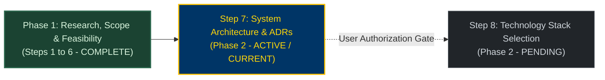

# KinetiWall — System Architecture & Architecture Decision Records Suite
**Document ID:** `KW-ARC-000`  
**Phase:** 2 — System Architecture & Technical Decisions  
**Step:** 7 of 90 — System Architecture & Architecture Decision Records  
**Status:** COMPLETE (Authoritative Architectural Blueprint)  
**Classification:** System Architecture, Architectural Modeling & Technical Governance  
**Date:** 2026-11-10  
**Authority:** Principal Software Architect & Rust Systems Lead  

---

## 1. Executive Summary & Architectural Charter

This documentation suite establishes the authoritative, production-grade **System Architecture Blueprint** for **KinetiWall** — an ultra-lightweight, hardware-accelerated Windows desktop live wallpaper engine engineered in pure Rust.

The architecture is designed to resolve a fundamental tension in desktop software: delivering rich, hardware-accelerated multimedia (4K 60fps video, interactive WebGL, system-audio reactivity) while maintaining an imperceptible operating system footprint (8–12 MB idle daemon RAM, 0 MB closed UI RAM, 0.00% CPU/GPU contention during fullscreen gaming, and absolute crash isolation).

```
┌─────────────────────────────────────────────────────────────────────────────┐
│                      KINETIWALL ARCHITECTURAL TRIAD                         │
├─────────────────────┬─────────────────────┬─────────────────────────────────┤
│ 1. CORE DAEMON      │ 2. EPHEMERAL UI     │ 3. ISOLATED PLAYERS             │
├─────────────────────┼─────────────────────┼─────────────────────────────────┤
│ • kinetiwall-core   │ • kinetiwall-ui     │ • kinetiwall-player-video       │
│ • Pure Rust (8-12MB)│ • Tauri v2 Frontend │ • kinetiwall-player-web         │
│ • Session Background│ • On-Demand Launch  │ • Windows Job Object Sandbox    │
│ • Owns HWND, Tray   │ • 0 MB RAM Closed   │ • Direct3D 11VA / WebView2      │
│ • Named Pipe Server │ • IPC Client Only   │ • Bounded Crash Auto-Restart    │
└─────────────────────┴─────────────────────┴─────────────────────────────────┘
```

---

## 2. Source Precedence & Architectural Traceability

The architecture is derived directly from the normative baselines established in Phase 1:
1. **Requirements Baseline:** [Step 1 Requirements Inventory](file:///e:/Projects/All%20working%20projects/App%20projects%20working/KinetiWall%20Engine%20(working)/docs/requirements/README.md) (`KW-F-001`..`046`, `KW-NF-001`..`027`, `KW-NG-001`..`006`).
2. **Technical Research:** [Step 2 Technical Research](file:///e:/Projects/All%20working%20projects/App%20projects%20working/KinetiWall%20Engine%20(working)/docs/research/README.md) (Multi-process IPC, D3D11VA, WebView2 virtual hosts).
3. **Platform Support Policy:** [Step 4 Platform Matrix](file:///e:/Projects/All%20working%20projects/App%20projects%20working/KinetiWall%20Engine%20(working)/docs/platform_support/README.md) (`DEC-PLT-001`..`012`).
4. **Release Scope Proposal:** [Step 5 Release Scope](file:///e:/Projects/All%20working%20projects/App%20projects%20working/KinetiWall%20Engine%20(working)/docs/release_scope/README.md) (`KW-SCP-001`..`007`).
5. **Quality & Risk Governance:** [Step 6 Quality Plan](file:///e:/Projects/All%20working%20projects/App%20projects%20working/KinetiWall%20Engine%20(working)/docs/quality_and_risk/README.md) (`KW-AC-001`..`023`, `KW-R-001`..`020`, `VG-001`..`010`).

---

## 3. Documentation Suite Index

| Document ID | Deliverable | File Path | Scope & Focus |
|:---|:---|:---|:---|
| **`KW-ARC-001`** | **Deliverable A** | [SYSTEM_ARCHITECTURE_OVERVIEW.md](file:///e:/Projects/All%20working%20projects/App%20projects%20working/KinetiWall%20Engine%20(working)/docs/architecture/SYSTEM_ARCHITECTURE_OVERVIEW.md) | System Context, Subsystem Boundaries, Data Ownership Model, Process Structure. |
| **`KW-ARC-002`** | **Deliverable B** | [ARCHITECTURE_DIAGRAMS.md](file:///e:/Projects/All%20working%20projects/App%20projects%20working/KinetiWall%20Engine%20(working)/docs/architecture/ARCHITECTURE_DIAGRAMS.md) | Full Mermaid diagram suite (System Context, Process View, Component View, IPC/Trust, Sequence Flows). |
| **`KW-ARC-003`** | **Deliverable C** | [COMPONENT_MATRIX.md](file:///e:/Projects/All%20working%20projects/App%20projects%20working/KinetiWall%20Engine%20(working)/docs/architecture/COMPONENT_MATRIX.md) | Component matrix: responsibilities, owned state, public contracts, dependencies, failure handling, and requirements mapping. |
| **`KW-ARC-004`** | **Deliverable D** | [ARCHITECTURE_DECISION_RECORDS.md](file:///e:/Projects/All%20working%20projects/App%20projects%20working/KinetiWall%20Engine%20(working)/docs/architecture/ARCHITECTURE_DECISION_RECORDS.md) | 14 formal Architecture Decision Records (`ADR-0001` through `ADR-0014`) with context, trade-offs, and approval statuses. |
| **`KW-ARC-005`** | **Deliverable E** | [PROCESS_LIFECYCLE_AND_STATES.md](file:///e:/Projects/All%20working%20projects/App%20projects%20working/KinetiWall%20Engine%20(working)/docs/architecture/PROCESS_LIFECYCLE_AND_STATES.md) | Process lifecycle models (Startup, UI on-demand, Player supervisor, Teardown) and formal 10-state playback state machine. |
| **`KW-ARC-006`** | **Deliverable F** | [SECURITY_AND_TRUST_BOUNDARIES.md](file:///e:/Projects/All%20working%20projects/App%20projects%20working/KinetiWall%20Engine%20(working)/docs/architecture/SECURITY_AND_TRUST_BOUNDARIES.md) | Trust boundary architecture, Named Pipe DACL, IPC authorization model, WebView2 origin sandboxing, and volatile audio memory. |
| **`KW-ARC-007`** | **Deliverables G & H** | [FAILURE_RECOVERY_AND_OPEN_DECISIONS.md](file:///e:/Projects/All%20working%20projects/App%20projects%20working/KinetiWall%20Engine%20(working)/docs/architecture/FAILURE_RECOVERY_AND_OPEN_DECISIONS.md) | 16 critical architectural failure recovery scenarios and Architecture Risk / Open-Decision Register linking to prototype spikes. |

---

## 4. Roadmap Progress & Step Transition Protocol



### Strict Transition Protocol to Step 8
Under strict engineering governance:
1. **Architecture Blueprint Only:** No application code, UI scaffolding, or build scripts have been created or modified in Step 7.
2. **Preservation of Normative Baseline:** All 46 functional requirements, 27 non-functional requirements, 6 non-goals, and quality gates remain authoritative.
3. **Stop Boundary:** Upon generating and validating this architecture suite, the agent will present the completion report and **STOP**, awaiting explicit user instruction before initiating Step 8 (`Step 8 of 90: Technology Stack Selection & Dependency Evaluation`).

