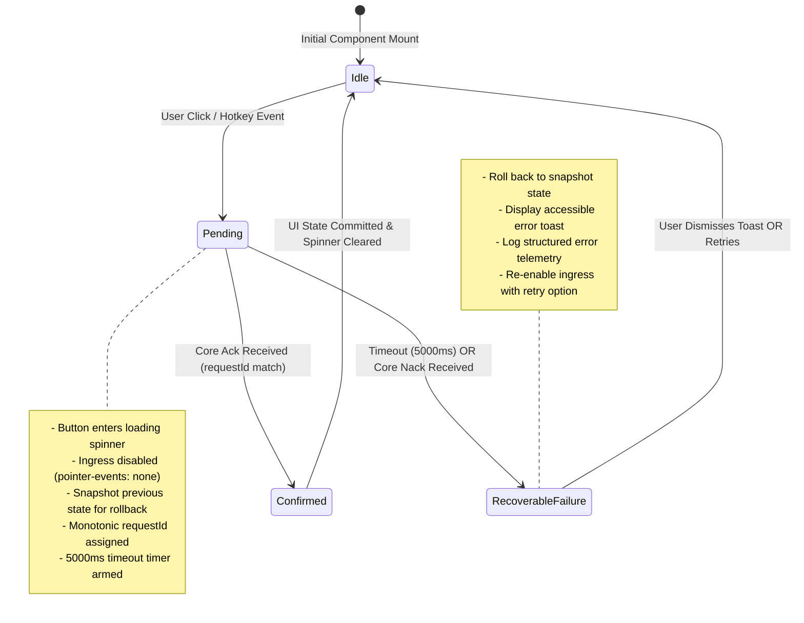

# Dashboard Action Lifecycle and Reliability Specification
**Document ID:** `KW-DSI-002`  
**Phase:** 4 (UI/UX Design System & Dashboard)  
**Step:** 24 of 90  
**Status:** Approved Architectural Specification  
**Classification:** Frontend Application Architecture / User Interaction & State Reliability Model  

---

## 1. Executive Summary & Purpose

This specification governs the deterministic execution lifecycle of user-initiated dashboard actions within KinetiWall.

When a user interacts with primary controls on the dashboard—such as toggling wallpaper playback, muting audio, switching active profiles, or reassigning displays—the interface must deliver immediate visual feedback while shielding the backend engine (`kinetiwall-core.exe`) from duplicate command floods, out-of-order execution, and desynchronized state.

---

## 2. Four-Phase Action Lifecycle State Machine

All dashboard actions conform to an atomic four-phase state machine:



### 2.1 State Definitions
* **`Idle`:** Normal interactive state. Control is enabled, displaying current confirmed value.
* **`Pending`:** Action has been dispatched across the IPC boundary. The control displays an optimistic loading indicator (`isLoading = true`) and sets `aria-busy="true"`. User interaction is disabled on this control to prevent duplicate command submissions (`ingressDisabled = true`).
* **`Confirmed`:** The Core daemon has validated and processed the command, returning `ipc://action-confirmed` with the matching `requestId`. Optimistic values become confirmed truth; the control returns to `Idle`.
* **`RecoverableFailure`:** The Core rejected the action or failed to acknowledge it within $5000\text{ ms}$. The control rolls back to its pre-action snapshot, clears the loading indicator, and presents an informative toast banner to the user.

---

## 3. Action Ingress Protection & Debounce Architecture

To ensure operational stability and prevent IPC channel saturation, KinetiWall implements two layers of input defense:

### 3.1 Synchronous Ingress Disabling
When a user triggers an action (e.g. clicks the "Pause" button), the click handler synchronously executes:
1. `setPendingAction(actionId, { snapshot, requestId, startedAt: Date.now() })`.
2. Sets `disabled={true}` and `aria-disabled="true"` on the triggering component before the event bubble finishes.
3. Suppresses subsequent click, keydown (`Enter`, `Space`), and touch events until the lifecycle concludes.

### 3.2 Debounce & Cooldown Guardrails
Even if a user triggers rapid alternating inputs (e.g. keyboard shortcuts), an enforced cooldown window of $200\text{ ms}$ is imposed between consecutive dispatches of the same action type:

```typescript
export interface ActionExecutionOptions {
  timeoutMs?: number;        // Default: 5000ms
  debounceMs?: number;       // Default: 200ms
  allowConcurrent?: boolean; // Default: false (per action category)
}
```

---

## 4. Primary Dashboard Action Execution Contracts

### 4.1 Play / Pause Toggle Contract

* **Trigger:** Hero panel "Play / Pause" button or global quick action (`Space` shortcut).
* **Command:** `CMD_SET_PLAYBACK_STATE`
* **Payload:** `{ targetState: 'Playing' | 'Paused', requestId: u64 }`
* **Optimistic Behavior:** Toggle icon flips immediately to target state with a subtle pulsating glow; button enters `isLoading = true`.
* **Rollback Scenario:** If playback cannot resume (e.g., rendering engine crashed or hardware video decoder failed to allocate DirectX surfaces), Core returns `ERR_DECODER_INIT_FAILED`. The UI reverts to `Paused` and surfaces: *"Unable to resume wallpaper: Video decoder initialization failed."*

```typescript
export async function togglePlaybackAction(): Promise<void> {
  const store = useDashboardStore.getState();
  const current = store.playback.globalState;
  const target = current === 'Playing' ? 'Paused' : 'Playing';
  
  const snapshot = current;
  const requestId = store.generateNextRequestId();

  // 1. Enter Pending State & Optimistic Update
  store.setPlaybackOptimistic(target, requestId);

  try {
    const result = await invoke<{ success: boolean; errorCode?: string }>('set_playback_state', {
      targetState: target,
      requestId,
    });

    if (!result.success) {
      throw new Error(result.errorCode || 'UNKNOWN_ERROR');
    }
  } catch (err) {
    // 2. Deterministic Rollback on Failure
    store.rollbackPlayback(snapshot, requestId, err as Error);
  }
}
```

### 4.2 Master Audio Mute / Unmute Contract

* **Trigger:** Quick Actions "Mute / Unmute" button (`M` key).
* **Command:** `CMD_SET_MASTER_MUTE`
* **Payload:** `{ muted: boolean, requestId: u64 }`
* **Validation:** If the active wallpaper does not contain an audio track (`hasAudioTrack === false`), the Mute button is permanently disabled with tooltip: *"Active wallpaper has no audio stream."*
* **Confirmation:** Core mutes native audio render stream via Windows CoreAudio API (`IAudioSessionControl`) without pausing video/shader presentation.

### 4.3 Active Profile / Preset Switch Contract

* **Trigger:** Profile selector dropdown in Dashboard header.
* **Command:** `CMD_APPLY_WALLPAPER_PROFILE`
* **Payload:** `{ profileId: string, requestId: u64 }`
* **Execution Flow:**
  1. Header displays loading indicator next to profile name.
  2. All display slot cards enter `Refreshing` state.
  3. Core pauses players, reads new profile configuration, instantiates or re-binds players, and pushes `ipc://topology-changed`.
  4. UI receives updated display assignments and commits new active profile.

---

## 5. Failure Rollback & Recovery Workflow

When an action fails or times out, the system executes an automated, non-destructive recovery sequence:

```
[User Action: Pause] ---> [Optimistic State: Paused] ---> [Core Error: HWND_INVALID]
                                                                  |
                                                                  v
                                              +-----------------------------------+
                                              | Automated Rollback Triggered      |
                                              | 1. Revert UI to 'Playing'         |
                                              | 2. Clear pending action registry  |
                                              | 3. Re-enable user click ingress   |
                                              | 4. Spawn Accessible Error Toast   |
                                              | 5. Emit Telemetry Incident Record |
                                              +-----------------------------------+
```

### 5.1 Error Toast Presentation Contract
* **Visual Role:** Non-blocking notification banner anchored to top-right of the dashboard content area.
* **Accessibility:** Rendered inside an `aria-live="assertive"` container.
* **Content:**
  - Clear plain-language explanation of failure.
  - Contextual recovery action (e.g., `"Retry"`, `"Open Diagnostics"`, or `"Restart Engine"`).
  - Dismiss button (`Esc` or click).
* **Auto-Dismiss:** Dismisses automatically after $8000\text{ ms}$ if no user interaction occurs; errors marked `Critical` persist until explicitly dismissed.

