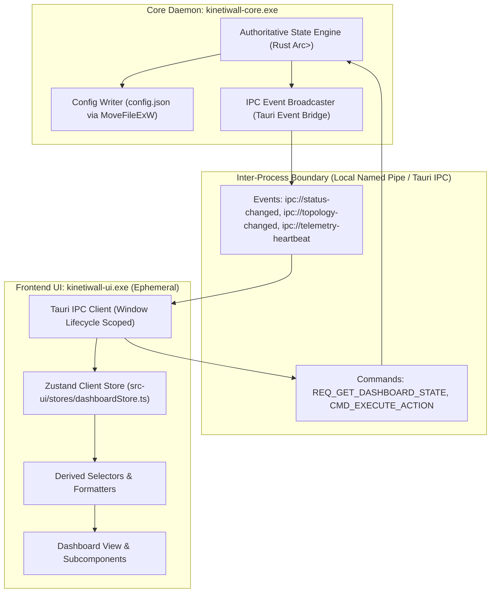
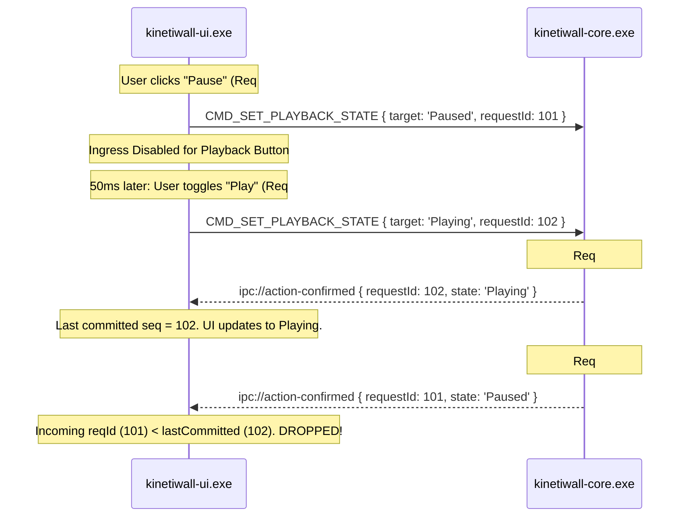

# Dashboard State Integration Architecture
**Document ID:** `KW-DSI-001`  
**Phase:** 4 (UI/UX Design System & Dashboard)  
**Step:** 24 of 90  
**Status:** Approved Architectural Specification  
**Classification:** Frontend Application Architecture / State Ownership & Event Synchronization Pipeline  

---

## 1. Executive Summary & Purpose

This specification establishes the architectural foundations of state ownership, event-driven data synchronization, sequence guardrails, and process-boundary lifecycle management for the KinetiWall Dashboard (`src-ui/views/DashboardView.tsx`).

The architecture guarantees that the user interface reliably mirrors the operational reality of the underlying Windows desktop engine (`kinetiwall-core.exe`) without introducing polling overhead, state desynchronization, or lifecycle interference.



---

## 2. State Ownership Hierarchy

To prevent split-brain states and race conditions, KinetiWall enforces a strict three-tier state hierarchy:

```
+-------------------------------------------------------------------------+
| Level 1: Authoritative Engine State (kinetiwall-core.exe)               |
| - Single Source of Truth; Thread-safe Rust Arc<RwLock<EngineState>>     |
| - Persisted atomically to %APPDATA%/KinetiWall/config.json              |
+-------------------------------------------------------------------------+
                                    |
                                    v (Push via Events / Pull via DTO)
+-------------------------------------------------------------------------+
| Level 2: Synchronized Client Store (Zustand: dashboardStore.ts)         |
| - In-memory mirror in kinetiwall-ui.exe                                  |
| - State slices: Engine, Playback, Displays, Actions, Telemetry          |
| - Discarded unconditionally upon window close                           |
+-------------------------------------------------------------------------+
                                    |
                                    v (Local Selectors / Reactive Mappings)
+-------------------------------------------------------------------------+
| Level 3: Presentation Derived State (React Component Subscriptions)    |
| - Computed formatters (e.g. "4K @ 60 FPS", "Active - Occluded")         |
| - Visual flags: isHeroPlayable, canMute, hasDiagnosticWarnings         |
| - Local UI-only ephemeral state (dropdown open, tab focus)             |
+-------------------------------------------------------------------------+
```

### 2.1 Level 1: Authoritative Engine State (`kinetiwall-core.exe`)
* **Ownership:** Managed exclusively by the Core Rust daemon runtime.
* **Storage & Persistence:** Stored in memory wrapped in thread-safe synchronization primitives (`Arc<RwLock<EngineState>>`). Configuration changes are flushed to disk using atomic rename operations (`MoveFileExW` with `MOVEFILE_REPLACE_EXISTING`) to prevent file corruption during sudden system shutdowns (`KW-DAT-001`).
* **Authority:** The Core holds final veto power over all actions. Any change proposed by the frontend is merely a request until confirmed by the Core.

### 2.2 Level 2: Synchronized Client Store (`src-ui/stores/dashboardStore.ts`)
* **Ownership:** Scoped to the `kinetiwall-ui.exe` process lifetime.
* **Implementation:** Built using `Zustand` with lightweight, predictable slice reducers.
* **Slices:**
  1. `engine`: Daemon connectivity status, engine health mode, core version, uptime.
  2. `playback`: Global playback mode (`Playing`, `Paused`, `Occluded`), master audio mute/volume, active profile ID.
  3. `displays`: Normalized dictionary of connected displays (`Record<string, DisplaySlotDTO>`).
  4. `activeWallpaper`: Currently active hero wallpaper metadata, thumbnail URI, rendering engine type.
  5. `pendingActions`: Monitored action map tracking in-flight operations with sequence numbers and timestamps.
  6. `telemetry`: Rolling buffer of system performance metrics (framerate, CPU %, GPU %).

### 2.3 Level 3: Presentation Derived State
* **Implementation:** Pure React selectors or useMemo hooks derived from Level 2 store slices.
* **Rules:** Presentation derived states are never written back to Level 2 or Level 1. Examples include formatting byte counts into human-readable strings, determining whether the active wallpaper can be muted based on its engine type, and calculating layout column spans.

---

## 3. Initial State Acquisition (Bootstrap Contract)

When `kinetiwall-ui.exe` initializes or when the `DashboardView` mounts, it must not fire multiple uncoordinated queries. Instead, it performs a single, atomic bootstrap call.

### 3.1 Bootstrap Command Specification

* **IPC Command Name:** `REQ_GET_DASHBOARD_STATE`
* **Transport:** Tauri v2 IPC Invoke (`invoke('get_dashboard_state')`)
* **Latency Target:** $\le 50\text{ ms}$ cold response time (`KW-NF-004`).
* **Data Transfer Object (`DashboardBootstrapDTO`):**

```typescript
export interface DashboardBootstrapDTO {
  schemaVersion: number;              // Current schema version (1)
  timestamp: number;                  // Windows Epoch millisecond timestamp
  engine: {
    daemonStatus: 'Connected' | 'Degraded' | 'Disconnected';
    engineHealth: 'Optimal' | 'Degraded' | 'Critical';
    activeProfileName: string;
    uptimeSeconds: number;
    version: string;
  };
  playback: {
    globalState: 'Playing' | 'Paused' | 'Occluded' | 'Stopped';
    masterMuted: boolean;
    masterVolume: number;             // 0.0 to 1.0
  };
  activeWallpaper: {
    id: string | null;
    title: string;
    artist: string;
    engineType: 'Video' | 'Web' | 'Shader' | 'Static' | 'None';
    thumbnailUri: string | null;
    renderResolution: string;
  };
  displays: Array<{
    displayId: string;                // Persistent Windows Display Device ID
    displayName: string;              // e.g. "DELL U2720Q (Display 1)"
    isPrimary: boolean;
    resolution: { width: number; height: number };
    scaleFactor: number;
    refreshRateHz: number;
    slotStatus: 'Active' | 'Paused' | 'Disconnected' | 'Faulted';
    assignedWallpaperTitle: string | null;
  }>;
  telemetry: {
    currentFps: number;
    cpuUtilizationPct: number;
    gpuUtilizationPct: number;
    vramAllocatedMb: number;
  };
}
```

---

## 4. Live Event Synchronization Pipeline

Once bootstrapped, `kinetiwall-ui.exe` transitions into an entirely passive event listener mode. The Core daemon pushes discrete state transitions across the Tauri IPC event bridge:

```
+-----------------------------------+---------------------------------------------------------+
| Event Topic                       | Trigger Condition & Payload Content                     |
+-----------------------------------+---------------------------------------------------------+
| ipc://status-changed              | Fired whenever engine health, global playback state, or |
|                                   | active profile transitions occur.                       |
+-----------------------------------+---------------------------------------------------------+
| ipc://topology-changed            | Fired upon Windows WM_DISPLAYCHANGE or display hotplug.  |
|                                   | Delivers updated monitor array and slot mappings.       |
+-----------------------------------+---------------------------------------------------------+
| ipc://telemetry-heartbeat         | Fired at 1 Hz when UI is open and focused; delivers     |
|                                   | current FPS, GPU memory, and CPU utilization.           |
+-----------------------------------+---------------------------------------------------------+
| ipc://action-confirmed            | Fired when an asynchronous Core action completes        |
|                                   | successfully, carrying the matching requestId.          |
+-----------------------------------+---------------------------------------------------------+
| ipc://action-failed               | Fired if an asynchronous Core action encounters an      |
|                                   | error, carrying matching requestId & error code.        |
+-----------------------------------+---------------------------------------------------------+
```

### 4.1 Event Subscription Lifecycle

Event listeners in `src-ui/stores/dashboardStore.ts` are bound to the window lifecycle using deterministic subscription management:

```typescript
// Subscribes during store initialization; unlistens on window beforeunload
export async function initializeDashboardSync(store: DashboardStoreApi): Promise<() => void> {
  const unlistenStatus = await listen<StatusChangedPayload>('ipc://status-changed', (event) => {
    store.getState().applyStatusUpdate(event.payload);
  });

  const unlistenTopology = await listen<TopologyChangedPayload>('ipc://topology-changed', (event) => {
    store.getState().applyTopologyUpdate(event.payload);
  });

  const unlistenTelemetry = await listen<TelemetryHeartbeatPayload>('ipc://telemetry-heartbeat', (event) => {
    store.getState().applyTelemetryUpdate(event.payload);
  });

  return () => {
    unlistenStatus();
    unlistenTopology();
    unlistenTelemetry();
  };
}
```

---

## 5. Sequence Protection & Stale Response Guardrails

In an asynchronous multi-process environment, network or IPC delays can cause out-of-order response processing (e.g. user toggles Pause $\rightarrow$ Play rapidly; the Pause confirmation arrives *after* the Play confirmation).

To prevent stale responses from regressing the UI state, KinetiWall implements a **Monotonic Request Sequence Counter**:



### 5.1 Monotonic Sequence Rules
1. Every outgoing mutation command increments `store.activeSequenceNumber` by 1.
2. The command payload transmits `requestId: u64`.
3. When receiving an `ipc://action-confirmed` or `ipc://action-failed` event:
   - If `payload.requestId < store.highestCommittedSequence`: The payload is logged at `DEBUG` level and discarded.
   - If `payload.requestId >= store.highestCommittedSequence`: `highestCommittedSequence` is updated and the new state is committed.
4. Sequence counters are 64-bit unsigned integers, preventing overflow concerns across application runtime lifetimes.

---

## 6. Ephemeral UI Lifecycle Invariance

The lifecycle of `kinetiwall-ui.exe` is completely decoupled from active wallpaper presentation:

1. **Window Close (`WM_CLOSE`):**
   - The UI process triggers `ExitProcess(0)`.
   - All webview memory, React DOM nodes, and Zustand state are deallocated ($0.0\text{ MB}$ RAM).
   - `kinetiwall-core.exe` and `kinetiwall-player.exe` continue rendering at full framerate without interruption (`DEC-SHL-02`).
2. **Window Re-Launch:**
   - A new instance of `kinetiwall-ui.exe` launches on demand.
   - Initial bootstrap query (`REQ_GET_DASHBOARD_STATE`) reconstitutes current state in $\le 50\text{ ms}$.
   - Event listeners are attached; the UI immediately reflects real-time status without requiring any state persistence to disk by the frontend.

