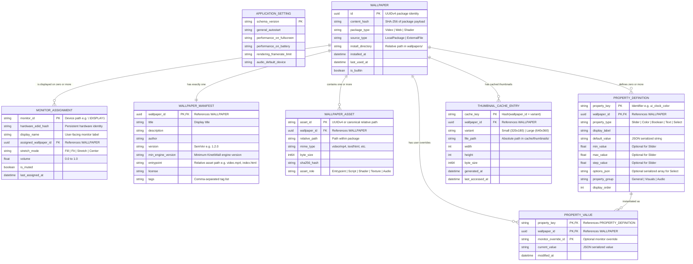

# CONCEPTUAL ENTITY-RELATIONSHIP DATA MODEL
## Document ID: KW-DAT-002 | Phase 2: System Architecture & Technical Decisions

---

### 1. Conceptual Model Overview

The KinetiWall data model structures the relationships between installed wallpapers, their underlying physical asset files, dynamic properties declared by package authors, user overrides, physical display hardware targets, global application settings, and transient caches.

Even though KinetiWall implements a file-backed Hybrid Storage Architecture (avoiding heavy database dependencies in V1.0), the entity relationships adhere to strict relational data integrity rules.

---

### 2. Mermaid Entity-Relationship Diagram

---

### 3. Detailed Entity Catalog

#### 3.1 Entity: `Wallpaper`
- **Primary Key**: `id` (`uuid` — RFC 4122 Version 4 UUID).
- **Attributes**:
  - `id`: System-wide immutable identifier for the wallpaper.
  - `content_hash`: Cryptographic SHA-256 hash of the package contents to detect modifications or duplicate imports.
  - `package_type`: Enumeration (`Video`, `Web`).
  - `source_type`: Enumeration (`ManagedPackage`, `ExternalDirectFile`).
  - `install_directory`: Relative folder path within `%LOCALAPPDATA%\KinetiWall\wallpapers\`.
  - `installed_at`: UTC ISO-8601 timestamp of package installation.
  - `last_used_at`: UTC ISO-8601 timestamp of last assignment to an active display.
  - `is_builtin`: Boolean flag distinguishing default engine bundled wallpapers from user-imported packages.

#### 3.2 Entity: `WallpaperManifest`
- **Primary Key / Foreign Key**: `wallpaper_id` (1:1 relationship with `Wallpaper`).
- **Attributes**:
  - `title`: User-facing title string (1–128 characters).
  - `description`: Detailed markdown or plaintext description (max 4096 characters).
  - `author`: Creator name or handle (max 64 characters).
  - `version`: Package semantic version string (`X.Y.Z`).
  - `min_engine_version`: Minimum KinetiWall runtime required to execute this package.
  - `entrypoint`: Primary entry file path relative to package root (`assets/loop.mp4` or `index.html`).
  - `license`: Software or media license identifier (e.g. `CC-BY-4.0`, `MIT`, `Proprietary`).
  - `tags`: Indexed list of categorization strings (e.g., `["Cyberpunk", "Anime", "60fps", "Interactive"]`).

#### 3.3 Entity: `WallpaperAsset`
- **Primary Key**: Composite (`wallpaper_id`, `relative_path`).
- **Attributes**:
  - `wallpaper_id`: Reference to parent `Wallpaper`.
  - `relative_path`: Normalized relative path within the package folder (forward slashes only, e.g., `assets/shaders/bloom.frag`).
  - `mime_type`: Standard IANA media type string.
  - `byte_size`: Integer 64-bit file size in bytes.
  - `sha256_hash`: Cryptographic hash for integrity verification.
  - `asset_role`: Classification (`Entrypoint`, `Script`, `Shader`, `Texture`, `Audio`, `Style`, `Document`).

#### 3.4 Entity: `PropertyDefinition`
- **Primary Key**: Composite (`wallpaper_id`, `property_key`).
- **Attributes**:
  - `wallpaper_id`: Reference to parent `Wallpaper`.
  - `property_key`: Unique programmatic token (alphanumeric snake_case, max 64 chars, e.g., `clock_color`).
  - `property_type`: Enum (`Slider`, `Color`, `Boolean`, `Text`, `Select`).
  - `display_label`: Localized or default human-readable UI label.
  - `default_value`: Serialized default JSON primitive (number, hex string, bool, string).
  - `min_value` / `max_value` / `step_value`: Numerical bounds for `Slider` types.
  - `options_json`: Array of `{label: string, value: string}` pairs for `Select` dropdown types.
  - `property_group`: Organizational section label for UI grouping.
  - `display_order`: Integer sorting index for rendering in the customization UI.

#### 3.5 Entity: `PropertyValue`
- **Primary Key**: Composite (`wallpaper_id`, `property_key`, `monitor_override_id`).
- **Attributes**:
  - `wallpaper_id`: Reference to parent `Wallpaper`.
  - `property_key`: Key matching a `PropertyDefinition`.
  - `monitor_override_id`: Null/Empty string for global wallpaper override; specific monitor ID for per-display customization.
  - `current_value`: Serialized user-specified value overriding the manifest default.
  - `modified_at`: Timestamp of last edit.

#### 3.6 Entity: `MonitorAssignment`
- **Primary Key**: `monitor_id` (Windows Win32 Device Name, e.g., `\\.\DISPLAY1`).
- **Attributes**:
  - `monitor_id`: Primary runtime identifier from Windows display enumerations (`EnumDisplayMonitors`).
  - `hardware_edid_hash`: Hardware identifier (SHA-256 of EDID block or device instance path) used to persist assignments across display port re-plugs and GPU driver restarts.
  - `display_name`: Human-friendly monitor name (e.g., `LG 27GP850`, `Dell U2720Q`).
  - `assigned_wallpaper_id`: Nullable foreign key referencing `Wallpaper.id`. If NULL, the display has no wallpaper assigned or falls back to the native desktop.
  - `stretch_mode`: Enum (`Fill`, `Fit`, `Stretch`, `Center`).
  - `volume`: Floating-point scalar (`0.0` to `1.0`).
  - `is_muted`: Boolean flag controlling audio mute state for this display.
  - `last_assigned_at`: Timestamp when the wallpaper assignment was executed.

#### 3.7 Entity: `ThumbnailCacheEntry`
- **Primary Key**: `cache_key` (`{wallpaper_id}_{variant}`).
- **Attributes**:
  - `wallpaper_id`: Foreign key referencing `Wallpaper.id`.
  - `variant`: Enum (`Small_320x180`, `Large_640x360`, `Animated_WebP`).
  - `file_path`: Absolute disk path in `%LOCALAPPDATA%\KinetiWall\cache\thumbnails\`.
  - `width` / `height`: Pixel dimensions.
  - `byte_size`: File size in bytes.
  - `generated_at`: UTC timestamp of creation.
  - `last_accessed_at`: UTC timestamp of last read (used for LRU cache eviction).

---

### 4. Primary Identification Strategy: UUIDv4 vs Content Hash vs Folder Name

A foundational architectural decision is how entities—specifically `Wallpaper` packages—are uniquely identified throughout the system lifecycle.

| Identification Mechanism | Description | Advantages | Disadvantages | Engine Adoption Decision |
| :--- | :--- | :--- | :--- | :--- |
| **UUIDv4** | 128-bit random identifier (`e.g., 550e8400-e29b-41d4-a716-446655440000`). | Immutable, collision-free ($P < 10^{-18}$), decoupled from file names, stable across renames/edits. | Opaque, not human-readable directly in explorer. | **ADOPTED AS PRIMARY KEY (`Wallpaper.id`).** |
| **Content Hash (SHA-256)** | Cryptographic hash of package contents / video file. | Identifies duplicate imports, ensures tamper detection. | Changes whenever user modifies any file/setting inside package, expensive to recompute on startup. | **ADOPTED AS SECONDARY METRIC (`content_hash`)** for deduplication and integrity checking. |
| **Directory Name** | Relative folder name in `wallpapers/`. | Simple to navigate in filesystem. | Fragile; breaking references if user renames folder outside the app. | **REJECTED AS PRIMARY KEY.** Folder name is set to `Wallpaper.id` to guarantee safety. |
| **Display Name / Title** | User-facing package title (e.g., "Cyberpunk Rain"). | Highly intuitive. | Non-unique, contains illegal filesystem characters, frequently edited by users. | **REJECTED AS PRIMARY KEY.** Kept as pure display metadata in manifest. |

**Architectural Policy**:
Every installed wallpaper is assigned an immutable `UUIDv4` upon import. Its directory is named `%LOCALAPPDATA%\KinetiWall\wallpapers\{uuid}\`. Even if the user modifies the title in the manifest, the UUID remains completely stable, guaranteeing that monitor assignments, property overrides, and cache files never suffer broken foreign-key relationships.

---

### 5. Foreign Key Relationships, Cardinalities & Cascade Behaviors

| Relationship | Cardinality | On Wallpaper Deletion (Cascade Rule) | On Target Deletion / Failure |
| :--- | :--- | :--- | :--- |
| `Wallpaper` $\to$ `WallpaperManifest` | 1 : 1 | **CASCADE DELETE**: Manifest file is deleted along with package directory. | If manifest is missing or invalid, package is marked `Corrupted` in library. |
| `Wallpaper` $\to$ `WallpaperAsset` | 1 : N | **CASCADE DELETE**: All asset files within package directory are purged. | If entrypoint asset is missing, wallpaper marked `BrokenAsset`. |
| `Wallpaper` $\to$ `PropertyDefinition` | 1 : N | **CASCADE DELETE**: Definitions removed from in-memory catalog. | N/A (Embedded in manifest). |
| `Wallpaper` $\to$ `PropertyValue` | 1 : N | **CASCADE DELETE**: User custom overrides for this wallpaper are deleted from `config.json`. | If definition is removed during update, orphaned value is pruned on next save. |
| `Wallpaper` $\to$ `MonitorAssignment` | 1 : N | **SET NULL / DETACH**: Monitor assignment for this wallpaper is cleared. Display falls back to default wallpaper or stops player process. | If monitor disconnects, assignment remains saved against `hardware_edid_hash` for reconnection. |
| `Wallpaper` $\to$ `ThumbnailCacheEntry` | 1 : N | **CASCADE DELETE**: Cached WebP/PNG thumbnails on disk are deleted immediately. | If cache file is deleted manually, it is lazily regenerated on next UI view. |

---

### 6. Relational Invariants and Constraints

1. **Wallpaper ID Uniqueness**:
   No two installed wallpapers may share the same UUIDv4. If an imported package contains an existing UUID, a new UUID is generated unless the import is explicitly an "Update Existing Package" operation.
2. **Asset Path Containment**:
   All `WallpaperAsset.relative_path` entries MUST resolve strictly inside the package directory. Path traversing tokens (`..`, absolute drive letters `C:`, backslash normalization tricks) violate the invariant and trigger an immediate import rejection (`ERR_PATH_TRAVERSAL`).
3. **Monitor Hardware Resilience**:
   A `MonitorAssignment` binds to both the temporary Windows device path (`\\.\DISPLAY1`) and the persistent `hardware_edid_hash`. If display numbers are re-ordered by Windows after a reboot, the engine reconciles assignments using the EDID hash.
4. **Property Type Safety**:
   Every `PropertyValue` MUST conform to the data type and bounds declared in its corresponding `PropertyDefinition`. A slider property with range `[0.0, 100.0]` rejecting any value outside this interval or of non-numeric type.

