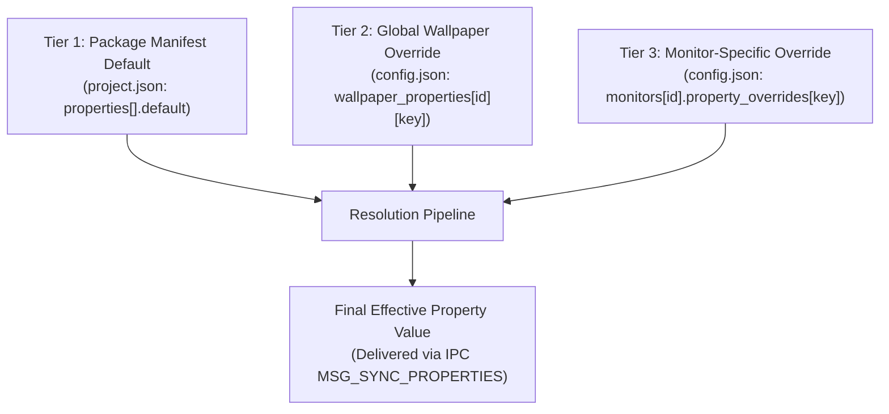

# CONFIGURATION & DYNAMIC PROPERTY SCHEMAS
## Document ID: KW-DAT-004 | Phase 2: System Architecture & Technical Decisions

---

### 1. Architectural Scope

This specification defines the exhaustive data contracts for KinetiWall's primary configuration document (`config.json`), the package manifest specification (`project.json` Manifest Schema V1), and the dynamic runtime property system allowing user customization of live wallpapers.

All schemas are specified with standard JSON Schema notation and their corresponding type-safe Rust representations utilizing `serde::{Serialize, Deserialize}`.

---

### 2. Global Application Configuration Schema (`config.json`)

#### 2.1 Complete JSON Schema Representation

```json
{
  "$schema": "https://json-schema.org/draft/2020-12/schema",
  "title": "KinetiWallConfig",
  "type": "object",
  "required": ["schema_version", "general", "performance", "rendering", "audio", "monitors", "wallpaper_properties", "diagnostics"],
  "properties": {
    "schema_version": {
      "type": "integer",
      "minimum": 1,
      "description": "Monotonically increasing schema migration version"
    },
    "general": {
      "type": "object",
      "required": ["autostart", "start_minimized", "minimize_to_tray", "theme", "language"],
      "properties": {
        "autostart": { "type": "boolean", "default": false },
        "start_minimized": { "type": "boolean", "default": true },
        "minimize_to_tray": { "type": "boolean", "default": true },
        "theme": { "type": "string", "enum": ["system", "dark", "light"], "default": "system" },
        "language": { "type": "string", "default": "en-US" }
      }
    },
    "performance": {
      "type": "object",
      "required": ["on_fullscreen_app", "on_maximized_window", "on_battery_power", "on_remote_desktop", "target_framerate_ac", "target_framerate_battery"],
      "properties": {
        "on_fullscreen_app": { "type": "string", "enum": ["pause", "mute", "keep_playing"], "default": "pause" },
        "on_maximized_window": { "type": "string", "enum": ["pause", "mute", "keep_playing"], "default": "keep_playing" },
        "on_battery_power": { "type": "string", "enum": ["pause", "throttle_30fps", "keep_playing"], "default": "throttle_30fps" },
        "on_remote_desktop": { "type": "string", "enum": ["pause", "keep_playing"], "default": "pause" },
        "target_framerate_ac": { "type": "integer", "minimum": 15, "maximum": 240, "default": 60 },
        "target_framerate_battery": { "type": "integer", "minimum": 15, "maximum": 60, "default": 30 }
      }
    },
    "rendering": {
      "type": "object",
      "required": ["hardware_acceleration", "vsync", "stretch_mode_default"],
      "properties": {
        "hardware_acceleration": { "type": "boolean", "default": true },
        "vsync": { "type": "boolean", "default": true },
        "stretch_mode_default": { "type": "string", "enum": ["fill", "fit", "stretch", "center"], "default": "fill" }
      }
    },
    "audio": {
      "type": "object",
      "required": ["master_volume", "master_mute", "mute_when_other_app_plays_audio", "output_device_id"],
      "properties": {
        "master_volume": { "type": "number", "minimum": 0.0, "maximum": 1.0, "default": 0.5 },
        "master_mute": { "type": "boolean", "default": false },
        "mute_when_other_app_plays_audio": { "type": "boolean", "default": true },
        "output_device_id": { "type": ["string", "null"], "default": null }
      }
    },
    "monitors": {
      "type": "object",
      "description": "Map of monitor identifier string (e.g. \\\\.\\DISPLAY1 or EDID hash) to assignment configuration",
      "additionalProperties": {
        "type": "object",
        "required": ["hardware_edid_hash", "assigned_wallpaper_id", "stretch_mode", "volume", "is_muted"],
        "properties": {
          "hardware_edid_hash": { "type": "string" },
          "display_name": { "type": "string" },
          "assigned_wallpaper_id": { "type": ["string", "null"], "format": "uuid" },
          "stretch_mode": { "type": "string", "enum": ["fill", "fit", "stretch", "center"], "default": "fill" },
          "volume": { "type": "number", "minimum": 0.0, "maximum": 1.0, "default": 1.0 },
          "is_muted": { "type": "boolean", "default": false },
          "property_overrides": {
            "type": "object",
            "additionalProperties": true,
            "description": "Per-monitor dynamic property overrides"
          }
        }
      }
    },
    "wallpaper_properties": {
      "type": "object",
      "description": "Map of wallpaper UUID to global user property overrides",
      "additionalProperties": {
        "type": "object",
        "additionalProperties": true
      }
    },
    "diagnostics": {
      "type": "object",
      "required": ["log_level", "max_log_retention_days", "enable_file_logging"],
      "properties": {
        "log_level": { "type": "string", "enum": ["error", "warn", "info", "debug", "trace"], "default": "info" },
        "max_log_retention_days": { "type": "integer", "minimum": 1, "maximum": 30, "default": 7 },
        "enable_file_logging": { "type": "boolean", "default": true }
      }
    }
  }
}
```

#### 2.2 Type-Safe Rust Representation (`config.rs`)

```rust
use serde::{Deserialize, Serialize};
use std::collections::HashMap;
use uuid::Uuid;

#[derive(Debug, Clone, Serialize, Deserialize, PartialEq)]
pub struct KinetiWallConfig {
    pub schema_version: u32,
    pub general: GeneralConfig,
    pub performance: PerformanceConfig,
    pub rendering: RenderingConfig,
    pub audio: AudioConfig,
    pub monitors: HashMap<String, MonitorAssignmentConfig>,
    pub wallpaper_properties: HashMap<Uuid, HashMap<String, serde_json::Value>>,
    pub diagnostics: DiagnosticsConfig,
    #[serde(flatten)]
    pub unknown_fields: HashMap<String, serde_json::Value>,
}

#[derive(Debug, Clone, Serialize, Deserialize, PartialEq)]
pub struct GeneralConfig {
    pub autostart: bool,
    pub start_minimized: bool,
    pub minimize_to_tray: bool,
    pub theme: ThemePreference,
    pub language: String,
}

#[derive(Debug, Clone, Copy, Serialize, Deserialize, PartialEq)]
#[serde(rename_all = "snake_case")]
pub enum ThemePreference {
    System,
    Dark,
    Light,
}

#[derive(Debug, Clone, Serialize, Deserialize, PartialEq)]
pub struct PerformanceConfig {
    pub on_fullscreen_app: FullscreenAction,
    pub on_maximized_window: WindowStateAction,
    pub on_battery_power: BatteryAction,
    pub on_remote_desktop: RemoteDesktopAction,
    pub target_framerate_ac: u32,
    pub target_framerate_battery: u32,
}

#[derive(Debug, Clone, Copy, Serialize, Deserialize, PartialEq)]
#[serde(rename_all = "snake_case")]
pub enum FullscreenAction {
    Pause,
    Mute,
    KeepPlaying,
}

#[derive(Debug, Clone, Copy, Serialize, Deserialize, PartialEq)]
#[serde(rename_all = "snake_case")]
pub enum WindowStateAction {
    Pause,
    Mute,
    KeepPlaying,
}

#[derive(Debug, Clone, Copy, Serialize, Deserialize, PartialEq)]
#[serde(rename_all = "snake_case")]
pub enum BatteryAction {
    Pause,
    Throttle30fps,
    KeepPlaying,
}

#[derive(Debug, Clone, Copy, Serialize, Deserialize, PartialEq)]
#[serde(rename_all = "snake_case")]
pub enum RemoteDesktopAction {
    Pause,
    KeepPlaying,
}

#[derive(Debug, Clone, Serialize, Deserialize, PartialEq)]
pub struct RenderingConfig {
    pub hardware_acceleration: bool,
    pub vsync: bool,
    pub stretch_mode_default: StretchMode,
}

#[derive(Debug, Clone, Copy, Serialize, Deserialize, PartialEq)]
#[serde(rename_all = "snake_case")]
pub enum StretchMode {
    Fill,
    Fit,
    Stretch,
    Center,
}

#[derive(Debug, Clone, Serialize, Deserialize, PartialEq)]
pub struct AudioConfig {
    pub master_volume: f32,
    pub master_mute: bool,
    pub mute_when_other_app_plays_audio: bool,
    pub output_device_id: Option<String>,
}

#[derive(Debug, Clone, Serialize, Deserialize, PartialEq)]
pub struct MonitorAssignmentConfig {
    pub hardware_edid_hash: String,
    pub display_name: String,
    pub assigned_wallpaper_id: Option<Uuid>,
    pub stretch_mode: StretchMode,
    pub volume: f32,
    pub is_muted: bool,
    #[serde(default)]
    pub property_overrides: HashMap<String, serde_json::Value>,
}

#[derive(Debug, Clone, Serialize, Deserialize, PartialEq)]
pub struct DiagnosticsConfig {
    pub log_level: String,
    pub max_log_retention_days: u32,
    pub enable_file_logging: bool,
}
```

---

### 3. Wallpaper Package Manifest Schema V1 (`project.json`)

Each installed wallpaper directory contains a standalone `project.json` file adhering to the Manifest V1 specification.

#### 3.1 Complete JSON Schema Representation

```json
{
  "$schema": "https://json-schema.org/draft/2020-12/schema",
  "title": "KinetiWallManifestV1",
  "type": "object",
  "required": ["manifest_version", "id", "title", "type", "entrypoint", "min_engine_version"],
  "properties": {
    "manifest_version": { "type": "integer", "const": 1 },
    "id": { "type": "string", "format": "uuid" },
    "title": { "type": "string", "minLength": 1, "maxLength": 128 },
    "description": { "type": "string", "maxLength": 4096, "default": "" },
    "author": { "type": "string", "maxLength": 64, "default": "Unknown" },
    "version": { "type": "string", "pattern": "^[0-9]+\\.[0-9]+\\.[0-9]+$", "default": "1.0.0" },
    "license": { "type": "string", "default": "Custom" },
    "min_engine_version": { "type": "string", "pattern": "^[0-9]+\\.[0-9]+\\.[0-9]+$", "default": "1.0.0" },
    "type": { "type": "string", "enum": ["video", "web"] },
    "entrypoint": { "type": "string", "minLength": 1 },
    "thumbnail": { "type": "string", "default": "thumbnail.png" },
    "preview": { "type": "string", "default": "" },
    "tags": {
      "type": "array",
      "items": { "type": "string", "maxLength": 32 },
      "default": []
    },
    "permissions": {
      "type": "object",
      "properties": {
        "webgl": { "type": "boolean", "default": true },
        "audio_output": { "type": "boolean", "default": false },
        "network_domains": {
          "type": "array",
          "items": { "type": "string" },
          "default": []
        }
      },
      "default": {}
    },
    "properties": {
      "type": "array",
      "items": {
        "$ref": "#/$defs/PropertyDefinition"
      },
      "default": []
    }
  },
  "$defs": {
    "PropertyDefinition": {
      "type": "object",
      "required": ["key", "type", "label", "default"],
      "properties": {
        "key": { "type": "string", "pattern": "^[a-zA-Z0-9_]{1,64}$" },
        "type": { "type": "string", "enum": ["slider", "color", "boolean", "text", "select", "file"] },
        "label": { "type": "string", "minLength": 1, "maxLength": 64 },
        "group": { "type": "string", "default": "General" },
        "order": { "type": "integer", "default": 0 },
        "default": {},
        "min": { "type": "number" },
        "max": { "type": "number" },
        "step": { "type": "number" },
        "unit": { "type": "string" },
        "options": {
          "type": "array",
          "items": {
            "type": "object",
            "required": ["label", "value"],
            "properties": {
              "label": { "type": "string" },
              "value": { "type": "string" }
            }
          }
        },
        "file_extensions": {
          "type": "array",
          "items": { "type": "string" }
        }
      }
    }
  }
}
```

#### 3.2 Type-Safe Rust Representation (`manifest.rs`)

```rust
use serde::{Deserialize, Serialize};
use uuid::Uuid;

#[derive(Debug, Clone, Serialize, Deserialize, PartialEq)]
pub struct WallpaperManifestV1 {
    pub manifest_version: u32,
    pub id: Uuid,
    pub title: String,
    #[serde(default)]
    pub description: String,
    #[serde(default = "default_author")]
    pub author: String,
    #[serde(default = "default_version")]
    pub version: String,
    #[serde(default = "default_license")]
    pub license: String,
    pub min_engine_version: String,
    #[serde(rename = "type")]
    pub package_type: PackageType,
    pub entrypoint: String,
    #[serde(default = "default_thumbnail")]
    pub thumbnail: String,
    #[serde(default)]
    pub preview: Option<String>,
    #[serde(default)]
    pub tags: Vec<String>,
    #[serde(default)]
    pub permissions: PackagePermissions,
    #[serde(default)]
    pub properties: Vec<PropertyDefinition>,
}

fn default_author() -> String { "Unknown".to_string() }
fn default_version() -> String { "1.0.0".to_string() }
fn default_license() -> String { "Custom".to_string() }
fn default_thumbnail() -> String { "thumbnail.png".to_string() }

#[derive(Debug, Clone, Copy, Serialize, Deserialize, PartialEq)]
#[serde(rename_all = "snake_case")]
pub enum PackageType {
    Video,
    Web,
}

#[derive(Debug, Clone, Default, Serialize, Deserialize, PartialEq)]
pub struct PackagePermissions {
    #[serde(default = "default_true")]
    pub webgl: bool,
    #[serde(default)]
    pub audio_output: bool,
    #[serde(default)]
    pub network_domains: Vec<String>,
}

fn default_true() -> bool { true }

#[derive(Debug, Clone, Serialize, Deserialize, PartialEq)]
pub struct PropertyDefinition {
    pub key: String,
    #[serde(rename = "type")]
    pub property_type: PropertyType,
    pub label: String,
    #[serde(default = "default_group")]
    pub group: String,
    #[serde(default)]
    pub order: i32,
    pub default: serde_json::Value,
    pub min: Option<f64>,
    pub max: Option<f64>,
    pub step: Option<f64>,
    pub unit: Option<String>,
    pub options: Option<Vec<SelectOption>>,
    pub file_extensions: Option<Vec<String>>,
}

fn default_group() -> String { "General".to_string() }

#[derive(Debug, Clone, Copy, Serialize, Deserialize, PartialEq)]
#[serde(rename_all = "snake_case")]
pub enum PropertyType {
    Slider,
    Color,
    Boolean,
    Text,
    Select,
    File,
}

#[derive(Debug, Clone, Serialize, Deserialize, PartialEq)]
pub struct SelectOption {
    pub label: String,
    pub value: String,
}
```

---

### 4. Supported Dynamic Property Types Specification

| Property Type | Purpose & Data Payload | Manifest Parameters | UI Widget Rendered | Validation Rule |
| :--- | :--- | :--- | :--- | :--- |
| **`slider`** | Numerical scalar (speed, volume, intensity, particle count). | `min`, `max`, `step`, `unit`, `default` (number). | Draggable slider with numerical input field. | Must be float; clamped: $min \le v \le max$. |
| **`color`** | Color tint, background hue, text color. | `default` (hex `#RRGGBB` or `#RRGGBBAA`). | Visual color picker with alpha slider. | Must match regex `^#(?:[0-9a-fA-F]{6}\|[0-9a-fA-F]{8})$`. |
| **`boolean`** | Feature toggles (show clock, enable bloom, rain sound). | `default` (boolean `true`/`false`). | Toggle switch / checkbox. | Must be strict boolean. |
| **`text`** | User-defined string (custom greeting, clock format). | `default` (string), `max_length`. | Single-line text input field. | UTF-8 string; length $\le 256$ characters. |
| **`select`** | Discrete enumerated choices (theme mode, clock style). | `options` array of `{label, value}`, `default`. | Dropdown combobox. | Value must strictly match one of the defined option values. |
| **`file`** | Custom user image/audio texture override. | `file_extensions` (`["png", "jpg", "mp3"]`). | File browse button with thumbnail preview. | Target file must exist locally and match extension whitelist. |

---

### 5. Dynamic Property Precedence Hierarchy

Dynamic property values undergo a deterministic 3-tier cascade evaluation before being dispatched to the rendering engine or player subprocess:



**Precedence Rules**:
1. **Tier 3 (Monitor Override)** takes highest precedence. If a user sets a clock color to "Red" specifically for Monitor 2, that overrides global choices for Monitor 2 only.
2. **Tier 2 (Global Wallpaper Override)** takes precedence over manifest defaults if no monitor-specific override exists.
3. **Tier 1 (Manifest Default)** is used whenever no higher-tier user override is recorded.
4. **Fallback Safety**: If a stored user override fails validation (e.g., non-numeric value passed to a slider, or corrupt JSON), the engine automatically discards the corrupted override and falls back to **Tier 1 (Default)** without crashing.

---

### 6. Schema Forward Compatibility & Unknown Property Handling

To ensure seamless forward and backward compatibility across future KinetiWall minor updates:
1. **Permissive Ingestion**: All Rust deserializers employ `#[serde(flatten)] pub unknown_fields: HashMap<String, Value>`. When KinetiWall V1.0 reads a configuration file generated by V1.2, it stores unknown fields without error and serializes them back out unmodified upon saving.
2. **Missing Field Defaulting**: New optional fields added in future releases MUST be annotated with `#[serde(default)]` to allow older configuration files to load without migration errors.
3. **Type Clamping**: Numerical values that fall outside updated bounds are clamped rather than rejected.

