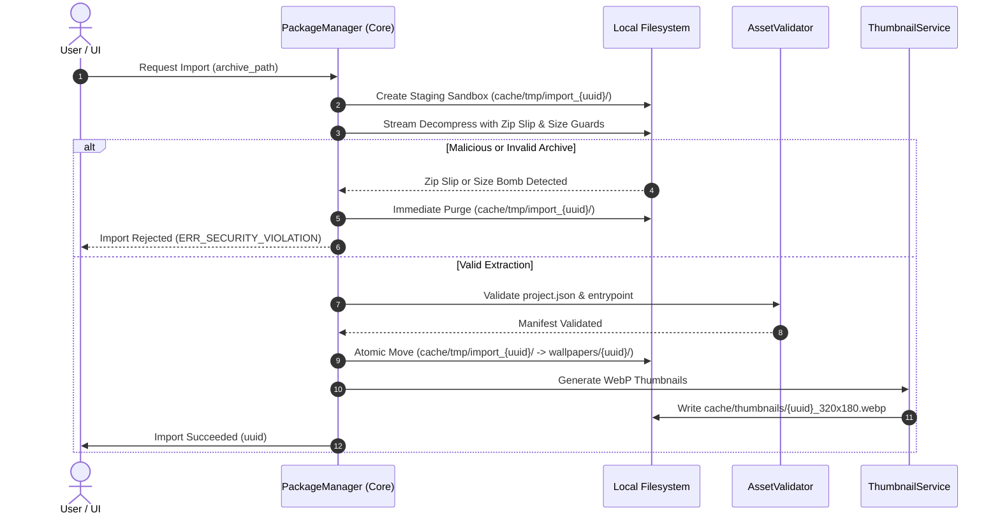

# FILE STORAGE HIERARCHY & ASSET LIFECYCLE RULES
## Document ID: KW-DAT-005 | Phase 2: System Architecture & Technical Decisions

---

### 1. Canonical Windows Directory Hierarchy

KinetiWall organizes all persistent application data, package content, temporary caches, and diagnostic outputs under standard Windows directory trees. In accordance with modern Windows application best practices, executable binaries are decoupled from user configuration and content.

#### 1.1 Standard Multi-User / Per-User Layout (`%LOCALAPPDATA%`)

```
%LOCALAPPDATA%\KinetiWall\
├── config.json                     # Primary application settings, monitors, and overrides
├── config.json.bak                 # Verified crash-recovery backup of config.json
├── config.json.tmp                 # Transient scratchpad for atomic writes (zero persistent lifetime)
├── wallpapers\                     # Authoritative library of installed wallpaper packages
│   ├── {wallpaper_uuid_1}\         # Self-contained wallpaper directory
│   │   ├── project.json            # Manifest V1 metadata and property declarations
│   │   ├── thumbnail.png           # Package-supplied primary thumbnail
│   │   └── assets\                 # Package payload assets
│   │       ├── video.mp4           # Video stream or Web entrypoint
│   │       ├── shaders\            # Optional GLSL/HLSL custom shaders
│   │       └── scripts\            # Optional JS logic
│   └── {wallpaper_uuid_2}\
│       ├── project.json
│       └── assets\
│           ├── index.html
│           ├── main.js
│           └── style.css
├── cache\                          # Disposable transient data (safe to wipe anytime)
│   ├── thumbnails\                 # Pre-generated UI thumbnails
│   │   ├── {uuid}_320x180.webp     # Low-resolution gallery grid preview
│   │   └── {uuid}_640x360.webp     # High-resolution detail preview
│   ├── shaders\                    # Compiled DirectX/Vulkan pipeline shader binaries
│   └── tmp\                        # In-flight package import staging sandbox
│       └── import_{staging_id}\
├── logs\                           # Structured runtime logs
│   ├── kinetiwall_2026-11-10.log
│   └── kinetiwall_2026-11-09.log
└── crashes\                        # Windows minidump crash records
    └── crash_20261110_120400.dmp
```

#### 1.2 Portable Mode Architecture (`--portable`)

When KinetiWall is launched from a removable drive or isolated folder, it detects the presence of a sentinel file named `kinetiwall.portable` in the same directory as `kinetiwall-core.exe`, or evaluates the CLI argument `--portable`.

When portable mode is active:
- All data paths shift from `%LOCALAPPDATA%\KinetiWall\` to a local subfolder: `.\data\` adjacent to `kinetiwall-core.exe`.
- Zero files are written to `%LOCALAPPDATA%` or the Windows Registry.
- Auto-start registration operates via relative shortcuts or is disabled.

---

### 2. User-Owned vs. Engine-Managed Asset Lifecycles

To prevent accidental data loss of user personal media, KinetiWall rigorously partitions assets into two distinct lifecycle models:

```
+--------------------------------------------------------------------------------------------------------+
|                                  KINETIWALL ASSET LIFECYCLE DOMAINS                                   |
+---------------------------------------------------+----------------------------------------------------+
|            ENGINE-MANAGED PACKAGES                |             EXTERNAL USER-LINKED MEDIA             |
|  - Full copy extracted into wallpapers/{id}/      |  - Direct reference to C:\Users\...\Videos\clip.mp4|
|  - Fully owned by KinetiWall                      |  - Read-only handle opened by Player process       |
|  - Deleted from disk upon "Uninstall Wallpaper"   |  - NEVER deleted or modified by KinetiWall         |
|  - Safe for automated engine export / repackaging |  - "Uninstall" simply removes library reference    |
+---------------------------------------------------+----------------------------------------------------+
```

#### 2.1 Managed Wallpaper Packages
- **Source**: Imported `.kwp` or `.zip` archives.
- **Storage**: Unpacked entirely into `%LOCALAPPDATA%\KinetiWall\wallpapers\{wallpaper_id}\`.
- **Ownership**: 100% managed by the KinetiWall `PackageManager`.
- **Deletion Behavior**: When the user clicks "Delete" in the UI, the engine terminates any active player rendering this wallpaper, resets monitor assignments to default, and purges the directory tree.

#### 2.2 External User-Linked Media
- **Source**: User selects "Open Video as Wallpaper" and selects an existing video file from their disk (e.g., `D:\Media\Wallpapers\nature_4k.mp4`).
- **Storage**: The original file remains in place. The engine generates a virtual package manifest inside `%LOCALAPPDATA%\KinetiWall\wallpapers\{uuid}\project.json` where `entrypoint` contains an absolute path reference, marked `source_type: "ExternalDirectFile"`.
- **Ownership**: The user owns the source file.
- **Safety Invariant**: When the user deletes an external wallpaper from KinetiWall, the engine **ONLY deletes its internal metadata folder** (`wallpapers/{uuid}/`). The user's original video file is **NEVER modified, renamed, moved, or deleted**.

---

### 3. Thumbnail & Preview Cache Lifecycle

Gallery browsing performance requires high-speed loading of hundreds of wallpaper previews without decoding multi-gigabyte 4K video files or spawning Web views on the fly.

#### 3.1 Cache Specifications
- **Format**: WebP (lossy quality 85, pure Rust encoder) for optimal compression ratio; fallback to PNG if WebP encoding fails.
- **Sizes**:
  - `Small (320x180)`: Used for compact multi-column gallery grids.
  - `Large (640x360)`: Used for detail inspect panels and monitor preview canvases.
- **Cache Key**: Deterministic MD5/SHA-256 hash of `wallpaper_id + variant + file_mtime`.

#### 3.2 LRU Cache Eviction Algorithm
To prevent uncontrolled disk consumption, the `ThumbnailService` enforces an automatic LRU (Least Recently Used) disk quota:

1. **Storage Quota**: Default 256 MB (configurable in `config.json`).
2. **High Watermark**: 256 MB. When the total directory size exceeds this threshold (checked during startup and every 6 hours of continuous operation), eviction triggers.
3. **Low Watermark**: 204 MB (80% of quota).
4. **Eviction Procedure**:
   - Query filesystem metadata (`std::fs::metadata`) for all files in `cache\thumbnails\`.
   - Sort entries by `last_accessed_at` timestamp ascending (oldest first).
   - Delete files sequentially until total disk usage drops below 204 MB.
   - If an active wallpaper's thumbnail is evicted, it will be recreated lazily on next gallery open.

---

### 4. In-Flight Import Staging & Atomic Commit Pipeline

Importing an untrusted `.kwp` / `.zip` archive must never leave half-extracted files, corrupt the existing library, or stall active playback.



#### 4.1 Step-by-Step Staging Procedure
1. **Sandbox Allocation**: Create `%LOCALAPPDATA%\KinetiWall\cache\tmp\import_{staging_uuid}\`.
2. **Safe Extraction**: Stream archive contents file-by-file through security filters (rejecting path traversals and forbidden extensions).
3. **Structural Verification**: Ensure `project.json` exists, matches Manifest Schema V1, and points to a valid `entrypoint` asset.
4. **Atomic Directory Move**: Execute atomic directory move or copy-delete to `%LOCALAPPDATA%\KinetiWall\wallpapers\{wallpaper_uuid}\`.
5. **Thumbnail Generation**: Extract first keyframe or copy bundled `thumbnail.png` to thumbnail cache.
6. **Library Index Update**: Insert new package metadata into in-memory index; broadcast update to UI via IPC.

---

### 5. Deletion, Reference Counting & Windows File Lock Handling

Windows aggressively locks open file handles, which can cause `ERROR_ACCESS_DENIED` (Win32 Error 5) if a file is deleted while a media player is releasing it.

#### 5.1 Deletion Protocol
1. **Reference Check**: Check if the target `wallpaper_id` is assigned to any active monitor in `config.json`.
2. **Graceful Detach**: If assigned:
   - Terminate or reassign the player process on that monitor.
   - Set monitor assignment to null/default in `config.json`.
   - Wait 150ms for the player process to exit and release all Win32 file handles.
3. **Robust Purge with Exponential Backoff**:
   Attempt directory removal (`std::fs::remove_dir_all`). If Win32 Error 5 / 32 occurs:
   - Retry 1: Wait 100ms, retry.
   - Retry 2: Wait 300ms, retry.
   - Retry 3: Wait 1000ms, retry.
   - If still locked: Rename directory to `wallpapers/.pending_delete_{uuid}` and mark for cleanup on next engine boot.
4. **Pruning Associated Records**:
   - Remove any custom property overrides for `wallpaper_id` from `config.json`.
   - Delete matching cached thumbnails from `cache\thumbnails\`.

