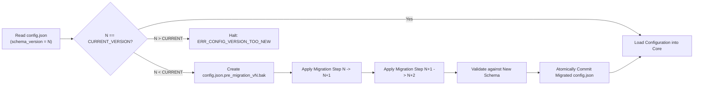

# SCHEMA VERSIONING & MIGRATION STRATEGY
## Document ID: KW-DAT-006 | Phase 2: System Architecture & Technical Decisions

---

### 1. Independent Domain Versioning Architecture

To prevent tight coupling between application settings, third-party wallpaper packages, transient caches, and inter-process communication contracts, KinetiWall enforces **Independent Domain Versioning**. Each data domain tracks its own discrete schema version:

```
+--------------------------------------------------------------------------------------------------+
|                                  INDEPENDENT DOMAIN VERSIONING                                   |
+--------------------------+----------------------------+------------------------------------------+
| DOMAIN                   | VERSION IDENTIFIER         | INDEPENDENT EVOLUTION POLICY             |
+--------------------------+----------------------------+------------------------------------------+
| Application Config       | config.schema_version      | Increments when config.json schema evolves|
| Wallpaper Manifest       | project.manifest_version   | Increments only on major package features|
| Thumbnail / Disk Cache   | cache.version (sentinel)   | Increments when thumbnail format changes |
| IPC Protocol Contracts   | IPC_PROTOCOL_VERSION       | Increments on breaking IPC messages      |
+--------------------------+----------------------------+------------------------------------------+
```

**Benefits of Decoupled Versioning**:
- Updating `config.json` to add a new audio feature (bumping `schema_version` from 1 to 2) does **not** invalidate existing wallpaper manifests (`project.json` remains V1).
- Upgrading thumbnail encoding (e.g. from PNG to AVIF/WebP) simply invalidates the cache directory without touching user configuration or wallpaper files.

---

### 2. Forward and Backward Compatibility Rules

KinetiWall adheres to standard Semantic Versioning principles combined with Postel’s Robustness Principle ("Be conservative in what you send, be liberal in what you accept"):

#### 2.1 Backward Compatibility (Reading Older Schemas)
- The engine MUST always be able to read and migrate configurations created by older versions of KinetiWall.
- Any breaking change requires an explicit, registered, automated migration function.

#### 2.2 Forward Compatibility (Reading Newer Schemas)
- If a newer minor release adds optional fields to `config.json`, older builds of KinetiWall (e.g. if the user downgrades) will preserve these unknown fields in memory using `#[serde(flatten)]` and write them back untouched.
- If `schema_version` in `config.json` is strictly greater than the highest version supported by the running executable (e.g., config is `v4`, executable only knows up to `v2`), the engine halts with `ERR_CONFIG_VERSION_TOO_NEW`, prompts the user to upgrade, and offers to start with default settings backed up as `config.json.unsupported.bak`.

---

### 3. Step-Wise Sequential Migration Pipeline

Migrations are executed by the `MigrationEngine` inside `kinetiwall-core.exe` during startup, before any other subsystems are initialized.



#### 3.1 Migration Pipeline Implementation Blueprint

```rust
pub type MigrationFn = fn(&mut serde_json::Value) -> Result<(), MigrationError>;

pub struct MigrationStep {
    pub from_version: u32,
    pub to_version: u32,
    pub migrate: MigrationFn,
}

pub struct MigrationEngine {
    steps: Vec<MigrationStep>,
}

impl MigrationEngine {
    pub fn new() -> Self {
        let mut engine = Self { steps: Vec::new() };
        // Register sequential migrations
        // engine.register(1, 2, migrate_v1_to_v2);
        // engine.register(2, 3, migrate_v2_to_v3);
        engine
    }

    pub fn migrate(&self, raw: &mut serde_json::Value, current_target: u32) -> Result<(), MigrationError> {
        let mut version = raw.get("schema_version")
            .and_then(|v| v.as_u64())
            .unwrap_or(1) as u32;

        while version < current_target {
            let step = self.steps.iter().find(|s| s.from_version == version)
                .ok_or(MigrationError::MissingMigrationPath(version, current_target))?;
            
            (step.migrate)(raw)?;
            version = step.to_version;
            raw["schema_version"] = serde_json::json!(version);
        }

        Ok(())
    }
}
```

**Key Architectural Invariants**:
1. **Never Monolithic**: Never write an ad-hoc migration function that converts directly from `v1` to `v4`. Every migration must step incrementally: `1 -> 2`, `2 -> 3`, `3 -> 4`. This guarantees that code paths are thoroughly testable and deterministic.
2. **Deterministic Transforms**: Migrations must be pure functions without side effects (no external network calls or user prompts).

---

### 4. Interrupted-Write Rollback & Recovery Rules

A power loss, crash, or out-of-disk condition during migration must never leave the user with an unbootable, corrupted installation.

#### 4.1 Safety Protocol
1. **Pre-Migration Snapshot**:
   Before modifying a single byte, `ConfigurationRepository` creates an explicit backup copy:
   `%LOCALAPPDATA%\KinetiWall\config.json.pre_migration_v{version}.bak`.
2. **In-Memory Transformation**:
   The entire JSON migration occurs in RAM using `serde_json::Value`.
3. **Atomic Commit**:
   The migrated document is written to `config.json.tmp`, flushed to disk (`FlushFileBuffers`), and atomically renamed over `config.json` via Win32 `MoveFileExW(..., MOVEFILE_REPLACE_EXISTING)`.
4. **Failure Recovery**:
   If an error occurs during parsing, transformation, or schema validation:
   - The `.tmp` file is immediately deleted.
   - The pre-migration backup is restored over `config.json`.
   - A critical error entry is written to `logs/migration_failure.log`.
   - The user is notified via a standard Windows native MessageBox: "KinetiWall configuration upgrade failed. Original configuration has been restored."

---

### 5. Manifest Migration & Deprecation Policy

Unlike `config.json` (which is under total control of the engine), wallpaper packages may come from external creators or third-party repositories.

#### 5.1 Immutable Manifest Guarantee
- The engine **NEVER alters third-party `project.json` files on disk during application updates**.
- Modifying a package manifest on disk would invalidate content hashes and break external synchronization.

#### 5.2 Virtual Manifest Adapters (In-Memory Normalization)
If a future release introduces Manifest V2:
- Manifest V1 packages will continue to be read natively.
- The `PackageManager` instantiates an in-memory **Adapter** that maps V1 manifest fields to the V2 internal engine representation.
- Legacy properties, deprecated stretch modes, and older permission formats are translated dynamically in RAM without touching the underlying `project.json`.

