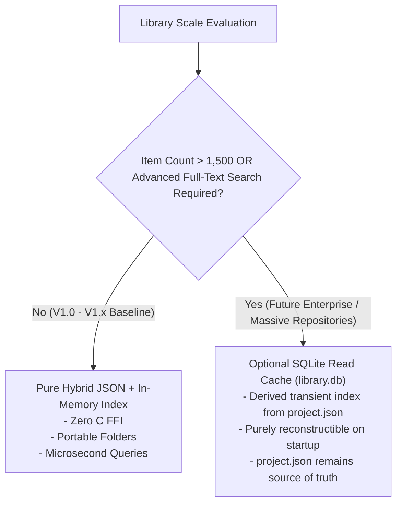

# STORAGE TECHNOLOGY EVALUATION & ARCHITECTURAL RECOMMENDATION
## Document ID: KW-DAT-003 | Phase 2: System Architecture & Technical Decisions

---

### 1. Executive Summary and Evaluation Context

To support KinetiWall's requirements for minimal resource utilization (< 100 MB RAM, < 800ms startup, zero external runtime prerequisites), the data architecture must select a physical storage strategy that maximizes reliability, avoids multi-process file locking contention, and provides high maintainability.

This evaluation conducts an exhaustive comparative analysis across four candidate storage models:
1. **Candidate A: Pure Embedded RDBMS (SQLite via `rusqlite`)**
2. **Candidate B: Pure Plaintext/JSON File-per-Entity**
3. **Candidate C: Deterministic Hybrid Architecture (Transactional JSON Config + Self-Contained Folder Manifests + Filesystem Media)**
4. **Candidate D: Plaintext TOML / YAML Configuration Architecture**

---

### 2. Candidate Architectures Described

#### Candidate A: Pure Embedded RDBMS (SQLite)
A single monolithic or multi-database SQLite file (`kinetiwall.db`) containing relational tables for settings, monitors, wallpapers, assets, and properties. Managed via `rusqlite` (bundled C amalgamation) or `sqlx`.
- *Pros*: ACID transactions, SQL querying, indexing, foreign key constraints.
- *Cons*: Binary format (not human readable), binary dependency on C SQLite compilation, Windows multi-process file locking hazards (`SQLITE_BUSY` under multi-process contention), complete corruption blast radius (database header corruption renders entire application unbootable), binary bloat.

#### Candidate B: Pure Plaintext JSON (Monolithic or Decentralized)
All configuration and library data stored strictly in JSON files.
- *Pros*: Human readable, zero C FFI dependencies (pure Rust `serde_json`), simple inspection, cross-platform portability.
- *Cons*: Inefficient for large relational searches if unindexed; monolithic JSON suffers serialization latency at massive scale.

#### Candidate C: Deterministic Hybrid Architecture (Recommended)
- **Application Config & Display Map**: Stored in a single transactional JSON document (`config.json`) manipulated via atomic temp-file replace patterns with automatic `.bak` recovery.
- **Wallpaper Packages**: Stored in decentralized, self-describing directories (`wallpapers/{wallpaper_id}/`), each containing its own `project.json` manifest and raw media assets.
- **In-Memory Query Index**: Built in-memory by `LibraryRepository` during core startup (< 15ms for 500 items).
- *Pros*: Zero C FFI bloat, zero multi-process file locks, package portability (drag-and-drop wallpaper folders), localized corruption blast radius (corrupted wallpaper manifest affects only that wallpaper, not global settings), instantaneous human debuggability.
- *Cons*: Requires custom in-memory sorting/filtering for complex queries (trivial in pure Rust with iterators for V1.0 library scales).

#### Candidate D: Plaintext TOML / YAML
Using TOML or YAML instead of JSON for configuration and manifests.
- *Pros*: Highly readable configuration syntax, supports comments natively.
- *Cons*: Parsing overhead is 3x to 5x slower than JSON (`serde_json` vs `toml-rs`); dynamic heterogeneous structures (variable dynamic property types) are clumsy in strict TOML; less ubiquitous than JSON across web player IPC boundaries.

---

### 3. Exhaustive 12-Factor Evaluation Matrix

| Factor # | Evaluation Criterion | Candidate A: SQLite (`rusqlite`) | Candidate B: Pure JSON Monolith | Candidate C: Hybrid Architecture (Selected) | Candidate D: TOML / YAML |
| :--- | :--- | :--- | :--- | :--- | :--- |
| **1** | **Read Performance** | Excellent for indexed queries (~0.1ms). | Good for small sets, degrades on monolith rewrite (>10ms). | **Instantaneous** from RAM; disk reads strictly on startup/import. | Good for small files, slower than JSON. |
| **2** | **Write Performance** | Excellent (page-level WAL commits). | High write amplification (rewrites whole JSON). | **Optimal**: `config.json` rewritten atomically; manifests immutable after install. | High write amplification on full rewrite. |
| **3** | **Memory Footprint** | Moderate: SQLite engine + page cache (2–5 MB RAM). | Very low: transient during parse (<1 MB RAM). | **Minimal**: Pure Rust zero-copy in-memory representation (<1.5 MB RAM). | Low (<2 MB RAM). |
| **4** | **Cold Startup Impact (KW-NF-006)** | Moderate: SQLite open, WAL replay, schema check (30–60ms). | Very fast: parse single file (~10ms). | **Ultra-Fast**: Parse `config.json` (2ms) + parallel scan of `project.json` (12ms) $\to$ **14ms total**. | Slower: TOML parser overhead (~25–40ms). |
| **5** | **Dependency Footprint** | **Heavy**: C compiler required for SQLite amalgamation or dynamic linking; C FFI surface. | **Zero**: 100% safe pure Rust (`serde`, `serde_json`). | **Zero**: 100% safe pure Rust (`serde`, `serde_json`). | Pure Rust, but slower parsing libraries. |
| **6** | **Concurrent Access Safety** | Fragile on Windows if child processes touch DB; lock contention (`SQLITE_BUSY`). | Unsafe if multiple writers; requires process serialization. | **Safe by Design**: Single-writer invariant in Core; children use IPC. | Unsafe without central serialization. |
| **7** | **Corruption Blast Radius** | **High**: Corrupted DB header or WAL loss breaks entire app launch and all wallpapers. | High if monolithic; isolated if decentralized. | **Isolated**: Broken manifest corrupts only 1 item; `config.json` has atomic `.bak` fallback. | Isolated if decentralized. |
| **8** | **Atomic Commit Support** | Native ACID transactions. | Requires custom atomic replace (`MoveFileExW`). | **Native OS-Level**: Atomic temp-file write + replace with `.bak` safety. | Requires custom atomic replace. |
| **9** | **Backup & Portability** | Requires `sqlite3_backup` or export scripts to share 1 wallpaper. | Copy JSON files. | **Trivial**: Copying `wallpapers/{id}/` folder copies entire standalone wallpaper. | Trivial for folder copies. |
| **10** | **Human Debuggability** | Low: Requires SQLite browser or CLI tool to inspect. | High: Inspectable in Notepad / VS Code. | **Maximum**: Plain JSON files with standard schemas; instantly editable. | Maximum (TOML supports comments). |
| **11** | **Git / Diff Friendliness** | Zero: Binary diffs produce unusable merge conflicts. | High: Standard text diffs. | **High**: Manifests and configs produce clear, mergeable line diffs. | Maximum: Clean diffs. |
| **12** | **Query & Tag Filtering** | Native SQL `SELECT ... WHERE tag IN (...)`. | In-memory filtering required. | **Fast in-memory**: Rust `filter().map()` over ~500 items takes $< 100\mu\text{s}$. | In-memory filtering required. |

---

### 4. Definitive Architectural Recommendation

#### Recommended Strategy: Candidate C (Deterministic Hybrid Architecture)
KinetiWall officially adopts the **Deterministic Hybrid Architecture**:
1. **Global Configuration & Topology**: Stored in `%LOCALAPPDATA%\KinetiWall\config.json`.
2. **Wallpaper Package Storage**: Stored in `%LOCALAPPDATA%\KinetiWall\wallpapers\{wallpaper_id}\` with `project.json` manifest.
3. **In-Memory Caching & Indexing**: On startup, `kinetiwall-core.exe` reads `config.json` and performs an asynchronous directory scan of `wallpapers/` to construct an in-memory `LibraryIndex`. All search, filtering, and tag sorting are performed against RAM at microsecond speeds.
4. **Zero SQLite Dependency in V1.0**: SQLite is intentionally excluded from V1.0 to eliminate C dependencies, reduce binary size by ~1.5 MB, guarantee pure Rust memory safety, and prevent Windows SQLite file-locking bugs across subprocesses.

---

### 5. Architectural Threshold for SQLite Secondary Indexing (Future Roadmap)

While the Hybrid Architecture is optimal for desktop wallpaper libraries up to 1,000 items, the architecture defines a precise **Scale Threshold** at which SQLite may be introduced:

**Boundary Conditions**:
- If a user's library exceeds 1,500 installed items, or if complex multi-faceted regex/full-text search over millions of user tags causes startup scan time to exceed 100ms, an **optional derived SQLite cache** (`cache\library_index.db`) may be introduced in a future release.
- **Crucial Invariant**: Even if SQLite is introduced in a future version, `project.json` manifests in the filesystem remain the **immutable source of truth**. The database would act strictly as a disposable, reconstructible read cache.

