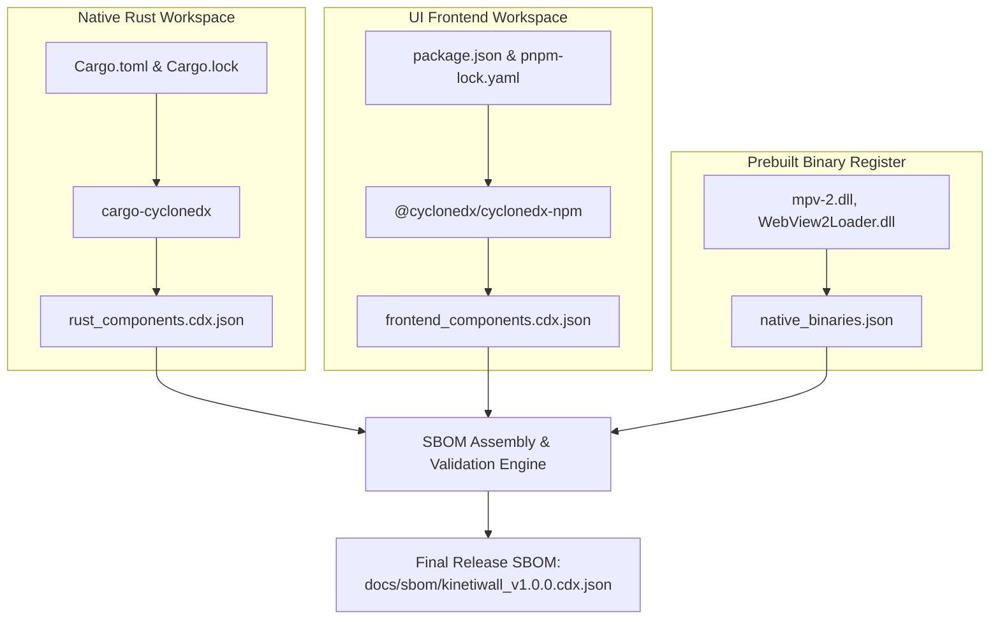

# SOFTWARE BILL OF MATERIALS (SBOM) & NOTICES POLICY
## Document ID: KW-DEP-005 | Phase 2: System Architecture & Technical Decisions

---

### 1. SBOM Standard Selection & Architectural Justification

An auditable Software Bill of Materials (SBOM) is an essential deliverable for enterprise compliance, vulnerability traceability, and software transparency. KinetiWall standardizes on the **OWASP CycloneDX v1.5 / v1.6 (JSON)** standard.

| Evaluation Metric | Candidate A: CycloneDX (JSON) | Candidate B: SPDX 2.3 / 3.0 (Tag-Value / JSON) | Candidate C: Ad-hoc Markdown List |
| :--- | :--- | :--- | :--- |
| **Industry Adoption** | Leading standard for AppSec & DevSecOps. | Established standard for open-source licensing. | Informal; not machine-readable. |
| **Tooling in Rust Ecosystem** | **Excellent**: `cargo-cyclonedx` maintained actively. | Moderate: `cargo-spdx` has slower release cadence. | Manual scripts required. |
| **Vulnerability Correlation** | Native integration with Dependency-Track & OSV. | Requires custom translation tools. | None. |
| **Native DLL Representation** | Supports binary components, hashes, and runtimes. | Supports packages and files. | Text strings only. |
| **JSON Schema Validation** | Strict official JSON Schema draft validation. | Supported, but complex object hierarchy. | None. |

#### Definitive Decision: Candidate A (OWASP CycloneDX JSON)
KinetiWall generates an official `kinetiwall_sbom.cdx.json` during every release build.

---

### 2. Comprehensive SBOM Generation Workflow

The SBOM generation pipeline consolidates both native Rust dependencies and frontend npm dependencies:



#### 2.1 Scope of the Release SBOM
1. **Component Classification**:
   - `application`: Top-level KinetiWall binaries.
   - `library`: All direct and transitive Cargo crates and npm packages.
   - `operating-system`: Windows SDK and WebView2 runtime dependencies.
2. **Recorded Component Attributes**:
   - Component Name & Version.
   - Package URL (`purl`, e.g. `pkg:cargo/tokio@1.40.0`).
   - Cryptographic SHA-256 hashes of build artifacts.
   - SPDX License Expressions and verified license texts.
   - Component Authors and Upstream Source URLs.

---

### 3. Third-Party Notices & Attribution Generation

Under permissive licenses (MIT, Apache-2.0, ISC, BSD) and weak copyleft licenses (LGPL-2.1), KinetiWall is legally required to reproduce copyright notices and license texts alongside the distributed software.

#### 3.1 Automated Generation via `cargo-about`
Attribution notices are never compiled by hand. The release pipeline executes `cargo-about` using a standardized template:

```bash
# GENERATE CONSOLIDATED THIRD-PARTY NOTICES:
cargo about generate docs/templates/about.hbs -o THIRD_PARTY_NOTICES.txt
```

#### 3.2 Contents and Structure of `THIRD_PARTY_NOTICES.txt`
1. **Preamble**: Summary of open-source projects utilized by KinetiWall.
2. **mpv / LGPL Written Source Offer**:
   ```
   ================================================================================
   WRITTEN OFFER FOR LGPL SOURCE CODE
   ================================================================================
   KinetiWall distributes a dynamically linked build of libmpv (mpv-2.dll) licensed
   under the GNU Lesser General Public License version 2.1 or later.
   
   In compliance with Section 6 of the LGPL-2.1, we hereby offer to provide the
   complete corresponding machine-readable source code for the exact build of
   libmpv and FFmpeg distributed with this application, upon request or via our
   public source repository at:
   https://github.com/KinetiWall/libmpv-build-scripts/releases/tag/v0.38.0
   ================================================================================
   ```
3. **Consolidated Alphabetical License Registry**: Full text of all licenses, grouped by license type and listing each crate/package governed by that license.

#### 3.3 User Accessibility Mandate
The generated `THIRD_PARTY_NOTICES.txt` MUST be made accessible to users in two distinct locations:
1. **Filesystem**: Co-located in the root application installation directory alongside `kinetiwall-core.exe`.
2. **UI Interface**: Accessible directly from the Gallery UI by navigating to:
   `Settings` $\to$ `About KinetiWall` $\to$ `Third-Party Licenses & Credits`.

