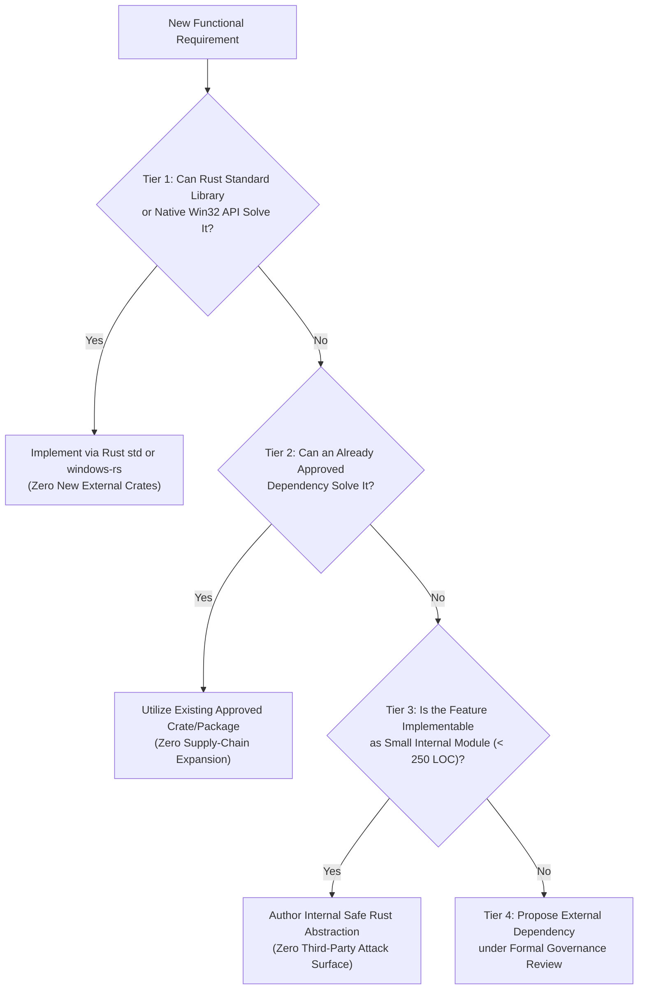

# DEPENDENCY SELECTION & EVALUATION POLICY
## Document ID: KW-DEP-002 | Phase 2: System Architecture & Technical Decisions

---

### 1. The Minimum-Dependency Principle

Third-party dependencies represent an engineering trade-off: they accelerate feature delivery but introduce supply-chain vulnerabilities, licensing obligations, maintenance overhead, binary bloat, and unexpected runtime failures.

KinetiWall enforces a strict **Minimum-Dependency Principle**. Prior to introducing any new external crate or npm package, engineering teams must evaluate the requirement through the **4-Tier Dependency Decision Framework**:



#### Policy Rules:
1. **Never Reimplement Crypto or Core OS Primitives**: The minimum-dependency principle does NOT justify hand-rolling cryptographic algorithms (e.g. SHA-256), memory allocators, or low-level Win32 security token parsers. Such functionality MUST use established, audited implementations (`sha2`, `windows-rs`).
2. **Feature Flag Minimization**: When a crate is introduced, `default-features = false` MUST be enforced unless all default features are strictly necessary. Only the specific features required by KinetiWall are enabled.

---

### 2. Multi-Factor Technical Evaluation Criteria

Every candidate dependency proposed under Tier 4 must be evaluated across six critical dimensions:

| Dimension | Evaluation Factor | Mandatory Benchmark / Acceptance Standard |
| :--- | :--- | :--- |
| **1. Maintenance Health** | Active Upstream Support | - Release within the past 12 months.<br/>- Verified active maintainer team (multiple individuals or reputable foundation).<br/>- No unaddressed critical issues open for $> 90$ days. |
| **2. Platform Support** | Windows Native Compatibility | - First-class Tier 1 support for `x86_64-pc-windows-msvc`.<br/>- Clean compilation for `aarch64-pc-windows-msvc` (Windows on ARM).<br/>- Zero dependencies on POSIX shells (`bash`), MinGW, or Unix-specific system libraries. |
| **3. Resource Footprint** | Memory & Cold Startup Budget | - Added binary size $\le 1.0\text{ MB}$ (uncompressed) unless major media component.<br/>- Idle memory allocation $\le 2\text{ MB}$ RAM.<br/>- Startup time contribution $\le 10\text{ ms}$. |
| **4. Transitive Blast Radius** | Dependency Tree Depth | - Transitive dependency count $\le 5$ crates for utility packages.<br/>- Zero transitive C FFI libraries unless explicitly authorized by architecture lead.<br/>- Zero duplicate versions of existing crates in tree. |
| **5. Supply-Chain Security** | Vulnerability Track Record | - Zero active RUSTSEC or GitHub Advisory Database entries.<br/>- Signed release tags / verified crates.io publisher.<br/>- No known history of malicious publisher takeovers or typosquatting. |
| **6. Licensing Alignment** | Distribution Compatibility | - Strict permissive license (`MIT`, `Apache-2.0`, `BSD-3-Clause`) or explicitly isolated LGPL-2.1 dynamic library.<br/>- Zero reciprocal copyleft licenses statically linked into core controller. |

---

### 3. Formal Dependency Approval Workflow

To introduce a new dependency into KinetiWall, the requesting engineer must complete the **12-Point Dependency Submission Form**:

```
================================================================================
KINETIWALL DEPENDENCY INTAKE & APPROVAL REQUEST
================================================================================
1. Dependency Name & Package ID:
2. Target Subsystem & Consuming Binary:
3. Problem Solved & Requirement Link (KW-F-xxx / KW-NF-xxx):
4. Tier 1-3 Exclusion Rationale (Why std/internal code is insufficient):
5. Candidate Version & Feature Flags:
6. Transitive Dependency Count & Tree Impact (cargo tree -p <crate>):
7. Exact License (SPDX expression & verified license file URL):
8. Binary Footprint Impact (Target binary size before/after):
9. Memory & Cold Boot Impact (Measured via benchmark):
10. Offline Installation Implication (Pre-installed / Bundled / Downloaded):
11. Alternative Candidates Evaluated (Minimum 2 alternatives):
12. Maintenance & Security Health Record (RUSTSEC audit output):
================================================================================
```

#### Sign-Off Authority Matrix:
- **Architectural Lead**: Signs off on subsystem allocation, resource budgets, and alternative evaluations.
- **Security Architect**: Signs off on transitive tree analysis, RUSTSEC audit, and C FFI attack surfaces.
- **Licensing Analyst**: Signs off on SPDX license expression, redistribution notices, and copyleft boundary compliance.

---

### 4. Dependency Deprecation, Replacement & Removal Policy

Dependencies are not permanent; they must be actively pruned when better alternatives emerge or maintenance degrades.

#### 4.1 Deprecation Triggers
A dependency is immediately moved to `DEPRECATED` status if any of the following occur:
1. **Upstream Abandonment**: No repository commits or releases for $> 18$ months, or maintainer officially marks the project archived.
2. **Unresolved Critical Vulnerability**: An active RUSTSEC or CVE advisory with CVSS score $\ge 7.0$ remains unfixed by upstream for $> 30$ days.
3. **License Relicensing**: Upstream relicenses the crate to a restrictive license (e.g., SSPL, AGPL, or non-commercial).
4. **Superior Native / Internal Alternative**: Windows SDK or Rust standard library introduces a built-in replacement (e.g. migrating from custom async channels to standard primitives).

#### 4.2 Safe Replacement & Rollback Protocol
When replacing a deprecated dependency:
1. **Interface Isolation**: The existing dependency MUST be wrapped behind an internal Rust trait (e.g. `AudioCaptureProvider` or `ThumbnailGenerator`).
2. **Parallel Implementation**: The new candidate is implemented behind the same trait.
3. **Automated Regression Suite**: Unit and integration tests must demonstrate 100% functional parity and equal or lower resource consumption.
4. **Atomic Rollback Strategy**: The previous implementation remains available behind a compile-time feature flag for at least one minor release cycle before final code removal.

