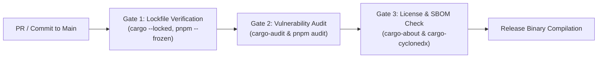

# SUPPLY-CHAIN SECURITY & LOCKFILE GOVERNANCE
## Document ID: KW-DEP-004 | Phase 2: System Architecture & Technical Decisions

---

### 1. Supply-Chain Threat Modeling

Software supply-chain attacks represent one of the fastest-growing threat vectors in modern software engineering. Malicious actors frequently compromise maintainer credentials, inject malicious build scripts into transitive dependencies, typosquat popular package names, or manipulate unpinned package updates.

KinetiWall establishes a **Zero-Implicit-Trust Supply Chain Policy** across both its Rust and frontend build pipelines:

```
+---------------------------------------------------------------------------------------------------------+
|                                    SUPPLY-CHAIN SECURITY CONTROLS                                       |
+--------------------------+---------------------------------+--------------------------------------------+
| THREAT VECTOR            | ATTACK MECHANISM                | KINETIWALL ENFORCED SAFEGUARD              |
+--------------------------+---------------------------------+--------------------------------------------+
| Dependency Confusion     | Private package spoofing        | Scoped namespace isolation (@tauri-apps/*) |
| Typosquatting            | Homoglyphs & typo package names | Exact registry check + download telemetry  |
| Compromised Maintainer   | Poisoned minor/patch update     | Cryptographic lockfile pinning (Cargo.lock)|
| Malicious Build Script   | build.rs network exfiltration   | Offline CI builds (cargo build --locked)   |
| Transitive Drift         | Dynamic semver resolution       | Frozen lockfiles in CI (--frozen-lockfile) |
| Binary Tampering         | Replaced prebuilt DLL           | Cryptographic SHA-256 hash assertions      |
+--------------------------+---------------------------------+--------------------------------------------+
```

---

### 2. Cargo Dependency Pinning & Lockfile Governance

#### 2.1 Mandatory Committed `Cargo.lock`
For all KinetiWall application binaries and workspace crates, `Cargo.lock` is a **first-class version-controlled asset**:
- It MUST be committed to Git.
- It MUST record the exact, cryptographic SHA-256 content hashes of every crate downloaded from `crates.io`.
- Removing or `.gitignore`-ing `Cargo.lock` is strictly prohibited.

#### 2.2 Enforced CI Build Mandate (`--locked`)
All Continuous Integration (CI) and release compilation runs MUST invoke Cargo with the `--locked` flag:

```bash
# MANDATORY CI BUILD INVOCATION:
cargo build --release --locked
```

**Consequence of `--locked`**:
If an engineer updates a dependency constraint in `Cargo.toml` without committing the corresponding updated `Cargo.lock`, the build immediately fails with an error, preventing silent transitive dependency version drift.

#### 2.3 Scoped Feature Flags
Every direct dependency in `Cargo.toml` must explicitly declare `default-features = false` if unused features exist:

```toml
# Approved Pattern:
tokio = { version = "1.40", default-features = false, features = ["rt-multi-thread", "net", "sync", "time"] }

# Prohibited Pattern (Pulls in unwanted network/tracing/process baggage):
tokio = { version = "1.40", features = ["full"] }
```

---

### 3. Frontend Lockfile & Package Manager Policy

#### 3.1 Standardization on `pnpm`
To prevent the duplicate-dependency sprawl and phantom dependency issues common in `npm`, KinetiWall standardizes exclusively on **`pnpm`** for frontend package management.
- `package-lock.json` and `yarn.lock` are banned from the repository.
- `pnpm-lock.yaml` is strictly version-controlled.

#### 3.2 CI Build Mandate (`--frozen-lockfile`)
All frontend build steps must execute using:

```bash
# MANDATORY CI FRONTEND INSTALL INVOCATION:
pnpm install --frozen-lockfile
```

If the lockfile does not exactly match the declared dependencies in `package.json`, installation fails instantly.

---

### 4. Build-Script (`build.rs`) & Procedural Macro Sandboxing

Rust's build scripts (`build.rs`) and procedural macros execute arbitrary native code on the developer's machine during compilation.

#### 4.1 Enforced Guardrails
1. **Network Isolation During CI Builds**:
   Release builds in CI pipelines execute with network access disabled after the initial fetch step (`cargo fetch` followed by `cargo build --offline`). A rogue `build.rs` cannot exfiltrate environment variables, source code, or signing keys over the network.
2. **Static Metadata Audits**:
   Build scripts must not download unverified binaries during compilation. All prebuilt native DLLs (`mpv-2.dll`, `WebView2Loader.dll`) must be committed or staged via verified CI pipeline artifacts with pre-recorded SHA-256 checksums.

---

### 5. Automated CI Security & Supply-Chain Gates

Every Pull Request and automated release pipeline triggers three mandatory supply-chain security checks:



1. **`cargo-audit` (RustSec Advisory Database)**:
   Scans `Cargo.lock` against all known security advisories. If any dependency contains an unpatched vulnerability with CVSS $\ge 5.0$, the CI pipeline fails.
2. **`pnpm audit`**:
   Scans `pnpm-lock.yaml` against the npm security advisory registry.
3. **`cargo-vet` (Supply-Chain Verification)**:
   Verifies that newly introduced or upgraded crates have been audited and vouched for by trusted engineering team members or the broader Rust community.

