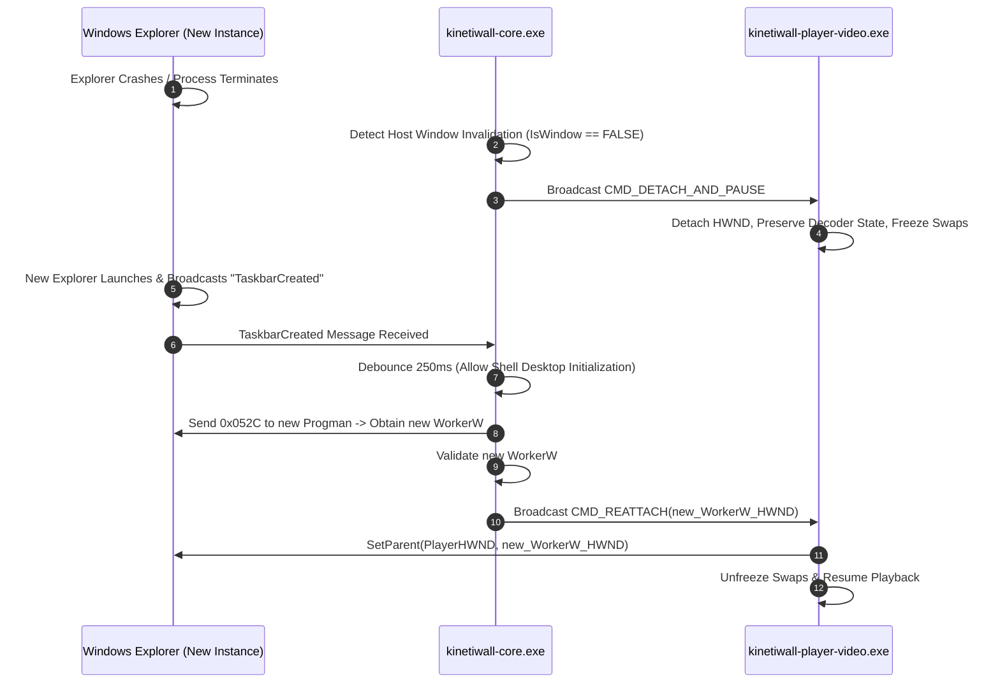

# Display & Desktop Reconciliation Strategy
**Document ID:** `KW-DSK-004`  
**Deliverable:** D (Display and Desktop Reconciliation Strategy)  
**Parent Document:** [README.md](file:///e:/Projects/All%20working%20projects/App%20projects%20working/KinetiWall%20Engine%20(working)/docs/desktop_integration/README.md)  
**Classification:** Core System Architecture / Operational Reliability Standard  

---

## 1. Multi-Monitor Coordinate Systems & Virtual Desktop Math

Windows supports complex multi-monitor layouts: horizontal arrangements, vertical stacks, mixed resolutions (e.g. 4K primary + 1080p secondary), mixed refresh rates (144Hz + 60Hz), and displays positioned with negative virtual-screen coordinates.

### 1.1 The Virtual Desktop Coordinate Space

```
         (-1920, 0)                   (0, 0)                       (3840, 0)
              +--------------------------+----------------------------+
              | Secondary Display        | Primary Display            |
              | (1080p, 100% DPI)        | (4K UHD, 150% DPI)         |
              | Rect: [-1920, 0, 0, 1080]| Rect: [0, 0, 3840, 2160]   |
              +--------------------------+----------------------------+
                                         | Virtual Desktop Bounds:    |
                                         | Left: -1920, Top: 0        |
                                         | Right: 3840, Bottom: 2160  |
                                         +----------------------------+
```

* **Virtual Screen Metrics:** Obtained via Win32 APIs:
  $$\text{SM\_XVIRTUALSCREEN} = \text{GetSystemMetrics}(\text{SM\_XVIRTUALSCREEN})$$
  $$\text{SM\_YVIRTUALSCREEN} = \text{GetSystemMetrics}(\text{SM\_YVIRTUALSCREEN})$$
  $$\text{SM\_CXVIRTUALSCREEN} = \text{GetSystemMetrics}(\text{SM\_CXVIRTUALSCREEN})$$
  $$\text{SM\_CYVIRTUALSCREEN} = \text{GetSystemMetrics}(\text{SM\_CYVIRTUALSCREEN})$$
* **Negative Coordinate Normalization:** When secondary monitors are positioned to the left or above the primary monitor, their screen coordinates are negative. When reparented into `WorkerW`, coordinates must be translated relative to the top-left origin of `WorkerW`:
  $$X_{\text{child}} = X_{\text{monitor}} - \text{SM\_XVIRTUALSCREEN}$$
  $$Y_{\text{child}} = Y_{\text{monitor}} - \text{SM\_YVIRTUALSCREEN}$$

---

## 2. Display Topology Change Handling (`WM_DISPLAYCHANGE`)

When the user changes resolution, adjusts DPI scaling, rotates a display, or hotplugs/unplugs a monitor, Windows broadcasts `WM_DISPLAYCHANGE` to all top-level windows.

```
[WM_DISPLAYCHANGE Received by Core Hidden Window]
                        |
                        v
        1. Debounce Hold-Off Timer (500 ms)
   (Avoids responding to intermediate OS driver modes)
                        |
                        v
        2. Enumerate Active Displays via EnumDisplayMonitors
                        |
                        v
        3. Match Connected Displays against Config Database
                        |
        +---------------+---------------+
        |                               |
 [Display Added]                 [Display Removed]
        |                               |
Spawn New Player Process         Terminate Orphaned Player
Attach to Target Display         Reclaim Process Handle
```

### 2.1 Display Reconciliation Logic

1. **Resolution Change on Active Display:** Core sends `CMD_RESIZE_PLAYER(DisplayId, Width, Height)` via IPC. The player process adjusts its DXGI swapchain buffers using `IDXGISwapChain::ResizeBuffers` without terminating or restarting the player process.
2. **Display Disconnected / Powered Off:** Core sends `CMD_TERMINATE_PLAYER` to the affected display's player process. The player performs clean teardown within $250\text{ ms}$.
3. **Display Hotplugged:** Core identifies the newly connected display ID (e.g. `\\.\DISPLAY3`), queries stored profile settings from SQLite, and spawns a new player instance.

---

## 3. Explorer Restart & Desktop Reconstruction Protocol

A major source of instability for live wallpaper engines is the sudden crash or restart of `explorer.exe`. When Explorer restarts:
* The previous `WorkerW` host window is destroyed by the kernel.
* Any child windows embedded within the dead `WorkerW` are destroyed or orphaned.
* Shell desktop icons are recreated from scratch.

### 3.1 Explorer Restart Recovery Sequence



### 3.2 Maximum Recovery Attempts & Safe Fallback

* **Retry Budget:** Core attempts desktop re-anchoring up to **3 consecutive times** with exponential backoff ($250\text{ ms}$, $500\text{ ms}$, $1000\text{ ms}$).
* **Degraded Fallback:** If Explorer fails to provide a valid `WorkerW` after 3 attempts (e.g. if the user runs a custom third-party shell like Cairo Desktop or Blackbox), Core transitions integration to `INTEGRATION_DEGRADED`, halts all player processes, and leaves native desktop wallpaper untouched.

---

## 4. Performance & CPU Overhead Architecture

To satisfy `KW-NF-001` (CPU $\le 1.0\%$ idle background overhead), desktop reconciliation employs an **event-driven architecture** rather than polling:

* **Zero Polling Loops:** Core never loops calling `FindWindowW` or `EnumWindows` on a timer.
* **Passive Win32 Event Listeners:**
  - `WM_DISPLAYCHANGE` for display topology adjustments.
  - `RegisterWindowMessageW(L"TaskbarCreated")` for Explorer restarts.
  - `RegisterPowerSettingNotification(GUID_MONITOR_POWER_ON)` for display sleep/wake.
  - `WTSRegisterSessionNotification(WTS_SESSION_LOCK)` for workstation lock.
* **Overhead Verification:** Idle CPU usage of the Core supervisor monitoring these passive OS events is measured at $< 0.05\%$ on baseline hardware.

