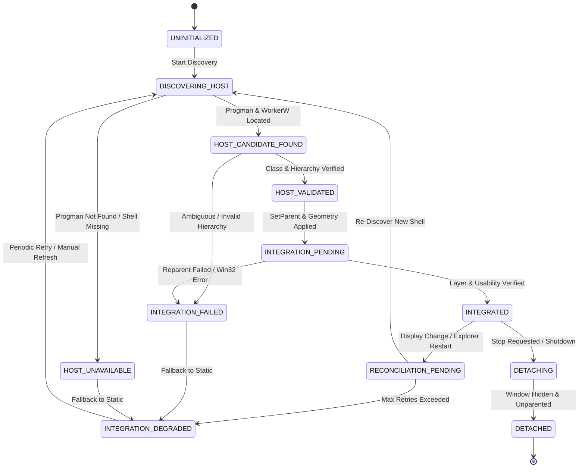

# Windows Desktop Integration Architecture Specification
**Document ID:** `KW-DSK-001`  
**Deliverable:** A (Windows Desktop Integration Architecture)  
**Parent Document:** [README.md](file:///e:/Projects/All%20working%20projects/App%20projects%20working/KinetiWall%20Engine%20(working)/docs/desktop_integration/README.md)  
**Classification:** Windows Platform Integration & Desktop Shell Standard  

---

## 1. Executive Summary & Problem Formulation

Live desktop wallpaper software on Microsoft Windows must achieve a complex technical objective: render real-time graphics (Direct3D 11 swapchains or Chromium WebView2 frames) directly onto the user's desktop, placed visually **behind** desktop icons (`SysListView32`) and ordinary desktop widgets, while leaving the Windows shell fully interactive, stable, and responsive.

Windows provides no officially documented public Win32 API named `SetDesktopWallpaperWindow()` or `CreateLiveWallpaperSurface()`. As a result, desktop wallpaper engines must integrate with the private internal window hierarchy created by Windows Explorer (`explorer.exe`). This specification establishes the architecture for discovering, validating, embedding, and supervising wallpaper windows within the Windows shell.

---

## 2. Desktop Window Layer Placement Architecture

The Windows shell renders the desktop workspace via an arrangement of specialized windows owned by `explorer.exe`:

```
+---------------------------------------------------------------------------------+
|                                WINDOWS Z-ORDER HIERARCHY                         |
+---------------------------------------------------------------------------------+
| [Z-Top]   System Menus, Notifications, Toast Alerts                             |
|           Taskbar (Shell_TrayWnd) & Start Menu                                  |
|           Active Top-Level Foreground Windows (IDEs, Games, Browsers)           |
|           Inactive Background Top-Level Windows                                 |
+---------------------------------------------------------------------------------+
| === DESKTOP SHELL BOUNDARY ===                                                  |
|                                                                                 |
|   Progman (Program Manager, class "Progman")                                    |
|     |                                                                           |
|     +--- SHELLDLL_DefView (class "SHELLDLL_DefView")                            |
|            |                                                                    |
|            +--- SysListView32 (Desktop Icons: "Recycle Bin", files, folders)    |
|                                                                                 |
|   +-------------------------------------------------------------------------+   |
|   | TARGET INTEGRATION LAYER: WorkerW (class "WorkerW", beneath icons)      |   |
|   |                                                                         |   |
|   |   +-----------------------------------------------------------------+   |   |
|   |   | KinetiWall Player HWND (class "KinetiWall_VideoPlayer_Render")  |   |   |
|   |   | Subclassed or Child Window of WorkerW                           |   |   |
|   |   | - Direct3D 11 SwapChain / mpv Video Presentation Surface        |   |   |
|   |   | - WS_CHILD | WS_VISIBLE | WS_CLIPSIBLINGS                       |   |   |
|   |   | - WS_EX_TRANSPARENT | WS_EX_NOACTIVATE                          |   |   |
|   |   +-----------------------------------------------------------------+   |   |
|   +-------------------------------------------------------------------------+   |
|                                                                                 |
|   Static Windows Wallpaper Surface (Native shell bitmap paint)                  |
+---------------------------------------------------------------------------------+
```

### 2.1 Essential Usability Contracts

For integration to be considered valid and operational, the following observable contracts must be satisfied simultaneously:
1. **Desktop Icon Visibility:** All desktop icons rendered by `SysListView32` must remain 100% visible on top of the live wallpaper.
2. **Icon Selection & Marquee:** Dragging a selection marquee rectangle on the desktop must function without tearing or lag.
3. **Context Menus:** Right-clicking empty desktop space must trigger the standard Windows desktop context menu (`New`, `Display Settings`, `Personalize`).
4. **Taskbar & Start Menu Isolation:** The Windows taskbar (`Shell_TrayWnd`) must never be occluded or pushed down by the wallpaper window.
5. **No Focus Stealing:** The wallpaper window must never acquire keyboard focus, activate as the foreground window, or interrupt user typing in foreground applications.

---

## 3. Evaluation of Candidate Integration Strategies

Four architectural approaches to Windows desktop integration were evaluated:

| Integration Candidate | Technical Mechanism | Layer Reliability | Shell Usability | Documented API Contract? | Process Isolation Safety | Recommendation |
| :--- | :--- | :---: | :---: | :---: | :---: | :--- |
| **Strategy 1: `Progman` Direct Embedding** | `SetParent(player_hwnd, progman_hwnd)` | Poor | Fails (Icons hidden behind player) | Mixed | Moderate | **REJECTED**: Occludes `SysListView32` icons; breaks desktop interaction. |
| **Strategy 2: `WorkerW` Split via `0x052C`** | Send message `0x052C` to `Progman` to split `WorkerW` into behind-icon surface; reparent player into spawned `WorkerW`. | **Excellent** | **Complete** (Icons, context menus, and taskbar remain 100% intact) | **Undocumented Shell Behavior** (Heavily verified across Win 7–11) | **High** (Encapsulated in child player process) | **RECOMMENDED PRIMARY STRATEGY** |
| **Strategy 3: Bottom-Most Top-Level Window** | Top-level window positioned at `HWND_BOTTOM` via `SetWindowPos` | Poor | Unstable (Pops above icons on minimize; focus races) | Documented | High | **REJECTED**: Windows frequently elevates bottom-most windows during desktop minimization (`Win+D`). |
| **Strategy 4: Shell Desktop Hook DLL Injection** | Inject DLL into `explorer.exe` to hook desktop window paint loop (`WM_ERASEBKGND`) | High | High | Documented API (Hooks) / High Risk | Dangerous (Explorer crashes bring down system) | **STRICTLY REJECTED**: Violates `DEC-SEC-01`; unacceptable security & stability risk. |

### 3.1 Weighted Decision Matrix

| Evaluation Criteria | Weight | Strategy 1 (`Progman`) | Strategy 2 (`WorkerW` 0x052C) | Strategy 3 (`HWND_BOTTOM`) | Strategy 4 (Explorer Hook) |
| :--- | :---: | :---: | :---: | :---: | :---: |
| **Desktop Icon Usability** | 20% | 1 / 10 | 10 / 10 | 4 / 10 | 9 / 10 |
| **Windows Shell Stability** | 20% | 6 / 10 | 9 / 10 | 8 / 10 | 2 / 10 |
| **Process Isolation & Safety** | 15% | 7 / 10 | 9 / 10 | 9 / 10 | 1 / 10 |
| **Multi-Monitor Geometry** | 15% | 4 / 10 | 9 / 10 | 7 / 10 | 8 / 10 |
| **Explorer Crash Recovery** | 10% | 5 / 10 | 9 / 10 | 5 / 10 | 1 / 10 |
| **OS Update Resilience** | 10% | 6 / 10 | 7 / 10 | 8 / 10 | 2 / 10 |
| **Security & Non-Invasiveness** | 10% | 8 / 10 | 9 / 10 | 10 / 10 | 1 / 10 |
| **Weighted Total Score** | 100% | **4.70 / 10** | **8.95 / 10** | **6.65 / 10** | **3.55 / 10** |

* **Approval Status:** **Strategy 2 (`WorkerW` Split via `0x052C`) is approved as the Primary Integration Strategy**, guarded by explicit host validation, single-reparenting per player process, and an automatic safe static-wallpaper fallback (`Strategy 5: Quiescent Degradation`).

---

## 4. Integration State Machine

The desktop integration lifecycle is modeled as a 10-state deterministic state machine:



### 4.1 State Definitions & Action Semantics

1. **`UNINITIALIZED`**: Player process spawned; render window created as hidden top-level window.
2. **`DISCOVERING_HOST`**: Locating `Progman` via `FindWindowW(L"Progman", NULL)` and dispatching `0x052C`.
3. **`HOST_CANDIDATE_FOUND`**: Enumerating top-level windows (`EnumWindows`) to find the `WorkerW` instance residing immediately behind `SHELLDLL_DefView`.
4. **`HOST_VALIDATED`**: Candidate `WorkerW` verified: class name confirmed, process belongs to `explorer.exe`, session matches user token.
5. **`INTEGRATION_PENDING`**: Calling `SetParent(hPlayerWnd, hWorkerW)` and applying `SetWindowPos` monitor bounds.
6. **`INTEGRATED`**: Layer placement verified: icons remain clickable, window is rendering smoothly, telemetry reports operational status.
7. **`RECONCILIATION_PENDING`**: Signal detected (`WM_DISPLAYCHANGE`, `TaskbarCreated`, or host handle invalidation). Rendering paused while re-anchoring.
8. **`INTEGRATION_DEGRADED`**: Integration cannot be established after 3 retries. Player stops rendering; native static Windows wallpaper is restored.
9. **`INTEGRATION_FAILED`**: Win32 API returned fatal error (`ERROR_ACCESS_DENIED`, handle invalid). Error logged; slot marked faulted.
10. **`DETACHING` / `DETACHED`**: Window hidden (`ShowWindow(SW_HIDE)`), unparented (`SetParent(NULL)`), and prepared for clean destruction.

---

## 5. Initialization Protocol & Verification Pipeline

Desktop integration follows a strict, sequential 10-stage initialization protocol:

```
[Stage 1: Core Lifecycle Verification]
  - Confirm Core is in RUNNING state and target display is active.
[Stage 2: Acquire Monitor Geometry & Session Identity]
  - Query GetMonitorInfoW, calculate virtual desktop bounding box.
[Stage 3: Discover & Signal Progman]
  - HWND hProgman = FindWindowW(L"Progman", NULL);
  - SendMessageTimeoutW(hProgman, 0x052C, 0x0000000D, 0, SMTO_NORMAL, 1000, &result);
[Stage 4: Enumerate & Discover WorkerW]
  - EnumWindows searching for WorkerW window with child SHELLDLL_DefView.
  - The TARGET WorkerW is the sibling WorkerW created immediately behind SHELLDLL_DefView.
[Stage 5: Validate Target WorkerW Host]
  - Verify RealGetWindowClassW(hWorkerW) == L"WorkerW".
  - Verify GetWindowThreadProcessId matches explorer.exe PID.
[Stage 6: Player Window Creation]
  - Player process creates render window with WS_CHILD | WS_CLIPSIBLINGS.
[Stage 7: Window Reparenting & Bounds Assignment]
  - SetParent(hPlayerWnd, hWorkerW);
  - SetWindowPos(hPlayerWnd, HWND_TOP, rc.left, rc.top, rc.width, rc.height, SWP_NOACTIVATE);
[Stage 8: Layer Placement Verification]
  - Test-hit verification: Ensure SysListView32 remains topmost child.
[Stage 9: Usability Verification]
  - Check that mouse clicks on desktop resolve to SysListView32.
[Stage 10: Operational State Transition]
  - Transition state to INTEGRATED; unfreeze render loop.
```

---

## 6. Teardown, Detachment & Surface Restoration

When a wallpaper stops, a display changes, or KinetiWall shuts down, the detachment protocol restores the Windows shell wallpaper seamlessly without flashing:

1. **Hide Player Window:** Invoke `ShowWindow(hPlayerWnd, SW_HIDE)`.
2. **Reparent to NULL:** Invoke `SetParent(hPlayerWnd, NULL)`. This completely disassociates the player window from the `WorkerW` hierarchy.
3. **Invalidate Desktop Surface:** Call `RedrawWindow(hWorkerW, NULL, NULL, RDW_INVALIDATE | RDW_ERASE | RDW_ALLCHILDREN)` to instruct Windows Explorer to repaint the default shell wallpaper.
4. **Destroy Player Window:** Invoke `DestroyWindow(hPlayerWnd)`.
5. **Total Detachment Budget:** Must complete in $\le 20\text{ ms}$ (within the $250\text{ ms}$ global shutdown budget).

---

## 7. Fullscreen Application Coordination & Occlusion Management

To comply with `KW-F-008` (power saving and zero resource waste during gaming or productivity):
1. **Hardware Occlusion Detection:** Core queries the active foreground window (`GetForegroundWindow`).
2. **Fullscreen Bounding Check:** If the foreground window rect matches or covers the monitor's physical bounding box (`GetMonitorInfoW`) and is not `Progman` or `WorkerW`, the display is marked **OCCLUDED**.
3. **Quiescent Rendering Pause:** Core dispatches `CMD_PAUSE_DISPLAY(DisplayId)` to the player. The player skips swapchain `Present` calls and halts video decoding, reducing CPU/GPU overhead to $\le 0.1\%$.
4. **Instant Resume:** When the fullscreen window loses focus or minimizes, Core sends `CMD_RESUME_DISPLAY(DisplayId)` to resume playback without recreating windows.

