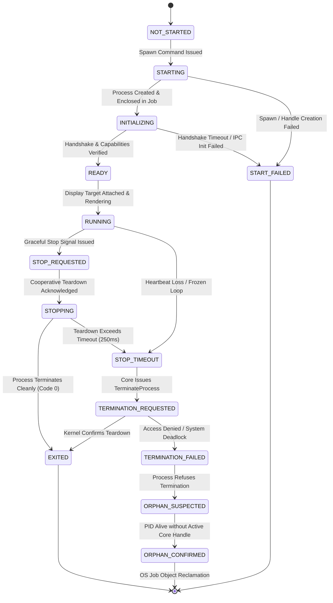
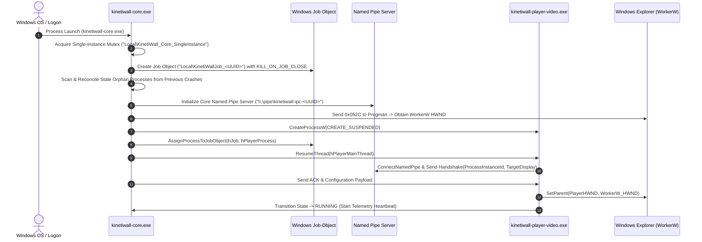

# Process Lifecycle & Supervision Specification
**Document ID:** `KW-LFC-001`  
**Deliverable:** A (Process Lifecycle Specification)  
**Parent Document:** [README.md](file:///e:/Projects/All%20working%20projects/App%20projects%20working/KinetiWall%20Engine%20(working)/docs/lifecycle_and_shutdown/README.md)  
**Classification:** Core System Architecture / Operational Reliability Standard  

---

## 1. Process Inventory and Ownership Models

KinetiWall enforces strict process isolation to prevent rendering crashes, web runtime memory leaks, or heavy media decoders from compromising core desktop stability. The process topology consists of four distinct process types:

```
+-----------------------------------------------------------------------+
|                         Windows NT Kernel                             |
|                                                                       |
|  +-----------------------------------------------------------------+  |
|  |             Windows Job Object: "KinetiWallJob_<UUID>"          |  |
|  |           Limit: JOB_OBJECT_LIMIT_KILL_ON_JOB_CLOSE             |  |
|  |                                                                 |  |
|  |  +--------------------------+     +--------------------------+  |  |
|  |  | kinetiwall-player-video  |     | kinetiwall-player-web    |  |  |
|  |  | Display: \\.\DISPLAY1    |     | Display: \\.\DISPLAY2    |  |  |
|  |  +------------^-------------+     +------------^-------------+  |  |
|  |               |                                |                |  |
|  +---------------|--------------------------------|----------------+  |
|                  | IPC (Named Pipe)               | IPC (Named Pipe)  |
|  +---------------v--------------------------------v----------------+  |
|  |                   kinetiwall-core.exe                          |  |
|  |       (Supervisor Daemon, Storage, Shell Tray Anchor)          |  |
|  +-------------------------------^--------------------------------+  |
|                                  | IPC (Named Pipe / Ephemeral)       |
|  +-------------------------------v--------------------------------+  |
|  |                   kinetiwall-ui.exe                            |  |
|  |          (Ephemeral Settings & Library Window)                 |  |
|  |          [Runs ONLY when user opens UI; 0 MB closed]           |  |
|  +----------------------------------------------------------------+  |
+-----------------------------------------------------------------------+
```

### 1.1 Process Characteristics Matrix

| Process Executable | Process Role | Invocation Trigger | Expected Lifetime | Supervisor | Job Object Member | Memory Ceiling |
| :--- | :--- | :--- | :--- | :--- | :--- | :--- |
| **`kinetiwall-core.exe`** | Background Supervisor & Daemon | OS Logon (Startup) or User Launch | Indefinite (OS Session) | OS Session Manager / Shell | Creator / Owner of Job | $\le 60\text{ MB}$ RSS |
| **`kinetiwall-ui.exe`** | Configuration & Library GUI | Tray double-click, shortcut, CLI | Ephemeral (User Session) | User / OS Shell | Optional | $\le 120\text{ MB}$ ($0\text{ MB}$ closed) |
| **`kinetiwall-player-video.exe`** | Video Player Subprocess | Display activation with video wallpaper | Active Wallpaper Duration | `kinetiwall-core.exe` | **Yes** (Enforced) | $\le 150\text{ MB}$ / display |
| **`kinetiwall-player-web.exe`** | Web Engine Subprocess | Display activation with web wallpaper | Active Wallpaper Duration | `kinetiwall-core.exe` | **Yes** (Enforced) | $\le 250\text{ MB}$ / display |

---

## 2. Process Lifecycle State Machine

To eliminate race conditions, duplicate processes, and zombie states, every process managed by KinetiWall adheres to a 14-state formal lifecycle state machine:



### 2.1 State Definitions and Transition Semantics

1. **`NOT_STARTED`**: The process configuration and target display are registered in Core, but no OS process has been spawned.
2. **`STARTING`**: Core has invoked `CreateProcessW` with suspended flag `CREATE_SUSPENDED`.
3. **`INITIALIZING`**: Process handle is successfully assigned to the Windows Job Object (`AssignProcessToJobObject`), resumed (`ResumeThread`), and is establishing IPC named pipe handshake with Core.
4. **`READY`**: IPC handshake completed, capabilities negotiated, security token validated, graphics surface allocated.
5. **`RUNNING`**: Wallpaper rendering active, window attached behind desktop icons (`WorkerW`), telemetry heartbeat transmitting every $1000\text{ ms}$.
6. **`STOP_REQUESTED`**: Supervisor issues `CMD_STOP_PLAYER` or `CMD_SHUTDOWN` cooperative message over IPC.
7. **`STOPPING`**: Subprocess has acknowledged command, detached from `WorkerW`, released graphics/media swapchains, and is flushing diagnostic buffers.
8. **`EXITED`**: Process has terminated and signaled its process handle (`WAIT_OBJECT_0`). Exit code recorded.
9. **`START_FAILED`**: `CreateProcessW` failed, binary missing, corrupted executable signature, or Job Object assignment failed.
10. **`STOP_TIMEOUT`**: Subprocess failed to acknowledge stop command or failed to terminate within the $250\text{ ms}$ graceful shutdown window.
11. **`TERMINATION_REQUESTED`**: Supervisor invokes Win32 `TerminateProcess(hProcess, EXIT_TIMEOUT_FORCE)`.
12. **`TERMINATION_FAILED`**: `TerminateProcess` returned an error (e.g. `ERROR_ACCESS_DENIED`, kernel driver deadlocks).
13. **`ORPHAN_SUSPECTED`**: Subprocess handle became invalid or unmonitored while target process ID remains active in the OS kernel.
14. **`ORPHAN_CONFIRMED`**: Supervisor detects process running without associated Job Object reference; escalates to kernel Job reclamation.

---

## 3. Orderly Startup and Spawn Orchestration

Startup orchestration proceeds sequentially through strictly validated gates. A subsequent stage never begins until the preceding stage is verified.

### 3.1 Cold Boot Sequence (Stage 1 through 7)



1. **Single Instance Mutual Exclusion:** Core acquires named Win32 Mutex `Local\KinetiWall_Core_SingleInstance`. If `ERROR_ALREADY_EXISTS`, Core signals the existing instance via IPC and exits immediately.
2. **Job Object Construction:** Core initializes the supervisor Job Object with `JOBOBJECT_EXTENDED_LIMIT_INFORMATION` configuring `JOB_OBJECT_LIMIT_KILL_ON_JOB_CLOSE` and `JOB_OBJECT_LIMIT_SILENT_BREAKAWAY_OK`.
3. **Cold Reconciliation:** Core queries the system process snapshot (`CreateToolhelp32Snapshot`) to discover and terminate any stale `kinetiwall-player-*.exe` processes orphaned by prior hard power cuts or debugger terminations.
4. **IPC Listener Initialization:** High-security Windows Named Pipe listener initialized with restricted DACL (`GENERIC_READ | GENERIC_WRITE` for current user logon SID only).
5. **Desktop Shell Integration (`WorkerW`):** Core sends the undocumented Windows shell message `0x052C` to `Progman` to spawn a dedicated `WorkerW` window beneath desktop icons (`SysListView32`).
6. **Subprocess Creation & Job Enclosure:** Core spawns player subprocesses using `CREATE_SUSPENDED`. Before resuming the main thread, the process handle is assigned to the Job Object. This ensures that even if Core is killed 1 microsecond later, the child will be destroyed by Windows.
7. **Handshake & Window Subclassing:** The player connects to Core via IPC, receives its display geometry and wallpaper manifest, reparents its render window into the display's `WorkerW`, and enters `RUNNING`.

---

## 4. UI Closure vs Engine Exit Contracts

A fundamental architectural rule of KinetiWall is the absolute decoupling of the User Interface from the Core Supervisor and active wallpaper playback.

```
+-----------------------------------------------------------------------------------+
| ACTION: User clicks "X" (Close Window) on kinetiwall-ui.exe                       |
+-----------------------------------------------------------------------------------+
| 1. kinetiwall-ui intercepts WM_CLOSE.                                             |
| 2. Flushes any uncommitted local draft state to Core via IPC (FLUSH_REQUEST).     |
| 3. Awaits FLUSH_ACK from Core (timeout 150ms).                                    |
| 4. Disconnects IPC pipe client.                                                   |
| 5. Releases Slint/Win32 GUI swapchains and font caches.                           |
| 6. Calls ExitProcess(0).                                                          |
| RESULT: UI process terminates completely. RAM footprint drops to exactly 0 MB.    |
| IMPACT ON WALLPAPER: ZERO. kinetiwall-core and players continue running smoothly. |
+-----------------------------------------------------------------------------------+

+-----------------------------------------------------------------------------------+
| ACTION: User selects "Exit KinetiWall" from Tray Icon Context Menu               |
+-----------------------------------------------------------------------------------+
| 1. Tray Menu initiates FULL_SYSTEM_SHUTDOWN.                                      |
| 2. If kinetiwall-ui is open, Core sends CMD_QUIT_UI to UI process.                |
| 3. Core sends CMD_TERMINATE_PLAYER to all active display players.                 |
| 4. Players detach from WorkerW, destroy swapchains, and terminate cleanly.        |
| 5. Core flushes storage, removes tray icon, closes Job Object, and exits.         |
| RESULT: All KinetiWall processes cleanly terminate. Shell wallpaper restored.     |
+-----------------------------------------------------------------------------------+
```

---

## 5. Shutdown Scopes, Timeouts and Escalation Protocol

Shutdown operations are categorized into three distinct operational scopes:

| Shutdown Scope | Triggering Context | Affected Components | Time Budget | Escalation Action |
| :--- | :--- | :--- | :--- | :--- |
| **`SCOPE_DISPLAY_STOP`** | User changes wallpaper, pauses display, or unplugs monitor | Specific `kinetiwall-player-*.exe` for target display | $250\text{ ms}$ | `TerminateProcess` on player; Core remains active. |
| **`SCOPE_UI_CLOSE`** | User closes configuration window, or Core restarts | `kinetiwall-ui.exe` only | $150\text{ ms}$ | `TerminateProcess` on UI; players & Core remain active. |
| **`SCOPE_ENGINE_SHUTDOWN`** | User clicks "Exit", system logoff, or reboot | All players, UI, and `kinetiwall-core.exe` | $500\text{ ms}$ total ($250\text{ ms}$ child, $250\text{ ms}$ Core) | Windows Job Object closure kills any remaining children. |

### 5.1 Escalation Protocol Timeline

```
T + 0 ms    : Core issues CMD_STOP_PLAYER with timeout deadline (T + 250 ms).
T + 10 ms   : Subprocess receives IPC message, exits render loop, detaches WorkerW.
T + 50 ms   : Subprocess releases D3D11 / mpv / WebView2 resources and closes pipe.
T + 100 ms  : Subprocess terminates (ExitProcess(0)). Core wait returns WAIT_OBJECT_0.
-------------------------------------------------------------------------------------
IF TIMEOUT EXCEEDED (T >= 250 ms):
T + 250 ms  : Core wait returns WAIT_TIMEOUT. State -> STOP_TIMEOUT.
T + 252 ms  : Core logs ERROR_SHUTDOWN_TIMEOUT with thread stack and resource state.
T + 255 ms  : Core calls TerminateProcess(hProcess, EXIT_CODE_FORCE_SHUTDOWN = 0xFE).
T + 270 ms  : Windows NT kernel destroys process address space and frees locked handles.
T + 280 ms  : Core cleans process table entry and reclaims display slot.
```

---

## 6. Windows OS Lifecycle and Session Events

KinetiWall handles external operating system transitions deterministically to prevent desktop corruption, audio desync, or battery drain:

| Windows Event | Message / Notification | Engine Response & Action Sequence | Restoration / Resume Action |
| :--- | :--- | :--- | :--- |
| **Session Logoff / Shutdown** | `WM_QUERYENDSESSION` / `WM_ENDSESSION` | Returns `TRUE` to allow fast shutdown. Flushes configuration to disk. Stops all players immediately ($T \le 200\text{ ms}$). | None (Session terminating). |
| **Lock Workstation** | `WTSRegisterSessionNotification` (`WTS_SESSION_LOCK`) | Sends `CMD_PAUSE_RENDERING` to all players. Pauses video decoders, halts WebView2 rAF loops, releases audio endpoints. | `WTS_SESSION_UNLOCK`: Sends `CMD_RESUME_RENDERING`. |
| **Display Power Off** | `RegisterPowerSettingNotification` (`GUID_MONITOR_POWER_ON` = 0) | Halts swapchain present calls. Freezes mpv decoding threads. Reduces CPU utilization to $< 0.1\%$. | `GUID_MONITOR_POWER_ON` = 1: Unfreezes render loop and re-presents last valid frame. |
| **System Sleep / Standby** | `WM_POWERBROADCAST` (`PBT_APMSUSPEND`) | Enters fully quiescent state. Flushes runtime telemetry. Closes hardware video decoders if required by VRAM limit. | `PBT_APMRESUMEAUTOMATIC`: Re-queries monitor coordinates, validates WorkerW HWND, resumes playback. |
| **Display Resolution / Topology Change** | `WM_DISPLAYCHANGE` | Core pauses rendering. Recalculates display bounding rects (`EnumDisplayMonitors`). Repositions player windows. | If display removed: tears down child player. If display added: spawns new player. |
| **Shell Crash (`explorer.exe` restart)** | `RegisterWindowMessageW("TaskbarCreated")` | Core detects shell restart. Re-queries WorkerW hierarchy (`0x052C`). Re-parents existing player HWNDs to new WorkerW. | Re-establishes tray notification icon without dropping wallpaper rendering. |

