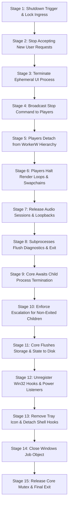

# Shutdown & Cleanup Protocol Specification
**Document ID:** `KW-LFC-002`  
**Deliverable:** B (Shutdown and Cleanup Protocol)  
**Parent Document:** [README.md](file:///e:/Projects/All%20working%20projects/App%20projects%20working/KinetiWall%20Engine%20(working)/docs/lifecycle_and_shutdown/README.md)  
**Classification:** Core System Architecture / Operational Reliability Standard  

---

## 1. Ordered Shutdown Stages (Stages 1 through 15)

To guarantee that no resources are leaked, no configuration writes are lost, and no zombie windows remain on the Windows desktop, engine shutdown proceeds through an unyielding 15-stage sequence:



### 1.1 Detailed Execution Protocol by Stage

| Stage | Stage Name | Owner | Max Budget | Operations & Preconditions | Verification / Postcondition |
| :---: | :--- | :--- | :--- | :--- | :--- |
| **1** | **Shutdown Ingress & Lock** | Core | $5\text{ ms}$ | Receive shutdown trigger (Tray, IPC, or `WM_CLOSE`). Atomically set `SHUTDOWN_IN_PROGRESS` atomic flag. | New IPC requests rejected with `ERR_ENGINE_SHUTTING_DOWN`. |
| **2** | **Lock User Ingress** | Core | $5\text{ ms}$ | Disable tray menu interactions. Unregister file watchers on wallpaper directories to prevent event floods. | Ingress channels locked; event queue drains. |
| **3** | **Terminate Ephemeral UI** | Core / UI | $100\text{ ms}$ | If `kinetiwall-ui.exe` is running, send `CMD_QUIT_UI`. If UI fails to exit within $100\text{ ms}$, invoke `TerminateProcess`. | UI process handle signaled (`WAIT_OBJECT_0`). |
| **4** | **Broadcast Stop to Players** | Core | $10\text{ ms}$ | Send `CMD_TERMINATE_PLAYER` simultaneously across all active display player Named Pipe channels. | Pipe write buffers flushed; read acknowledgments pending. |
| **5** | **Detach from Shell Surface** | Player | $20\text{ ms}$ | Subprocess calls `ShowWindow(hWnd, SW_HIDE)` and `SetParent(hWnd, NULL)`. Restores native shell desktop background. | Desktop WorkerW surface cleanly exposes native Windows wallpaper. |
| **6** | **Halt Rendering & Swapchains**| Player | $40\text{ ms}$ | Freeze media decoder (mpv `mpv_command_string("stop")`) or WebView2 navigate to `about:blank`. Release DXGI swapchain. | GPU pipeline flushed; VRAM allocations freed. |
| **7** | **Release Audio Endpoints** | Player | $15\text{ ms}$ | Stop WASAPI audio stream (`IAudioClient::Stop()`). Release audio session control. Unregister endpoint change notifications. | System audio mixer disconnects without pops or clicks. |
| **8** | **Subprocess Flush & Exit** | Player | $30\text{ ms}$ | Write final telemetry trace records. Close Named Pipe handle. Invoke `ExitProcess(0)`. | Player process memory reclaimed by OS kernel. |
| **9** | **Core Supervision Wait** | Core | $150\text{ ms}$ | Core calls `WaitForMultipleObjects` on all player process handles with $150\text{ ms}$ budget. | All active child process handles signaled. |
| **10** | **Escalation Protocol** | Core | $20\text{ ms}$ | For any process handle still unsignaled at timeout expiry, invoke `TerminateProcess(hProcess, 0xFE)`. | Process table guarantees 0 remaining player processes. |
| **11** | **Atomic Persistence Flush** | Core | $50\text{ ms}$ | Flush SQLite WAL (`PRAGMA wal_checkpoint(TRUNCATE)`), write `config.json` via atomic replace (`MoveFileExW`). | Storage committed to disk with zero partial writes. |
| **12** | **Unregister OS Listeners** | Core | $10\text{ ms}$ | Unregister `RegisterPowerSettingNotification`, `WTSRegisterSessionNotification`, and WinEvent hooks (`UnhookWinEvent`). | OS event pump stops routing system messages to Core. |
| **13** | **Remove Shell Tray Icon** | Core | $10\text{ ms}$ | Call `Shell_NotifyIconW(NIM_DELETE, &nid)`. Destroy tray window HWND. | Notification area icon removed without ghost artifact. |
| **14** | **Close Windows Job Object** | Core | $10\text{ ms}$ | Close handle to Windows Job Object (`CloseHandle(hJob)`). Enforces fallback termination if any process broke away. | Kernel releases Job Object encapsulation. |
| **15** | **Release Mutex & Exit** | Core | $5\text{ ms}$ | Close Named Pipe servers. Release `Local\KinetiWall_Core_SingleInstance` Mutex. Call `ExitProcess(0)`. | Core process completely exits. Total shutdown time $\le 480\text{ ms}$. |

---

## 2. Cancellation and In-Flight Operation Rollback

User cancellation can occur during complex lifecycle operations (e.g. user aborts applying a new 4K video wallpaper while it is downloading or initializing):

```
+-----------------------------------------------------------------------------------+
| USER CANCEL DURING INITIALIZATION:                                                |
| 1. User clicks "Cancel" in UI while player is in STARTING or INITIALIZING state.   |
| 2. UI dispatches CMD_CANCEL_DISPLAY_INIT(DisplayId) to Core.                      |
| 3. Core marks display slot CANCEL_PENDING.                                        |
| 4. If child process is still suspended: Core calls TerminateProcess immediately.  |
| 5. If child process is connecting IPC: Core rejects handshake with ERR_CANCELLED. |
| 6. Child process catches cancellation error, performs immediate cleanup, exits.   |
| 7. Target display reverts immediately to its prior active wallpaper or fallback.  |
+-----------------------------------------------------------------------------------+
```

### 2.1 Invariant Rules for Cancellation

1. **Atomic Reversion:** Cancelling a wallpaper switch must never leave a display in a blank black state or half-initialized surface. The prior wallpaper remains rendering until the new player transitions to `READY`. If aborted, the old player continues or resumes.
2. **Handle Cleanup on Cancel:** Any temporary staging files (e.g. downloaded remote wallpaper streams or extracted archives) are scheduled for deletion via `FILE_FLAG_DELETE_ON_CLOSE` or immediate unlink.
3. **Cancellation Timeout:** A cancelled initialization is afforded a strict $100\text{ ms}$ cancellation budget before forced termination.

---

## 3. Data Protection and Persistence Guarantees

KinetiWall enforces a strict policy preventing false save reports and partial writes during shutdown:

```
[In-Memory Configuration State]
               |
               v
  1. Serialize to Temp File: "config.json.tmp.<UUID>"
               |
               v
  2. Flush File Buffers: FlushFileBuffers(hTempFile)
               |
               v
  3. Close Temp File Handle: CloseHandle(hTempFile)
               |
               v
  4. Atomic File Replace:
     MoveFileExW("config.json.tmp.<UUID>", "config.json", 
                 MOVEFILE_REPLACE_EXISTING | MOVEFILE_WRITE_THROUGH)
               |
       +-------+-------+
       |               |
   [SUCCESS]        [FAILURE (e.g. File Lock)]
       |               |
       v               v
 Log SUCCESS      1. Log ERROR_CONFIG_FLUSH_FAILED with Win32 Error Code
 Return true      2. Attempt write to Fallback: "config.json.recovered.<timestamp>"
                  3. Return explicit FAILURE code to caller (NO FALSE REPORT)
```

### 3.1 SQLite WAL Flush Rules

1. Before Core teardown, SQLite execution thread executes `PRAGMA wal_checkpoint(TRUNCATE)`.
2. If `SQLITE_BUSY` or `SQLITE_LOCKED` is returned, Core retries every $10\text{ ms}$ up to a maximum of $50\text{ ms}$.
3. If WAL flush fails, the database connection is closed cleanly; SQLite's native write-ahead log will safely replay and recover upon the next cold launch.

---

## 4. Diagnostics Telemetry and Audit Records

Every phase transition and shutdown milestone emits an auditable structured log record conforming to the format:

```json
{
  "timestamp": "2026-11-11T11:00:20.142Z",
  "level": "INFO",
  "component": "kinetiwall-core",
  "subsystem": "lifecycle_supervisor",
  "event_type": "SHUTDOWN_MILESTONE",
  "payload": {
    "stage": 9,
    "stage_name": "CORE_SUPERVISION_WAIT",
    "elapsed_ms": 112,
    "active_children": 2,
    "signaled_children": 2,
    "escalated_children": 0,
    "status": "COMPLETED_ON_TIME"
  }
}
```

In the event of an escalation, an error event is written:

```json
{
  "timestamp": "2026-11-11T11:00:20.255Z",
  "level": "ERROR",
  "component": "kinetiwall-core",
  "subsystem": "lifecycle_supervisor",
  "event_type": "SHUTDOWN_ESCALATION",
  "payload": {
    "stage": 10,
    "target_display": "\\\\.\\DISPLAY2",
    "process_uuid": "f81d4fae-7dec-11d0-a765-00a0c91e6bf6",
    "os_pid": 14208,
    "action": "TerminateProcess",
    "reason": "GRACEFUL_SHUTDOWN_TIMEOUT_EXCEEDED",
    "timeout_budget_ms": 250,
    "win32_exit_code": 254
  }
}
```

