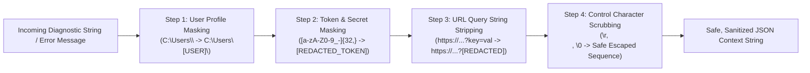

# DIAGNOSTIC PRIVACY & SECURITY POLICY
## Document ID: KW-OBS-002 | Phase 3: Observability, Diagnostics & Operational Reliability

---

### 1. Diagnostic Data Classification & Privacy Tiers

In accordance with KinetiWall's core privacy mandate (**KW-NF-019**, **DEC-SEC-06**), diagnostic data is classified into three strict operational tiers. Data in the Prohibited tier is blocked from ingestion at the code boundary:

```
+---------------------------------------------------------------------------------------------------------+
|                                      DIAGNOSTIC DATA CLASSIFICATION                                     |
+--------+------------------------+-------------------------------+---------------------------------------+
| TIER   | CLASSIFICATION         | DATA ELEMENTS INCLUDED        | INGESTION & RETENTION POLICY          |
+--------+------------------------+-------------------------------+---------------------------------------+
| Tier 1 | Prohibited Content     | Passwords, tokens, raw audio, | **COMPLETELY FORBIDDEN**. Stripped    |
|        | (Strict Zero-Retention)| window titles, user documents | at source; zero disk footprint.       |
+--------+------------------------+-------------------------------+---------------------------------------+
| Tier 2 | Restricted Diagnostics | Local paths, display names,   | **MANDATORY REDACTION**. Anonymized   |
|        | (Local Sanitized Only) | error strings, hardware IDs   | prior to serialization; local only.   |
+--------+------------------------+-------------------------------+---------------------------------------+
| Tier 3 | Permitted Telemetry    | Operational states, durations,| **PERMITTED UNENCRYPTED**. Single-line|
|        | (Operational Metrics)  | error codes, frame statistics | JSON; retained for 7 days rolling.    |
+--------+------------------------+-------------------------------+---------------------------------------+
```

---

### 2. Explicit List of Prohibited Diagnostic Content

The following data elements MUST NEVER appear in KinetiWall log files, diagnostic exports, or temporary scratchpads under any circumstance:

1. **Authentication Tokens & Secrets**: API keys, web session cookies, tokens, or private keys.
2. **User Identifying Path Segments**: Usernames in standard Windows directory paths (e.g., `C:\Users\JohnDoe\AppData\...` must be redacted to `C:\Users\[USER]\AppData\...`).
3. **Private Document & Window Titles**: Window titles captured during foreground occlusion detection (e.g., `"Confidential_Q3_Financials.xlsx - Excel"` is strictly banned; only the executable name `"EXCEL.EXE"` and window state `Maximized` may be recorded).
4. **Raw Audio Samples**: Zero raw audio PCM buffers or microphone audio data. Only derived mathematical frequency bucket floats ($0.0 \le f \le 1.0$) are evaluated.
5. **Raw Video Frames & Screen Pixels**: Zero frame buffer dumps, desktop screenshots, or decoded wallpaper video rasters.
6. **Web Browsing & External Network Data**: Visited URLs, web search history, cookies, or query strings loaded inside web wallpapers.
7. **Hardware Serial Numbers**: Permanent motherboard UUIDs, CPU serial numbers, MAC addresses, or GPU hardware serials.

---

### 3. Centralized Path & Secret Redaction Engine

All strings destined for log context fields pass through a high-performance in-memory Redaction Engine prior to JSON serialization:



#### 3.1 Redaction Implementation Blueprint

```rust
pub struct DiagnosticRedactor {
    user_profile_pattern: regex::Regex,
    token_pattern: regex::Regex,
}

impl DiagnosticRedactor {
    pub fn new() -> Self {
        let username = std::env::var("USERNAME").unwrap_or_else(|_| "User".to_string());
        let user_pattern = format!(r"(?i)(C:\\Users\\){}(\\.*)", regex::escape(&username));

        Self {
            user_profile_pattern: regex::Regex::new(&user_pattern).unwrap(),
            token_pattern: regex::Regex::new(r"(?i)(token|key|secret|bearer)[=:\s]+[A-Za-z0-9_\-]{16,}").unwrap(),
        }
    }

    pub fn sanitize(&self, input: &str) -> String {
        // 1. Mask username in local Windows paths
        let masked_paths = self.user_profile_pattern.replace_all(input, "${1}[USER]${2}");
        
        // 2. Mask authorization tokens
        let masked_tokens = self.token_pattern.replace_all(&masked_paths, "${1}=[REDACTED_TOKEN]");

        // 3. Neutralize log-injection characters (newlines, carriage returns)
        masked_tokens
            .replace('\r', "\\r")
            .replace('\n', "\\n")
            .replace('\0', "")
    }
}
```

---

### 4. Storage, Rotation & Rolling Retention Rules

Diagnostic files reside strictly within the user's local application data folder and adhere to rigid disk consumption quotas:

#### 4.1 Storage Specifications
- **Directory Path**: `%LOCALAPPDATA%\KinetiWall\logs\`
- **File Naming Pattern**: `kinetiwall_{component}_{YYYY-MM-DD}.log` (e.g. `kinetiwall_core_2026-11-11.log`).
- **File Encoding**: UTF-8 without Byte Order Mark (BOM).
- **Log Format**: JSON Lines (`.log` containing one JSON document per line).

#### 4.2 Rotation & Retention Limits
1. **Daily Rotation**: Log files roll automatically at `00:00:00 UTC`.
2. **Size-Based Rollover**: If an individual process log reaches **10 MB** within a single calendar day, it is rotated to `kinetiwall_{component}_{YYYY-MM-DD}.1.log`.
3. **Hard Disk Quota**: The total aggregate size of the `%LOCALAPPDATA%\KinetiWall\logs\` directory is capped at **50 MB**.
4. **Automated 7-Day Pruning**:
   - During engine startup and every 24 hours of continuous runtime, `DiagnosticsManager` inspects all files in `logs/`.
   - Any log file with a last modification timestamp older than **7 calendar days** is permanently deleted.
   - If total directory size still exceeds 50 MB, oldest files are pruned sequentially until total usage is below 40 MB (80% low-water mark).

#### 4.3 Disk-Full & Permission-Denied Fallback (Safe Degradation)
If the local drive is 100% full or if write permissions to `%LOCALAPPDATA%` fail:
- The logging worker catches the OS error, sets an internal `in_memory_fallback` flag, and routes events to an in-memory ring buffer (capacity: 256 events).
- Once the memory buffer fills, oldest events are dropped.
- **Critical Policy**: A write error in the logging system **MUST NEVER crash KinetiWall or interrupt live wallpaper playback**.

---

### 5. Local Diagnostic Export Protocol

To facilitate troubleshooting without compromising user privacy, KinetiWall provides a transparent, local-only "Export Diagnostics" utility:

#### 5.1 Export Workflow & User Safeguards
1. **User Initiation**: The user navigates to *Settings $\to$ About $\to$ Export Diagnostics* and clicks "Generate Diagnostic Report".
2. **On-the-Fly Sanitization**:
   - Gathers the last 48 hours of log files.
   - Extracts current engine configuration from `config.json`, stripping custom text fields and hashing hardware EDID serials.
   - Packages system metadata (Windows build number, DirectX feature level, GPU adapter model, display topology).
3. **User Inspection Modal**:
   The Gallery UI displays an interactive manifest of all included files. The user can view the plain text of each file prior to saving.
4. **Zero Outbound Transmission**:
   The engine saves a compressed `.zip` archive (e.g. `KinetiWall_Diagnostics_20261111.zip`) to the user's chosen folder (Desktop / Downloads). **Zero network requests are initiated.**

---

### 6. Log Injection & File Tampering Defenses

1. **Log Forging / Log Splitting Mitigation**:
   Attackers attempting to spoof log records by embedding newline characters (`\n`, `\r\n`) inside untrusted wallpaper manifests (e.g. malicious title `"Rain\n{\"severity\":\"ERROR\"...}"`) are neutralized:
   - The JSON serialization layer strictly escapes newline characters as `\n`.
   - The redaction engine scrubs raw control bytes (`\x00`..`\x1F`).
2. **Symlink Traversal Prevention**:
   The Core Controller verifies that `%LOCALAPPDATA%\KinetiWall\logs\` is a physical NTFS directory and not a symbolic link, directory junction, or reparse point (`GetFileAttributesW(FILE_ATTRIBUTE_REPARSE_POINT)`).

