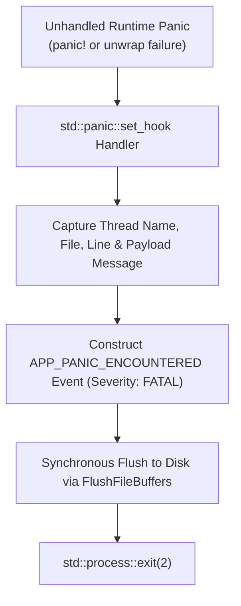
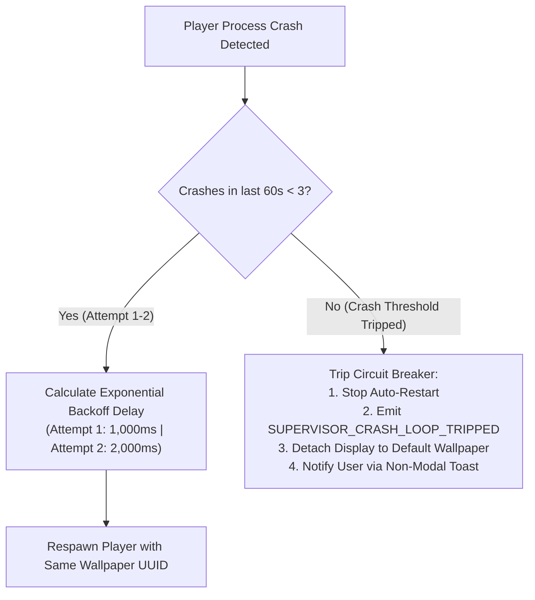

# FAILURE HANDLING & CRASH DIAGNOSTICS
## Document ID: KW-OBS-003 | Phase 3: Observability, Diagnostics & Operational Reliability

---

### 1. Process Exit Code Taxonomy & Failure Classification

When a child process terminates, KinetiWall's `LifecycleSupervisor` inspects the Win32 exit code returned by `GetExitCodeProcess` to distinguish controlled exits from unexpected fatal faults:

```
+---------------------------------------------------------------------------------------------------------+
|                                    PROCESS EXIT CODE CLASSIFICATION                                     |
+-------------------+----------------------------+-----------------+--------------------------------------+
| EXIT CODE / HEX   | CLASSIFICATION             | SEVERITY        | SUPERVISORY REACTION                 |
+-------------------+----------------------------+-----------------+--------------------------------------+
| 0 (0x00000000)    | Normal Clean Teardown      | INFO            | Expected. No restart triggered.      |
| 1 (0x00000001)    | Controlled Error Exit      | WARN            | Check log; restart once with delay.  |
| 2 (0x00000002)    | Rust Runtime Panic Abort   | ERROR           | Parse panic hook log; start backoff. |
| 0xC0000005        | Win32 Access Violation     | FATAL           | Severe memory fault; start backoff.  |
| 0xC00000FD        | Win32 Stack Overflow       | FATAL           | Stack recursion; start backoff.      |
| 0x8007000E        | Win32 Out Of Memory (OOM)  | ERROR           | Memory budget breach; restart delay. |
| 0x00000103        | Still Active (STILL_ACTIVE)| INFO            | Process still running normally.      |
+-------------------+----------------------------+-----------------+--------------------------------------+
```

---

### 2. Rust Runtime Panic Hook Architecture

In release binaries, an unhandled Rust panic (`panic!`) immediately aborts execution. To ensure post-mortem diagnostic evidence is captured before process destruction, all KinetiWall native binaries install a custom panic hook during startup:



#### 2.1 Panic Handler Implementation Blueprint

```rust
pub fn install_panic_hook(component_name: &'static str) {
    std::panic::set_hook(Box::new(move |panic_info| {
        let payload = if let Some(s) = panic_info.payload().downcast_ref::<&str>() {
            *s
        } else if let Some(s) = panic_info.payload().downcast_ref::<String>() {
            s.as_str()
        } else {
            "Box<Any> panic payload"
        };

        let location = panic_info.location()
            .map(|loc| format!("{}:{}:{}", loc.file(), loc.line(), loc.column()))
            .unwrap_or_else(|| "unknown_location".to_string());

        let thread_name = std::thread::current().name()
            .unwrap_or("unnamed_thread")
            .to_string();

        // Emit high-priority structured diagnostic record
        tracing::error!(
            event_name = "APP_PANIC_ENCOUNTERED",
            component = component_name,
            error_code = "RUST_PANIC_ABORT",
            location = %location,
            thread = %thread_name,
            panic_message = %payload,
            "Fatal unhandled panic encountered in native component"
        );

        // Force immediate log flush before process terminates
        log::logger().flush();
        std::thread::sleep(std::time::Duration::from_millis(100));
        std::process::exit(2);
    }));
}
```

---

### 3. Watchdogs & Supervisory Restart-Loop Prevention

A fundamental desktop reliability requirement is preventing **Crash Loops** (where a defective video file or corrupt shader causes the player to crash and respawn indefinitely, exhausting CPU and freezing the desktop).

#### 3.1 Supervisory Restart Algorithm with Exponential Backoff
The `LifecycleSupervisor` within `kinetiwall-core.exe` tracks player crash history using a sliding time window:



#### 3.2 Circuit Breaker Rules
1. **Sliding Window**: 60 seconds.
2. **Maximum Rapid Retries**: 3 crash restarts per 60-second window.
3. **Backoff Schedule**:
   - Restart 1: Wait 1,000 ms.
   - Restart 2: Wait 2,000 ms.
   - Restart 3: Wait 4,000 ms.
   - Failure 4: **Circuit Breaker Tripped**. The wallpaper is quarantined, and the display returns to the Windows static desktop.

---

### 4. Minidump Diagnostic Artifact Policy (`.dmp`)

Windows user-mode crash dumps (`.dmp`) provide deep post-mortem analysis (stack traces, register states) but pose severe privacy risks if distributed carelessly.

#### 4.1 Strict Opt-In Minidump Policy
- **Release Default**: **DISABLED**. Ordinary release builds do NOT generate memory dumps on crash.
- **Support Diagnostic Mode**: When explicitly enabled by the user under *Settings $\to$ Advanced $\to$ Enable Crash Dumps*:
  1. Win32 `SetUnhandledExceptionFilter` invokes `MiniDumpWriteDump` from `DbgHelp.dll`.
  2. Type: `MiniDumpWithIndirectlyReferencedMemory` (bounded minidump, typically 5–15 MB).
  3. Output Path: `%LOCALAPPDATA%\KinetiWall\crashes\crash_{timestamp}.dmp`.
  4. Quota: Maximum 3 minidumps retained (max 45 MB total). Oldest dump deleted automatically when quota is reached.
  5. **Absolute Zero Network Transmission**: Minidumps are stored strictly locally and must be manually inspected and shared by the user.

---

### 5. User-Facing Error Reporting Principles

Technical logs and user interfaces serve different audiences. While logs capture exact Win32 hex codes, user-facing error dialogues adhere to four non-negotiable guidelines:

1. **Actionable Plain Language**: Never present raw error strings like `HRESULT 0x887A0005 (DXGI_ERROR_DEVICE_REMOVED)`. Instead, explain: *"The graphics driver restarted unexpectedly. KinetiWall has restored wallpaper playback automatically."*
2. **Stable Public Error Codes**: Every user-facing message displays a stable alphanumeric code (e.g., `KW-ERR-104: Video Codec Unsupported`) enabling users to search the documentation or knowledge base.
3. **No Disruptive Modal Dialogs**: Recoverable errors or background restarts MUST NOT spawn modal popups that steal focus from full-screen games or office applications. Errors are reported via the Gallery UI status banner or subtle Windows Action Center notifications.
4. **Direct Link to Diagnostics**: Error cards in the Gallery UI provide a one-click button: *"Copy Error Details"* (which copies sanitized diagnostic context to the clipboard) or *"Export Diagnostic Logs"*.

