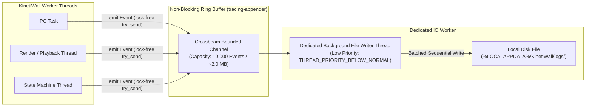

# LOGGING & OBSERVABILITY ARCHITECTURE
## Document ID: KW-OBS-001 | Phase 3: Observability, Diagnostics & Operational Reliability

---

### 1. Component Responsibilities & Logging Ownership

KinetiWall deploys a multi-process architecture to isolate media decoding and web rendering from the native Windows desktop controller. The observability architecture mirrors these process boundaries while guaranteeing high-signal correlation:

```
+---------------------------------------------------------------------------------------------------------+
|                                    KINETIWALL LOGGING OWNERSHIP MODEL                                   |
+--------------------------+-----------------------+-----------------------------+------------------------+
| COMPONENT PROCESS        | AUTHORITATIVE ROLE    | PRIMARY DESTINATION         | LOGGING TRANSPORT      |
+--------------------------+-----------------------+-----------------------------+------------------------+
| Core Controller          | Master System Log,    | logs/kinetiwall_core_{date} | Non-blocking Async File|
| (kinetiwall-core.exe)    | IPC State, Lifecycle  | .log                        | (tracing-appender)     |
+--------------------------+-----------------------+-----------------------------+------------------------+
| Gallery UI               | User Actions, Window  | logs/kinetiwall_ui_{date}   | Non-blocking Async File|
| (kinetiwall-ui.exe)      | Navigation, UI Errors | .log                        | (Tauri / tracing)      |
+--------------------------+-----------------------+-----------------------------+------------------------+
| Video Player             | Direct3D Render State,| logs/player_video_{instance}| Process-local File +   |
| (player-video.exe)       | mpv Decoder Metrics   | .log                        | Milestone IPC Events   |
+--------------------------+-----------------------+-----------------------------+------------------------+
| Web Player Host          | WebView2 Init, Virtual| logs/player_web_{instance}  | Process-local File +   |
| (player-web.exe)         | Host Navigation, WebGL| .log                        | Milestone IPC Events   |
+--------------------------+-----------------------+-----------------------------+------------------------+
```

#### 1.1 Ownership Architecture Evaluation & Justification
Three diagnostic ownership topologies were evaluated:
- **Candidate A: Centralized IPC Logging (Rejected)**: All child processes stream every debug line to the Core Controller over Named Pipes. *Rejected because a high-volume render log storm would saturate the control IPC channel, stall playback coordination, and lose post-mortem evidence if the pipe breaks during a crash.*
- **Candidate B: Uncoordinated Isolated Files (Rejected)**: Each process writes to separate unindexed files with zero correlation. *Rejected because reconstructing a failure across processes requires manual timestamp alignment.*
- **Candidate C: Coordinated Hybrid Ownership (Adopted)**:
  1. Each process writes non-blocking, structured events to its own designated log file using `tracing-appender`.
  2. Critical lifecycle events (e.g., `READY`, `PAUSED`, `ERROR`, `CRASHED`) are transmitted over control IPC contracts (`CTR-02`, `CTR-03`) to the Core Controller.
  3. All events share a synchronized `correlation_id` and unique `process_instance_id`, providing complete cross-process traceability with zero IPC bottleneck risk.

---

### 2. Structured Log Schema Specification (Schema V1)

Every log entry emitted by KinetiWall is formatted as a single-line JSON document (JSON Lines / `jsonl`), enabling automated ingestion, filtering, and programmatic analysis:

```json
{
  "schema_version": 1,
  "timestamp_utc": "2026-11-11T10:42:15.124Z",
  "monotonic_elapsed_ms": 14208,
  "severity": "INFO",
  "event_name": "PAUSE_POLICY_ACTIVATED",
  "component": "core",
  "process_id": 18452,
  "process_instance_id": "550e8400-e29b-41d4-a716-446655440000",
  "correlation_id": "8889c614-7253-4f13-8954-00004e51caff",
  "operation_id": "OP_PAUSE_MON_1",
  "message": "Wallpaper playback paused due to foreground fullscreen application",
  "error_code": null,
  "duration_ms": 12,
  "state_before": "playing",
  "state_after": "paused",
  "context": {
    "monitor_id": "\\\\.\\DISPLAY1",
    "trigger_reason": "fullscreen_window_detected",
    "foreground_class": "Valve001"
  }
}
```

#### 2.1 Schema Field Definitions & Constraints

| Field Name | Type | Mandatory? | Constraint / Validation Rule | Purpose |
| :--- | :--- | :--- | :--- | :--- |
| `schema_version` | Integer | Yes | Exactly `1` for V1 releases. | Supports forward schema migration. |
| `timestamp_utc` | String | Yes | ISO-8601 UTC with ms precision (`YYYY-MM-DDTHH:MM:SS.mmmZ`). | Human and calendar correlation. |
| `monotonic_elapsed_ms`| Integer | Yes | Unsigned 64-bit integer (`u64`) from process start. | Immune to system wall-clock adjustments. |
| `severity` | String | Yes | Enum: `TRACE`, `DEBUG`, `INFO`, `WARN`, `ERROR`, `FATAL`. | Filtering and alert thresholding. |
| `event_name` | String | Yes | Screaming snake case, max 48 characters (`APP_STARTUP_COMPLETED`). | Machine-parseable event identifier. |
| `component` | String | Yes | Enum: `core`, `ui`, `player-video`, `player-web`. | Originating subsystem identity. |
| `process_id` | Integer | Yes | Windows OS Process ID (`u32`). | Correlates with Task Manager / OS traces. |
| `process_instance_id`| String | Yes | RFC 4122 UUIDv4 generated on process start. | Distinguishes respawned instances on PID reuse. |
| `correlation_id` | String | Conditional | RFC 4122 UUIDv4 linking multi-process operations. | Traces an operation across Core and Player. |
| `operation_id` | String | No | Alphanumeric token, max 32 chars (`OP_SWITCH_WALLPAPER`). | Scopes a specific transaction. |
| `message` | String | Yes | Human-readable string, max 256 characters. | Concise operational description. |
| `error_code` | String | Conditional | Stable error code (`ERR_DECODER_INIT_FAILED`) or Win32 hex. | Programmatic error classification. |
| `duration_ms` | Integer | Conditional | Unsigned integer representing elapsed time in ms. | Performance budget verification. |
| `state_before` | String | Conditional | Operational state prior to transition (e.g. `playing`). | State machine debugging. |
| `state_after` | String | Conditional | Operational state resulting from transition (e.g. `paused`).| State machine debugging. |
| `context` | Object | Yes | Bounded key-value map. Max 10 keys; max value length 1024 chars.| Non-sensitive diagnostic payload. |

---

### 3. Severity Levels & Dynamic Filtering Rules

```
+---------------------------------------------------------------------------------------------------------+
|                                      SEVERITY LEVEL SPECIFICATION                                       |
+----------+-----------------------------------------------------+------------------+---------------------+
| SEVERITY | INTENDED OPERATIONAL USE                            | DEFAULT RELEASE  | USER NOTIFICATION   |
+----------+-----------------------------------------------------+------------------+---------------------+
| TRACE    | Fine-grained internal timing & loop diagnostics.    | Disabled         | No                  |
| DEBUG    | State machine evaluations, IPC frame parsing bytes. | Disabled         | No                  |
| INFO     | Normal lifecycle milestones, user settings changes. | **Enabled**      | No                  |
| WARN     | Degraded non-fatal condition (e.g. dropped frame).  | **Enabled**      | No (Telemetry only) |
| ERROR    | Operation failed (e.g. corrupt video file loaded).  | **Enabled**      | Non-modal Toast / UI|
| FATAL    | Unrecoverable crash (e.g. Core panic, unhandled OS).| **Enabled**      | Native Error Dialog |
+----------+-----------------------------------------------------+------------------+---------------------+
```

#### 3.1 Dynamic Filtering Behavior
- **Standard Release Builds**: Default logging filter is set to `INFO, kinetiwall_core=INFO, kinetiwall_player=WARN`. High-frequency decode ticks and IPC transport bytes are silenced.
- **Diagnostic Mode (Support Investigation)**: User can temporarily toggle "Verbose Logging" in Settings $\to$ Diagnostics. This lowers the filter to `DEBUG` for **15 minutes**, automatically reverting to `INFO` to prevent disk bloat.

---

### 4. Illustrative Diagnostic Event Scenarios

#### 4.1 Scenario A: Core Engine Startup Completed
```json
{
  "schema_version": 1,
  "timestamp_utc": "2026-11-11T10:42:01.050Z",
  "monotonic_elapsed_ms": 680,
  "severity": "INFO",
  "event_name": "APP_STARTUP_COMPLETED",
  "component": "core",
  "process_id": 14208,
  "process_instance_id": "11111111-2222-3333-4444-555555555555",
  "correlation_id": null,
  "operation_id": "BOOT_INIT",
  "message": "KinetiWall Core daemon initialized successfully",
  "error_code": null,
  "duration_ms": 680,
  "state_before": "initializing",
  "state_after": "idle",
  "context": {
    "engine_version": "1.0.0",
    "windows_build": "22631",
    "display_count": 2,
    "autostart_enabled": true
  }
}
```

#### 4.2 Scenario B: Video Player Hardware Decode Initialization Failure (Fallback)
```json
{
  "schema_version": 1,
  "timestamp_utc": "2026-11-11T10:42:05.340Z",
  "monotonic_elapsed_ms": 4970,
  "severity": "WARN",
  "event_name": "RENDERER_HW_ACCEL_FALLBACK",
  "component": "player-video",
  "process_id": 19856,
  "process_instance_id": "22222222-3333-4444-5555-666666666666",
  "correlation_id": "8889c614-7253-4f13-8954-00004e51caff",
  "operation_id": "INIT_PLAYER_MON1",
  "message": "D3D11VA hardware acceleration unavailable for codec; falling back to software decode",
  "error_code": "WARN_D3D11VA_UNSUPPORTED_PROFILE",
  "duration_ms": 45,
  "state_before": "initializing_hardware",
  "state_after": "fallback_software",
  "context": {
    "codec": "hevc_main10",
    "gpu_adapter": "Intel UHD Graphics 630",
    "resolution": "3840x2160"
  }
}
```

#### 4.3 Scenario C: Player Process Crash Detected & Supervisory Recovery
```json
{
  "schema_version": 1,
  "timestamp_utc": "2026-11-11T10:43:10.012Z",
  "monotonic_elapsed_ms": 69642,
  "severity": "ERROR",
  "event_name": "PLAYER_CRASH_DETECTED",
  "component": "core",
  "process_id": 14208,
  "process_instance_id": "11111111-2222-3333-4444-555555555555",
  "correlation_id": "99999999-aaaa-bbbb-cccc-dddddddddddd",
  "operation_id": "RECOVERY_CYCLE_1",
  "message": "Video player subprocess terminated unexpectedly with non-zero exit code",
  "error_code": "STATUS_ACCESS_VIOLATION_0xC0000005",
  "duration_ms": 8,
  "state_before": "playing",
  "state_after": "recovering",
  "context": {
    "crashed_pid": 19856,
    "crashed_player_instance": "22222222-3333-4444-5555-666666666666",
    "restart_attempt": 1,
    "backoff_delay_ms": 1000
  }
}
```

---

### 5. Asynchronous Logging Architecture & Performance Safety

Logging operations must never contend with the real-time presentation thread or block asynchronous Named Pipe IPC handlers:



#### 5.1 Enforced Asynchronous Guarantees
1. **Lock-Free Emission**: Worker threads invoke non-blocking `try_send`. If the queue is saturated during an extreme error storm, lowest-severity events (`TRACE`/`DEBUG`) are dropped, and a single `DIAG_LOG_QUEUE_OVERFLOW` warning flag is set. The rendering thread **never blocks waiting for disk I/O**.
2. **Dedicated Background Writer**: Disk file writes occur on an independent thread running at `THREAD_PRIORITY_BELOW_NORMAL`.
3. **Shutdown Flushing Timeout**: During graceful application exit, the writer thread is granted a hard maximum of **250 ms** to flush pending queued events to disk via `sync_all()`. If 250 ms elapses, the process terminates immediately to ensure snappy desktop exit.

