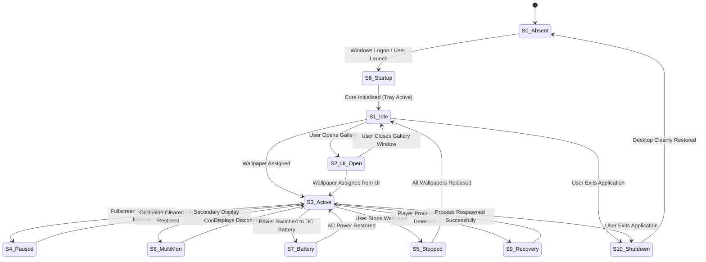

# PERFORMANCE ENGINEERING SPECIFICATION
## Document ID: KW-PRF-001 | Phase 2: System Architecture & Engineering Standards

---

### 1. Scope, Methodology & Operating Assumptions

This specification defines the formal performance parameters, operational state models, metrics dictionary, reference workloads, component resource budgets, and verification criteria for KinetiWall.

#### 1.1 Fundamental Measurement Assumptions
1. **Isolated Testing Rig**: Benchmarks must be performed on dedicated Windows 10/11 reference machines free from extraneous background activity (cloud sync clients, active anti-virus scans, Windows Update installations).
2. **Standard Non-Elevated Execution**: All processes execute under a standard Windows user token without administrative elevation.
3. **Hardware Acceleration Baseline**: Default benchmarks assume a Direct3D11-capable GPU supporting hardware video acceleration (NVDEC, D3D11VA, Intel QSV, or AMD AMF). Software fallback rendering is benchmarked separately as an edge case.
4. **Distinction between Metric Tiers**:
   - **APPROVED REQUIREMENT**: Hard commitment derived from Phase 1 requirements (`KW-NF-xxx`). Failure to meet these criteria constitutes a release-blocking defect.
   - **PROPOSED CANDIDATE TARGET**: Engineering goal established during architectural modeling. Subject to empirical adjustment following prototype benchmarks.
   - **UNMEASURED ESTIMATE**: Theoretical baseline awaiting implementation measurement.

---

### 2. Formal Operating States Model (S0 through S10)

KinetiWall transitions through eleven discrete operating states. System resource expectations, active processes, and acceptable overhead vary strictly by state:



#### Detailed State Behavioral Catalog

| State ID | State Name | Entry Conditions | Exit Conditions | Processes Present | Expected CPU Overhead | Expected Private Bytes | GPU Activity |
| :--- | :--- | :--- | :--- | :--- | :--- | :--- | :--- |
| **S0** | **Application Absent** | System clean boot or KinetiWall uninstalled. | Core executable launched. | None (Windows baseline). | $0.00\%$ (Clean baseline) | $0.0\text{ MB}$ | None. |
| **S1** | **Controller Idle** | Core launched, system tray icon loaded, zero active monitors assigned. | Wallpaper assigned or UI opened. | `kinetiwall-core.exe` | $\le 0.10\%$ total CPU | $\le 15.0\text{ MB}$ RAM | Zero (No D3D swapchains). |
| **S2** | **UI Open** | User clicks tray icon $\to$ `kinetiwall-ui.exe` spawns. | User closes UI window $\to$ `kinetiwall-ui.exe` terminates. | `kinetiwall-core.exe`, `kinetiwall-ui.exe` | $\le 1.50\%$ during browsing | $\le 75.0\text{ MB}$ (Combined Core + UI) | Moderate (DWM UI composition). |
| **S3** | **Wallpaper Active** | Wallpaper assigned to display and rendering. | Fullscreen occlusion, pause trigger, or stop. | `kinetiwall-core.exe`, `kinetiwall-player-video.exe` (or `web.exe`) | $\le 2.0\%$ total CPU (1080p60) | $\le 65.0\text{ MB}$ (Combined Core + Video Player) | Active D3D11 Presentation & Hardware Video Decode. |
| **S4** | **Wallpaper Paused** | Fullscreen window detected, maximized window occluding desktop, or manual pause. | Foreground window unmaximized, closed, or user unpauses. | `kinetiwall-core.exe`, `kinetiwall-player-video.exe` (suspended) | **$\le 0.10\%$ total CPU** (Drops to near-zero) | Static ($\le 65.0\text{ MB}$; textures retained for instant resume) | **Zero** ($0.00\%$ Decode, $0.00\%$ Presentation). |
| **S5** | **Wallpaper Stopped** | User explicitly stops wallpaper playback. | New wallpaper assigned or app exited. | `kinetiwall-core.exe` (Player terminated). | $\le 0.10\%$ total CPU | $\le 15.0\text{ MB}$ (Player RAM purged 100%) | Zero. |
| **S6** | **Multi-Monitor Active**| Two or more displays active with live wallpapers. | Displays detached or reassigned to single. | `kinetiwall-core.exe`, 2+ Player subprocesses. | $\le 3.5\%$ total CPU (Dual 1080p60) | $\le 115.0\text{ MB}$ (Core + 2 Video Players) | Multiple D3D11 swapchains active. |
| **S7** | **Battery-Aware Mode** | System disconnects from AC mains, operating on DC battery. | AC power reconnected. | Depends on user policy: Paused (S4) or Throttled 30fps. | $\le 1.0\%$ total CPU (if throttled) | $\le 65.0\text{ MB}$ | Throttled or zero presentation. |
| **S8** | **Startup Transition** | Windows logon event triggers autostart. | Core reaches steady S1 or S3 state. | Spawning processes. | Transient spike $\le 15\%$ for $< 500\text{ ms}$ | Peak $\le 30.0\text{ MB}$ during init | Transient init. |
| **S9** | **Recovery Transition**| Player subprocess crashes unexpectedly. | Supervisor restarts player with backoff. | Core supervises respawn. | Transient spike $\le 5\%$ | Re-allocated safely | Swapchain re-created. |
| **S10**| **Shutdown Transition**| User clicks "Exit KinetiWall" or Windows shuts down. | All processes terminated, handles closed. | Teardown sequence. | Transient teardown | Rapid release to $0.0\text{ MB}$ | Swapchains destroyed, desktop reparented. |

---

### 3. Formal Performance Metrics Dictionary

To prevent ambiguous reporting, all performance measurements must adhere strictly to these defined metrics:

#### 3.1 CPU and Scheduling Metrics

##### `CPU-CORE-IDLE` (Core Controller Idle CPU)
- **Definition**: Average CPU utilization consumed strictly by `kinetiwall-core.exe` when no wallpapers are playing or when playback is paused.
- **Unit**: Percentage of total logical processor capacity (`% Processor Time / Environment::ProcessorCount`).
- **Collection Method**: Windows Performance Monitor (PerfMon) counter `\Process(kinetiwall-core)\% Processor Time` sampled at 1,000ms intervals over a 300-second window.
- **Interpretation**: Must remain $\le 0.10\%$. Any value consistently $> 0.25\%$ indicates unapproved thread spinning or high-frequency polling.

##### `CPU-ACTIVE-VIDEO` (Active Video Playback Total CPU)
- **Definition**: Aggregate CPU utilization consumed across `kinetiwall-core.exe` and `kinetiwall-player-video.exe` during continuous playback of reference 1080p60 MP4 content.
- **Unit**: Percentage of total logical processor capacity (%).
- **Collection Method**: Sum of `\Process(*)\% Processor Time` across KinetiWall process IDs via PerfMon / ETW over a 600-second run.
- **Interpretation**: Must remain $\le 2.0\%$ on reference hardware. Higher values indicate hardware decoding failure (fallback to software CPU decoding).

##### `CPU-WAKEUP-RATE` (Thread Context Switch & Wake-up Rate)
- **Definition**: Rate at which the Core Controller wakes up from sleep to evaluate timers or poll state.
- **Unit**: Wake-ups per second (Hz).
- **Collection Method**: Event Tracing for Windows (ETW) thread dispatch events (`Microsoft-Windows-Kernel-Process`).
- **Interpretation**: Must remain $\le 4\text{ Hz}$ when idle or paused. Higher rates prevent CPU package C-states (C8/C10), degrading laptop battery life.

#### 3.2 Memory and Operating System Resource Metrics

##### `MEM-CORE-PRIVATE` (Core Controller Private Bytes)
- **Definition**: Memory allocated strictly by `kinetiwall-core.exe` that cannot be shared with other processes.
- **Unit**: Megabytes (MB) ($1\text{ MB} = 1,048,576\text{ bytes}$).
- **Collection Method**: PerfMon counter `\Process(kinetiwall-core)\Private Bytes`.
- **Distinction**: Private Bytes represents true non-reclaimable memory footprint, unlike Working Set which fluctuates based on Windows OS memory manager pressure.

##### `MEM-UI-RESIDENT` (Gallery UI Closed Memory Footprint)
- **Definition**: Private bytes consumed by `kinetiwall-ui.exe` 5 seconds after the user closes the Gallery window.
- **Unit**: Megabytes (MB).
- **Target**: **Exactly $0.0\text{ MB}$**.
- **Collection Method**: Process table lookup (`GetProcessIdByName("kinetiwall-ui.exe")`). Process handle must be closed and terminated.

##### `MEM-LEAK-SOAK` (24-Hour Memory Growth)
- **Definition**: Net delta in private bytes across the process tree between hour 1 and hour 24 of continuous video playback.
- **Formula**: $\Delta M = \text{PrivateBytes}_{t=24\text{h}} - \text{PrivateBytes}_{t=1\text{h}}$.
- **Target**: $\Delta M \le 2.0\text{ MB}$ (accounting for normal allocator heap fragmentation). Any continuous upward trend indicates a native memory leak.

##### `RES-HANDLE-COUNT` (Operating System Handle Count)
- **Definition**: Total Win32 OS handles (events, mutexes, threads, files, pipes, window handles) held open by `kinetiwall-core.exe`.
- **Target**: $\le 150$ handles in steady state. Handle growth over 100 pause/resume cycles must be zero ($0$).

#### 3.3 GPU and Presentation Metrics

##### `GPU-PRESENT-DROPRATE` (Dropped Frame Rate)
- **Definition**: Percentage of presented frames that missed their VSync presentation deadline during sustained playback.
- **Formula**: $\text{DropRate} = \left(\frac{\text{DroppedFrames}}{\text{TotalFramesPresented}}\right) \times 100\%$.
- **Collection Method**: PresentMon / Direct3D11 swapchain query `pSwapChain->GetFrameStatistics()`.
- **Target**: $\le 0.10\%$ on reference hardware (no more than 3 dropped frames over 3,600 frames).

##### `GPU-DECODE-UTIL` (Hardware Video Decoder Utilization)
- **Definition**: Utilization percentage of the GPU's dedicated hardware video decoding silicone (NVDEC / D3D11 Video Processor).
- **Collection Method**: PerfMon `\GPU Engine(*engtype_VideoDecode*)\Utilization Percentage`.
- **Interpretation**: Confirms video is decoded on dedicated ASIC, keeping general 3D shading cores free for user tasks.

#### 3.4 Latency and Responsiveness Metrics

##### `LAT-PAUSE-REACTION` (Fullscreen Occlusion Pause Latency)
- **Definition**: Elapsed time from the exact millisecond a qualifying foreground window (e.g. fullscreen game) is presented until `kinetiwall-player-video.exe` halts Direct3D frame presentation.
- **Start Event**: Win32 `EVENT_SYSTEM_FOREGROUND` or `WM_ACTIVATEAPP` received by Core hook.
- **End Event**: Player subprocess emits `EVT_PLAYBACK_STATE_CHANGED(Paused)` over IPC.
- **Target**: $\le 100\text{ ms}$ (P95).

##### `LAT-RESUME-PRESENT` (Occlusion Clear to First Presented Frame)
- **Definition**: Elapsed time from foreground window minimization/closure until the first active wallpaper video frame is presented to the desktop swapchain.
- **Start Event**: WinEvent hook detects foreground window cleared.
- **End Event**: D3D11 `Present()` completion timestamp.
- **Target**: $\le 150\text{ ms}$ (P95).

##### `LAT-COLD-BOOT` (Cold Engine Launch Latency)
- **Definition**: Elapsed time from `kinetiwall-core.exe` process invocation until system tray icon is responsive and IPC listener is active.
- **Target**: $\le 800\text{ ms}$ on SSD reference hardware.

---

### 4. Comprehensive Performance Targets Table

```
+--------------------------------------------------------------------------------------------------------------------------+
|                                        KINETIWALL PERFORMANCE TARGETS REGISTER                                           |
+--------------+----------+--------------------+-----------------------+---------------------+-------------------+---------+
| METRIC ID    | STATE    | THRESHOLD / TARGET | MEASUREMENT METHOD    | DURATION / SAMPLE   | HARDWARE COND.    | STATUS  |
+--------------+----------+--------------------+-----------------------+---------------------+-------------------+---------+
| KW-MET-001   | S1, S4   | <= 15.0 MB Private | PerfMon Private Bytes | 300s, 1s interval   | Min Spec (4GB)    | APPROVED|
| KW-MET-002   | S1, S4   | <= 0.10% Total CPU | WPR / PerfMon CPU     | 3,600s window       | Core i5 / Ryzen 5 | APPROVED|
| KW-MET-003   | S1, S3   | Exactly 0.0 MB     | Process Table PID     | 5s post-close       | All hardware      | APPROVED|
| KW-MET-004   | S8       | <= 800 ms Launch   | High-res QPC Timer    | 10 cold runs        | SSD (SATA/NVMe)   | APPROVED|
| KW-MET-005   | S3       | <= 2.0% Total CPU  | PerfMon Video Player  | 600s continuous run | 1080p60 AVC/MP4   | APPROVED|
| KW-MET-006   | S6       | <= 35 MB / Monitor | PerfMon Private Bytes | Dual 1080p60        | Recommended Spec  | APPROVED|
| KW-MET-007   | S3       | HW Decode Active   | D3D11VA Engine Query  | Sustained playback  | Intel/NVIDIA/AMD  | APPROVED|
| KW-MET-008   | S7       | <= 1.0W Delta      | Software Battery / AC | 1,800s battery test | Laptop Balanced   | APPROVED|
| KW-MET-009   | S4       | <= 0.50% FPS Delta | PresentMon Game Run   | 10 min 3D Game run  | High-Spec Gaming  | APPROVED|
| KW-MET-010   | S4       | <= 100 ms Reaction | IPC Latency Timestamp | 50 pause events     | All hardware      | APPROVED|
| KW-MET-011   | S3       | <= 150 ms Resume   | IPC + D3D11 Present   | 50 resume events    | All hardware      | APPROVED|
| KW-MET-012   | S3       | <= 0.10% Drops     | D3D11 Frame Stats     | 10-minute reference | 60Hz / 144Hz VSync| APPROVED|
| KW-MET-013   | S9       | <= 1,000 ms Recov  | Supervisor Watchdog   | Injected player kill| All hardware      | APPROVED|
| KW-MET-014   | S3       | <= 2.0 MB Delta    | 24-Hour Soak Run      | 24 hours continuous | Recommended Spec  | APPROVED|
| KW-MET-015   | S2       | <= 2,000 ms Warm   | High-res Timer to UI  | 10 warm opens       | Recommended Spec  | APPROVED|
| KW-MET-016   | S1, S4   | <= 4.0 Hz Wakeups  | ETW Context Switches  | 300s idle window    | Laptop Balanced   | PROPOSED|
| KW-MET-017   | S1       | <= 150 Handles     | GetProcessHandleCount | 100 pause cycles    | All hardware      | PROPOSED|
| KW-MET-018   | S3       | <= 4.5% Total CPU  | 4K30 Video Playback   | 600s continuous run | 4K Display / GPU   | PROPOSED|
| KW-MET-019   | S3       | <= 4.0% Total CPU  | Web Canvas / WebGL    | 600s continuous run | WebView2 Sandboxed| PROPOSED|
| KW-MET-020   | S3       | <= 1.5% Core CPU   | WASAPI FFT Spectrum   | 60 Hz Stream        | Active Audio      | PROPOSED|
+--------------+----------+--------------------+-----------------------+---------------------+-------------------+---------+
```

---

### 5. Component Resource Budgets

To prevent blame-shifting across modules, KinetiWall partitions memory and CPU allocations into strict per-component budgets:

```
+-------------------------------------------------------------------------------------------------------------------------+
|                                              COMPONENT RESOURCE BUDGET ALLOCATION                                       |
+--------------------------+-----------------------+-----------------------+-----------------------+----------------------+
| COMPONENT SUBSYSTEM      | MAX IDLE PRIVATE RAM  | MAX ACTIVE PRIVATE RAM| MAX IDLE / PAUSE CPU  | MAX ACTIVE CPU (60Hz)|
+--------------------------+-----------------------+-----------------------+-----------------------+----------------------+
| Core Controller Daemon   | 15.0 MB               | 20.0 MB               | 0.10%                 | 0.25%                |
| Gallery UI (Tauri Host)  | 0.0 MB (Terminated)   | 55.0 MB (Open)        | 0.00%                 | 1.50% (Browsing)     |
| Video Player (per Mon)   | 0.0 MB (if stopped)   | 45.0 MB               | 0.00% (Paused)        | 1.75% (1080p60)      |
| Web Player (per Mon)     | 0.0 MB (if stopped)   | 75.0 MB               | 0.00% (Paused)        | 3.50% (WebGL)        |
| WASAPI Audio FFT Pipeline| 0.0 MB (Inactive)     | 4.0 MB                | 0.00%                 | 1.50% (60Hz FFT)     |
| Diagnostic Logging Queue | 2.0 MB                | 5.0 MB                | 0.00%                 | 0.10%                |
| TOTAL BUDGET (Single Mon)| **15.0 MB**           | **65.0 MB (Video)**   | **0.10%**             | **2.00% (Video)**    |
+--------------------------+-----------------------+-----------------------+-----------------------+----------------------+
```

---

### 6. Reference Workloads Inventory

To ensure benchmarks are deterministic and reproducible across independent test labs, standard reference workloads are defined:

#### 6.1 Video Reference Workloads
- **`REF-VID-01` (Standard HD Reference)**:
  - Format: MP4 (H.264 / AVC High Profile Level 4.2), AAC Stereo Audio (muted by default).
  - Resolution: $1920 \times 1080$ pixels.
  - Frame Rate: 60.000 fps (CFR - Constant Frame Rate).
  - Bitrate: 12.0 Mbps, 60-second seamless loop.
  - Complexity: High-motion natural scenery (rain, flowing river).
- **`REF-VID-02` (Ultra HD 4K Reference)**:
  - Format: MP4 (HEVC / H.265 Main 10 Profile), 3840x2160, 30.0 fps, 25.0 Mbps, 60-second loop.
- **`REF-VID-03` (Next-Gen Open Codec Reference)**:
  - Format: WebM (VP9 / AV1), 1920x1080, 60.0 fps, 10.0 Mbps.

#### 6.2 Web Reference Workloads
- **`REF-WEB-01` (2D Canvas Clock & Particle Visualizer)**:
  - Local origin: `https://kinetiwall.local/` (WebView2).
  - Script: 1,000 continuous animated canvas particles with real-time digital clock rendering at 60 fps.
- **`REF-WEB-02` (WebGL 3D Shader Workload)**:
  - Three.js / WebGL 2.0 procedural raymarched terrain, continuous fragment shader execution.

#### 6.3 Multi-Monitor Workload Configurations
- **`TOP-01` (Single Desktop)**: Primary display $1920 \times 1080$ @ 60Hz.
- **`TOP-02` (Dual Identical)**: Display 1 ($1920 \times 1080$ @ 60Hz) + Display 2 ($1920 \times 1080$ @ 60Hz).
- **`TOP-03` (Mixed Resolution & Refresh Rate)**: Display 1 ($2560 \times 1440$ @ 144Hz) + Display 2 ($1920 \times 1080$ @ 60Hz).

---

### 7. Pass, Fail, and Inconclusive Criteria

Each executed performance benchmark produces exactly one definitive outcome:

#### 7.1 PASS
- All applicable approved requirements (`KW-NF-001` through `KW-NF-015`) and approved metrics (`KW-MET-001`..`030`) are satisfied across all measured test repetitions.
- No memory leaks, handle leaks, or unhandled errors observed.
- Clean Windows baseline verified prior to test run.

#### 7.2 FAIL
- Violation of any approved performance threshold (e.g. Core private bytes $> 15.0\text{ MB}$, idle CPU $> 0.10\%$, dropped frames $> 0.10\%$).
- Any unhandled process crash, hung thread, or unrecovered deadlock.
- Failure of desktop icon restoration or desktop freezing upon teardown.
- **Severity Classification**:
  - **Critical Failure**: Desktop shell freeze, DWM crash, memory leak $> 50\text{ MB/hour}$, failure to pause during fullscreen game. (Blocks release unconditionally).
  - **High Failure**: Idle CPU $> 0.50\%$, cold boot $> 1,200\text{ ms}$, frame drop rate $> 1.0\%$.
  - **Medium Failure**: Resume latency $150\text{ ms} < t \le 300\text{ ms}$, UI warm boot $> 2,500\text{ ms}$.

#### 7.3 INCONCLUSIVE
- Test environment contaminated by background OS activity (Windows Defender scan, Windows Update).
- Tool failure (PerfMon counter dropped, ETW buffer overflow).
- Sample size insufficient ($n < 5$ runs) or coefficient of variation $> 25\%$ without assignable cause.

