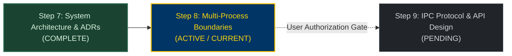

# KinetiWall — Multi-Process Boundaries & Component Responsibilities Suite
**Document ID:** `KW-PRC-000`  
**Phase:** 2 — System Architecture & Technical Decisions  
**Step:** 8 of 90 — Multi-Process Boundaries & Component Responsibilities  
**Status:** COMPLETE (Authoritative Process Architecture Baseline)  
**Classification:** Process Architecture, Resource Ownership & Component Governance  
**Date:** 2026-11-10  
**Authority:** Principal Software Architect & IPC Systems Lead  

---

## 1. Executive Summary & Core Architectural Mandate

This documentation suite establishes the authoritative, binding **Process Architecture & Component Responsibility Specification** for **KinetiWall**.

The core engineering objective of this step is to define the exact boundaries between **operating-system processes** and **in-process modules**. Process isolation is not a design goal in itself; every process boundary introduces memory overhead, IPC serialization latency, context-switching costs, and handle synchronization complexity. Therefore, KinetiWall adheres to a strict principle:

> **The Boundary Invariant:** A separate operating-system process is introduced **only** when mandated by fault containment (crash isolation), security sandboxing (untrusted code execution), or independent resource lifecycles (ephemeral UI termination). All other capabilities remain cohesive, single-responsibility modules inside the core daemon.

```
┌─────────────────────────────────────────────────────────────────────────────┐
│                 KINETIWALL PROCESS TOPOLOGY TAXONOMY                        │
├─────────────────────┬─────────────────────┬─────────────────────────────────┤
│ 1. CORE DAEMON      │ 2. EPHEMERAL UI     │ 3. ISOLATED PLAYERS             │
├─────────────────────┼─────────────────────┼─────────────────────────────────┤
│ • kinetiwall-core   │ • kinetiwall-ui     │ • kinetiwall-player-video       │
│ • Pure Rust (8-12MB)│ • Tauri v2 Frontend │ • kinetiwall-player-web         │
│ • Session Background│ • On-Demand Launch  │ • Windows Job Object Sandbox    │
│ • Single Source of  │ • 0 MB RAM Closed   │ • Direct3D 11VA / WebView2      │
│   Authoritative State│ • Pure IPC Client   │ • Bounded Crash Auto-Restart    │
└─────────────────────┴─────────────────────┴─────────────────────────────────┘
```

---

## 2. Source Precedence & Architectural Traceability

This specification directly refines and operationalizes the architectural foundations established in earlier steps:
1. **Requirements Baseline:** [Step 1 Requirements Inventory](file:///e:/Projects/All%20working%20projects/App%20projects%20working/KinetiWall%20Engine%20(working)/docs/requirements/README.md) (`KW-F-001`..`046`, `KW-NF-001`..`027`, `KW-NG-001`..`006`).
2. **Platform Support Policy:** [Step 4 Platform Matrix](file:///e:/Projects/All%20working%20projects/App%20projects%20working/KinetiWall%20Engine%20(working)/docs/platform_support/README.md) (`DEC-PLT-001`..`012`).
3. **Release Scope Proposal:** [Step 5 Release Scope](file:///e:/Projects/All%20working%20projects/App%20projects%20working/KinetiWall%20Engine%20(working)/docs/release_scope/README.md) (`KW-SCP-001`..`007`).
4. **Quality & Risk Governance:** [Step 6 Quality Plan](file:///e:/Projects/All%20working%20projects/App%20projects%20working/KinetiWall%20Engine%20(working)/docs/quality_and_risk/README.md) (`KW-AC-001`..`023`, `KW-R-001`..`020`, `VG-001`..`010`).
5. **System Architecture & ADRs:** [Step 7 System Architecture](file:///e:/Projects/All%20working%20projects/App%20projects%20working/KinetiWall%20Engine%20(working)/docs/architecture/README.md) (`ADR-0001`..`0014`, `KW-ARC-001`..`008`).

---

## 3. Documentation Suite Index

| Document ID | Deliverable | File Path | Scope & Focus |
|:---|:---|:---|:---|
| **`KW-PRC-001`** | **Deliverable A** | [PROCESS_TOPOLOGY_SPECIFICATION.md](file:///e:/Projects/All%20working%20projects/App%20projects%20working/KinetiWall%20Engine%20(working)/docs/process_architecture/PROCESS_TOPOLOGY_SPECIFICATION.md) | Multi-Process Layout, boundary justifications, Tauri process model analysis, media engine trade-offs. |
| **`KW-PRC-002`** | **Deliverable B** | [PROCESS_RESPONSIBILITY_MATRIX.md](file:///e:/Projects/All%20working%20projects/App%20projects%20working/KinetiWall%20Engine%20(working)/docs/process_architecture/PROCESS_RESPONSIBILITY_MATRIX.md) | 21-attribute matrix for all 4 core processes (`PROC-01`..`04`) and candidate post-V1 process (`PROC-05`). |
| **`KW-PRC-003`** | **Deliverable C** | [IN_PROCESS_MODULE_MATRIX.md](file:///e:/Projects/All%20working%20projects/App%20projects%20working/KinetiWall%20Engine%20(working)/docs/process_architecture/IN_PROCESS_MODULE_MATRIX.md) | In-process module matrix for the 12 core controller subsystems with justification for keeping them in-process. |
| **`KW-PRC-004`** | **Deliverable D** | [STATE_AND_RESOURCE_OWNERSHIP_MATRIX.md](file:///e:/Projects/All%20working%20projects/App%20projects%20working/KinetiWall%20Engine%20(working)/docs/process_architecture/STATE_AND_RESOURCE_OWNERSHIP_MATRIX.md) | Authoritative state ownership (desired vs observed), ownership invariants, and 12-resource lifetime matrix. |
| **`KW-PRC-005`** | **Deliverable E** | [IPC_BOUNDARY_AND_TRUST_MATRIX.md](file:///e:/Projects/All%20working%20projects/App%20projects%20working/KinetiWall%20Engine%20(working)/docs/process_architecture/IPC_BOUNDARY_AND_TRUST_MATRIX.md) | Authorized communication paths, trust levels, allowed message categories, authorization gates, and rate limits. |
| **`KW-PRC-006`** | **Deliverable F** | [LIFECYCLE_AND_FAILURE_RESPONSIBILITIES.md](file:///e:/Projects/All%20working%20projects/App%20projects%20working/KinetiWall%20Engine%20(working)/docs/process_architecture/LIFECYCLE_AND_FAILURE_RESPONSIBILITIES.md) | End-to-end responsibilities for startup, gallery launch/close, player crash, controller crash, Explorer restart, and TDR. |
| **`KW-PRC-007/8`**| **Deliverables G & H** | [INTERFACE_CONTRACTS_AND_COUPLING.md](file:///e:/Projects/All%20working%20projects/App%20projects%20working/KinetiWall%20Engine%20(working)/docs/process_architecture/INTERFACE_CONTRACTS_AND_COUPLING.md) | 12 cross-component contracts (`CTR-01`..`12`), 13 coupling anti-patterns prevention register, and ADR status updates. |

---

## 4. Phase 2 Roadmap Progress & Step Transition Protocol



### Transition Protocol to Step 9
1. **Architecture Documentation Only:** Zero executable code, scaffolding, or build dependencies have been created or modified in Step 8.
2. **Preservation of Normative Baseline:** All existing requirements (`KW-F-001`..`046`, `KW-NF-001`..`027`, `KW-NG-001`..`006`) retain their exact definitions and authority.
3. **Stop Boundary:** Upon generating and validating this documentation suite, the agent will present the completion report and **STOP**, awaiting explicit user instruction before initiating Step 9 (`Step 9 of 90: Inter-Process Communication (IPC) Protocol & Serialization`).

