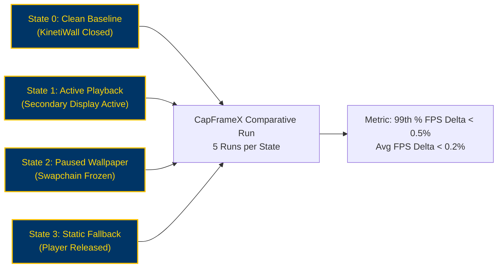

# KinetiWall — Performance Benchmark Plan & Testing Protocol
**Document ID:** `KW-QAR-003`  
**Deliverable:** Deliverable C — Performance Benchmark Plan  
**Phase:** 1 — Project Research, Requirements & Feasibility  
**Step:** 6 of 90 — Acceptance Criteria, Success Metrics & Risk Register  
**Status:** COMPLETE (Methodology & Protocol Baseline)  
**Authority:** Performance Systems Engineering & Benchmarking Lead  
**Date:** 2026-11-10  

---

## 1. Purpose & Empirical Benchmarking Standard

Performance is KinetiWall's primary competitive differentiator. To ensure claims are scientifically defensible, this document defines **reproducible benchmarking protocols** reflecting real-world desktop workloads.

**Governance Invariant:** No performance claim will be published or approved without auditable telemetry logs generated according to the exact hardware controls, test durations, and measurement tools specified herein.

**Current Implementation State:** All benchmarks are classified as **`NOT RUN (PLANNED)`** pending Phase 3–6 implementation.

---

## 2. Reference Hardware & Environmental Baselines

To eliminate hardware-induced variance, benchmarks must be executed and recorded across three standardized reference test configurations:

```
┌─────────────────────────────────────────────────────────────────────────────┐
│                    REFERENCE HARDWARE BENCHMARK TIERS                       │
├─────────────────────┬─────────────────────┬─────────────────────────────────┤
│ TIER 1: HIGH-END PC │ TIER 2: MID-RANGE PC│ TIER 3: MOBILE LAPTOP (BATTERY) │
├─────────────────────┼─────────────────────┼─────────────────────────────────┤
│ • AMD Ryzen 7 7800X3D│ • Intel Core i5-12400│ • AMD Ryzen 5 7530U / Intel i5  │
│ • NVIDIA RTX 4080   │ • NVIDIA RTX 3060   │ • Integrated Radeon / Iris Xe   │
│ • 32 GB DDR5-6000   │ • 16 GB DDR4-3200   │ • 16 GB LPDDR4x-4266            │
│ • Dual 4K 144Hz HDR │ • 1440p 144Hz + 1080p│ • Single 1080p 60Hz Internal    │
│ • Windows 11 24H2   │ • Windows 11 23H2   │ • Windows 11 24H2 (Battery & AC)│
└─────────────────────┴─────────────────────┴─────────────────────────────────┘
```

### Controlled Operating Conditions
1. **Background Cleanliness:** Fresh system reboot; zero third-party startup applications (Discord, Steam, Chrome, Spotify closed); Windows Update paused.
2. **Thermal Normalization:** 10-minute system idle warm-up period before benchmarking to stabilize GPU/CPU fan curves and clock frequencies.
3. **Power Profile:** Windows "High Performance" power plan on AC power; "Balanced" with Battery Saver rules during mobile battery testing.
4. **Repetitions & Aggregation:** Every scenario must execute 5 independent runs; results aggregated using trimmed mean (discarding high/low outliers).

---

## 3. Protocol 1: Controller Overhead & Ephemeral Lifecycle (`BENCH-01`)

### 3.1 Objective
Measure the sustained private memory working set, thread count, and CPU utilization of `kinetiwall-core.exe` during idle background execution, rapid window switching, and UI teardown.

### 3.2 Target Thresholds
- **Daemon Idle RAM:** ≤15.0 MB approved ceiling (`KW-NF-001`), **8–12 MB** target.
- **Daemon Idle CPU:** ≤0.10% approved ceiling (`KW-NF-002`), **0.00%** target.
- **UI Teardown RAM:** **0.0 MB** resident upon Gallery window close (`KW-NG-001`).

### 3.3 Test Execution Procedure
1. Launch `kinetiwall-core.exe` with default static/video wallpaper.
2. Open Gallery UI (`kinetiwall-ui.exe`), browse 50 wallpapers, then close window (`WM_CLOSE`).
3. Attach Windows Performance Recorder (WPR) with `GeneralProfile` and `VirtualAllocation` providers.
4. Record performance trace for 3,600 seconds (1 hour) while a synthetic PowerShell script opens and maximizes 20 standard desktop windows every 30 seconds.
5. Stop WPR and analyze ETL trace using Windows Performance Analyzer (WPA).

### 3.4 Telemetry Artifacts & Evidence
- WPA trace file (`controller_idle_1hr.etl`).
- PerfMon CSV export tracking `\Process(kinetiwall-core)\Private Bytes` and `% Processor Time`.

---

## 4. Protocol 2: Active Video Playback Subsystem (`BENCH-02`)

### 4.1 Objective
Quantify hardware-decoded video playback efficiency, GPU 3D/Video engine utilization, VRAM consumption, and loop-boundary frame deltas.

### 4.2 Standard Test Media Workloads

| Workload Code | Resolution | Frame Rate | Video Codec | Container | Bitrate | Color Depth |
|:---|:---:|:---:|:---:|:---:|:---:|:---:|
| **`MED-1080P-H264`** | 1920x1080 | 60 FPS | H.264 (AVC) | MP4 | 12 Mbps | 8-bit SDR |
| **`MED-1440P-VP9`**  | 2560x1440 | 60 FPS | VP9 | WebM | 20 Mbps | 8-bit SDR |
| **`MED-4K-HEVC`**    | 3840x2160 | 60 FPS | H.265 (HEVC) | MKV | 45 Mbps | 10-bit HDR |
| **`MED-4K-AV1`**     | 3840x2160 | 60 FPS | AV1 | MP4 | 35 Mbps | 10-bit HDR |

### 4.3 Target Thresholds
- **1080p Playback CPU:** ≤1.00% average CPU utilization (`KW-NF-003`).
- **4K Playback CPU:** ≤2.50% average CPU utilization (`KW-NF-003`).
- **Loop Boundary Delta:** ≤16.6 ms presentation delta at loop point (`KW-F-011`).
- **VRAM Budget:** ≤120 MB for 1080p; ≤250 MB for 4K (`KW-NF-006`).

### 4.4 Test Execution Procedure
1. Configure player with `hwdec=d3d11va` and `vo=gpu-next`.
2. Load target workload (`MED-4K-HEVC`) in infinite loop (`loop-file=inf`).
3. Run PresentMon for 300 seconds capturing frame-times, dropped frames, and presentation latency.
4. Query GPU-Z hardware engine logs for dedicated Video Decode utilization.

---

## 5. Protocol 3: Gaming Performance Impact & Contention (`BENCH-03`)

### 5.1 Objective
Scientifically prove that KinetiWall imposes **zero measurable performance penalty or frame stutter** on active 3D games when paused.

### 5.2 Comparative Workload Matrix
Every benchmark compares four distinct system states on the exact same gaming hardware:
1. **State 0 (Clean Baseline):** KinetiWall completely shut down (0 processes).
2. **State 1 (Active Wallpaper):** KinetiWall actively rendering 4K video on secondary display while game runs on primary.
3. **State 2 (Paused Wallpaper):** KinetiWall paused via fullscreen detection (0.00% CPU/GPU).
4. **State 3 (Resource-Released):** KinetiWall in static-fallback mode with players unloaded.



### 5.3 Benchmark Game Titles & Graphics Settings
- **Game A (CPU & Latency Bound):** *Counter-Strike 2* (1440p, Competitive Low Settings, CapFrameX 180s capture on Dust II benchmark demo).
- **Game B (GPU Bound):** *Cyberpunk 2077* (1440p / 4K, Ray Tracing Ultra, built-in benchmark run).

### 5.4 Evaluated Metrics & Passing Standard
- **Average FPS:** Delta between State 0 and State 2 must be <0.20%.
- **99th Percentile (1% Low) Frame-Time:** Delta between State 0 and State 2 must be **<0.50%** (`KW-NF-005`).
- **Micro-Stuttering:** Stuttering percentage reported by CapFrameX must be identical between State 0 and State 2 (≤0.1% variance).

---

## 6. Protocol 4: Pause and Resume Latency Measurement (`BENCH-04`)

### 6.1 Objective
Measure discrete time intervals for fullscreen occlusion detection, IPC dispatch, swapchain halting, and desktop resume.

### 6.2 Interval Definitions (Preventing Conflation)

$$\text{Total Pause Latency} = T_{\text{OS Event}} + T_{\text{Daemon Calc}} + T_{\text{IPC Dispatch}} + T_{\text{Swapchain Halt}}$$

```
Window Focus Change ──> SetWinEventHook ──> Core IPC Send ──> Player Msg Recv ──> D3D11 Freeze
       [T0]                 [T1]               [T2]                [T3]               [T4]
        └────── T_OS ────────┘└──── T_Daemon ────┘└───── T_IPC ─────┘└──── T_Halt ─────┘
```

1. **$T_{\text{OS}}$ (OS Delivery):** From window focus change to `SetWinEventHook` callback invocation.
2. **$T_{\text{Daemon}}$ (Detection Calc):** From hook invocation to rect-matching and IPC command construction.
3. **$T_{\text{IPC}}$ (IPC Dispatch):** Named Pipe transmit time from daemon to child player process.
4. **$T_{\text{Halt}}$ (Swapchain Freeze):** Player halts `IDXGISwapChain::Present` and freezes backbuffer.

### 6.3 Target Thresholds
- **Total Pause Latency ($T_4 - T_0$):** **≤50.0 ms** (`KW-NF-004`).
- **Desktop Resume Latency:** **≤16.6 ms** (1 frame @ 60Hz) upon desktop re-exposure (`KW-F-028`).

### 6.4 Verification Tooling
High-precision software query performance counters (`QueryPerformanceCounter`, sub-microsecond precision) logging event timestamps to shared ETW trace session.

---

## 7. Protocol 5: Mobile Battery Consumption & Transitions (`BENCH-05`)

### 7.1 Objective
Verify that battery power transitions trigger immediate power conservation with zero background wakeups.

### 7.2 Test Procedure
1. Disconnect reference laptop from AC power; battery charge stabilized between 60% and 80%.
2. With "Pause on Battery" policy enabled, monitor battery discharge rate via Windows Energy Estimation Engine (`SRUM` / `powercfg /energy`).
3. Verify that KinetiWall CPU cycles drop to 0.00% and GPU wakes drop to 0 per minute.
4. Reconnect AC power; verify seamless playback resume within ≤1,000ms.

---

## 8. Benchmark Execution & Evidence Repository

All raw benchmark data, PresentMon CSV files, CapFrameX runs, and WPR ETL traces must be archived in `tests/benchmarks/evidence/{milestone}/` alongside the build hash and hardware profile manifest. No benchmark result is recognized without its underlying raw trace artifact.

