# KinetiWall — Quality Assurance, Success Metrics & Risk Register Suite
**Document ID:** `KW-QAR-000`  
**Phase:** 1 — Project Research, Requirements & Feasibility  
**Step:** 6 of 90 — Acceptance Criteria, Success Metrics & Risk Register  
**Status:** COMPLETE (Proposed Working Quality Baseline)  
**Classification:** Quality Planning, Verification Framework & Risk Governance  
**Date:** 2026-11-10  
**Authority:** Technical Program Lead & QA Systems Architecture  

---

## 1. Executive Summary & Purpose

This documentation suite establishes the authoritative, objective, and auditable **Quality Engineering & Risk Management Framework** for **KinetiWall** — an ultra-lightweight, hardware-accelerated Windows desktop live wallpaper engine written in pure Rust.

A core tenet of this framework is to prevent any AI coding agent or human engineer from declaring a feature "complete" based solely on compilation success, aesthetic UI screenshots, or unbenchmarked claims. Every requirement must be verified through **observable runtime behavior, deterministic evidence, reproducible automated tests, and rigorous pass/fail criteria**.

```
┌─────────────────────────────────────────────────────────────────────────────┐
│                   KINETIWALL QUALITY & RISK GOVERNANCE                      │
├─────────────────────┬─────────────────────┬─────────────────────────────────┤
│ ACCEPTANCE CRITERIA │   SUCCESS METRICS   │          RISK REGISTER          │
├─────────────────────┼─────────────────────┼─────────────────────────────────┤
│ • Traceable to Req  │ • 30 Formal Metrics │ • 20 Systemic Risks (KW-R-001..) │
│ • Observable Output │ • Performance WPR   │ • 5x5 Inherent / Residual Model │
│ • Hard Pass / Fail  │ • CapFrameX Gaming  │ • Concrete Prevention & Fallback│
│ • Defined Hardware  │ • Reliability MTBF  │ • Role-Based Ownership          │
│ • State: NOT RUN    │ • Approved vs Prop. │ • Review Milestone Gates        │
└─────────────────────┴─────────────────────┴─────────────────────────────────┘
```

---

## 2. Source Precedence & Requirement Traceability

All quality planning in this suite strictly adheres to the established source hierarchy:
1. **Explicit User Requirements & Approved Decisions:** Baseline specifications in [Step 1 Requirements Inventory](file:///e:/Projects/All%20working%20projects/App%20projects%20working/KinetiWall%20Engine%20(working)/docs/requirements/README.md) (`KW-F-001`..`046`, `KW-NF-001`..`027`, `KW-NG-001`..`006`).
2. **Approved Architecture & Scope Decisions:** Verified platform and release scopes in [Step 4 Platform Support](file:///e:/Projects/All%20working%20projects/App%20projects%20working/KinetiWall%20Engine%20(working)/docs/platform_support/README.md) (`DEC-PLT-001`..`012`) and [Step 5 Release Scope](file:///e:/Projects/All%20working%20projects/App%20projects%20working/KinetiWall%20Engine%20(working)/docs/release_scope/README.md) (`KW-SCP-001`..`007`).
3. **Verified Technical Research:** Verified technical findings in [Step 2 Research](file:///e:/Projects/All%20working%20projects/App%20projects%20working/KinetiWall%20Engine%20(working)/docs/research/README.md) and [Step 3 Competitor Intelligence](file:///e:/Projects/All%20working%20projects/App%20projects%20working/KinetiWall%20Engine%20(working)/docs/competitive_analysis/README.md).
4. **General Systems Engineering Principles:** Industry-standard Win32, Direct3D 11, and Rust systems safety practices.

### Traceability Lineage
$$\text{Requirement ID} \longrightarrow \text{Acceptance Criterion ID} \longrightarrow \text{Test Case ID} \longrightarrow \text{Evidence Artifact} \longrightarrow \text{Release Gate}$$

---

## 3. Implementation-State Awareness & Test Statuses

Because KinetiWall is in **Phase 1 (Planning & Feasibility)**, zero production code has been authored. To prevent false claims:
- **`NOT RUN (PLANNED)`**: The test case or benchmark has been fully designed with preconditions, execution steps, and thresholds, but has not yet been executed against production binaries.
- **`EXECUTED (PASSED)`**: The test was executed on physical or virtual hardware and produced auditable evidence satisfying 100% of pass criteria.
- **`EXECUTED (FAILED)`**: The test was executed and failed one or more criteria.
- **`BLOCKED`**: The test cannot be executed until an upstream dependency or hardware setup is completed.

---

## 4. Documentation Suite Index

| Document ID | Deliverable | File Path | Scope & Focus |
|:---|:---|:---|:---|
| **`KW-QAR-001`** | **Deliverable A** | [ACCEPTANCE_CRITERIA_CATALOG.md](file:///e:/Projects/All%20working%20projects/App%20projects%20working/KinetiWall%20Engine%20(working)/docs/quality_and_risk/ACCEPTANCE_CRITERIA_CATALOG.md) | Exhaustive 15-attribute acceptance criteria across all 11 application domains (`KW-AC-001`..`055`). |
| **`KW-QAR-002`** | **Deliverable B** | [SUCCESS_METRICS_SPECIFICATION.md](file:///e:/Projects/All%20working%20projects/App%20projects%20working/KinetiWall%20Engine%20(working)/docs/quality_and_risk/SUCCESS_METRICS_SPECIFICATION.md) | 30 formal metrics (`KW-MET-001`..`030`) covering performance, reliability, security, compatibility, and quality. |
| **`KW-QAR-003`** | **Deliverable C** | [PERFORMANCE_BENCHMARK_PLAN.md](file:///e:/Projects/All%20working%20projects/App%20projects%20working/KinetiWall%20Engine%20(working)/docs/quality_and_risk/PERFORMANCE_BENCHMARK_PLAN.md) | Reproducible benchmark protocols for daemon RAM/CPU, 4K video, WebGL, gaming impact (CapFrameX), and latency. |
| **`KW-QAR-004`** | **Deliverable D** | [RELIABILITY_AND_RECOVERY_PLAN.md](file:///e:/Projects/All%20working%20projects/App%20projects%20working/KinetiWall%20Engine%20(working)/docs/quality_and_risk/RELIABILITY_AND_RECOVERY_PLAN.md) | Fault injection protocols, player crash loops, Explorer restarts, multi-monitor hotplug, and 72-hour burn-in stress. |
| **`KW-QAR-005`** | **Deliverable E** | [SECURITY_AND_PRIVACY_MATRIX.md](file:///e:/Projects/All%20working%20projects/App%20projects%20working/KinetiWall%20Engine%20(working)/docs/quality_and_risk/SECURITY_AND_PRIVACY_MATRIX.md) | Penetration attack scenarios: Named Pipe DACL, IPC fuzzing, Zip Slip, WebView2 CORS sandbox, volatile WASAPI audio. |
| **`KW-QAR-006`** | **Deliverable F** | [FORMAL_RISK_REGISTER.md](file:///e:/Projects/All%20working%20projects/App%20projects%20working/KinetiWall%20Engine%20(working)/docs/quality_and_risk/FORMAL_RISK_REGISTER.md) | 20 formal risks (`KW-R-001`..`020`) evaluated with 24 attributes, 5x5 scoring, controls, mitigations, and contingencies. |
| **`KW-QAR-007`** | **Deliverables G & H** | [VALIDATION_GATES_AND_QUALITY_EXIT.md](file:///e:/Projects/All%20working%20projects/App%20projects%20working/KinetiWall%20Engine%20(working)/docs/quality_and_risk/VALIDATION_GATES_AND_QUALITY_EXIT.md) | 10 risk-based implementation gates (`VG-001`..`010`) and 15 Release Quality Exit Gates (`KW-RQG-001`..`015`). |

---

## 5. Phase 1 Roadmap Progress & Step Transition Protocol

```mermaid
flowchart LR
    S1["Step 1: Requirements\n(COMPLETE)"] --> S2["Step 2: Technical Research\n(COMPLETE)"]
    S2 --> S3["Step 3: Competitor Analysis\n(COMPLETE)"]
    S3 --> S4["Step 4: Platform Policy\n(COMPLETE)"]
    S4 --> S5["Step 5: Release Scope\n(COMPLETE)"]
    S5 --> S6["Step 6: Quality & Risk\n(ACTIVE / CURRENT)"]
    S6 -.->|User Authorization Gate| S7["Step 7: Technology Stack Selection\n(PENDING)"]

    classDef done fill:#1b4332,stroke:#2d6a4f,stroke-width:2px,color:#d8f3dc;
    classDef active fill:#003566,stroke:#ffc300,stroke-width:2px,color:#ffd60a;
    classDef pending fill:#212529,stroke:#495057,stroke-width:1px,color:#ced4da;

    class S1,S2,S3,S4,S5 done;
    class S6 active;
    class S7 pending;
```



### Strict Transition Protocol to Step 7
1. **Planning Only:** Zero application source files, UI templates, or build scripts have been modified.
2. **Preservation of Normative Baseline:** All existing requirements and platform support policies remain authoritative.
3. **Stop Boundary:** Upon completing and verifying this suite, the agent will report the outcome and **STOP**, awaiting explicit user instruction before initiating Step 7 (`Step 7 of 90: Technology Stack Selection & Dependency Evaluation`).

