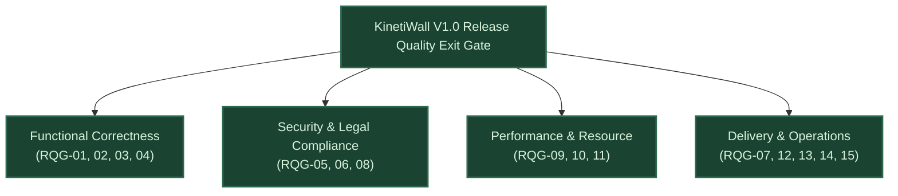

# KinetiWall — Validation Gates & Release Quality Exit Protocol
**Document ID:** `KW-QAR-007`  
**Deliverables:** Deliverable G (Validation Gates) & Deliverable H (Release Quality Exit)  
**Phase:** 1 — Project Research, Requirements & Feasibility  
**Step:** 6 of 90 — Acceptance Criteria, Success Metrics & Risk Register  
**Status:** COMPLETE (Auditable Governance Gate Baseline)  
**Authority:** Technical Program Lead & Senior QA Architect  
**Date:** 2026-11-10  

---

## 1. Executive Charter & Purpose

This document establishes the binding **Risk-Based Implementation Gates** and **Release Quality Exit Protocol** that govern all subsequent development steps (Phase 2 through Phase 7).

**The Zero-Waiver Policy:** No milestone exit or production release candidate will be approved based on timeline pressure if any mandatory validation gate or Release Quality Gate fails.

---

## 2. Deliverable G: Risk-Based Validation Gates (`VG-001` – `VG-010`)

The 10 prototype validation gates below mitigate the highest-risk uncertainties identified in the Formal Risk Register (`KW-R-001`..`020`) before committing engineering resources to full production implementation:

```
┌─────────────────────────────────────────────────────────────────────────────┐
│                 RISK-BASED PROTOTYPE VALIDATION GATES                       │
├─────────┬───────────────────────────────────┬──────────────┬────────────────┤
│ Gate ID │ Technical Domain Spike            │ Risk Mitigated│ Parallelizable?│
├─────────┼───────────────────────────────────┼──────────────┼────────────────┤
│ VG-001  │ Desktop Attachment & Restoration  │ KW-R-001, 002│ NO (Blocker)   │
│ VG-002  │ Job Object Process Cleanup        │ KW-R-009     │ YES            │
│ VG-003  │ libmpv D3D11VA HW Looping         │ KW-R-004, 005│ YES            │
│ VG-004  │ Event Fullscreen Detection Pause  │ KW-R-003, 004│ YES            │
│ VG-005  │ Multi-Monitor Dynamic Topology    │ KW-R-010     │ YES            │
│ VG-006  │ WebView2 Virtual Host Sandboxing  │ KW-R-006, 007│ YES            │
│ VG-007  │ WASAPI Volatile FFT Audio Bridge  │ KW-R-011     │ YES            │
│ VG-008  │ Offline Standalone Installer      │ KW-R-013     │ YES            │
│ VG-009  │ Native Executable Reparenting     │ KW-R-015     │ YES (Post-V1)  │
│ VG-010  │ Media Library LGPL Compliance     │ KW-R-012     │ NO (Legal)     │
└─────────┴───────────────────────────────────┴──────────────┴────────────────┘
```

### Detailed Validation Gate Specifications

| Gate ID | Prototype Objective | Risks Addressed | Required Empirical Evidence | Pass Criteria | Fail Criteria & Scope Consequence | Parallel? | Approval Role |
|:---|:---|:---:|:---|:---|:---|:---:|:---:|
| **`VG-001`** | **Desktop Shell Attachment & Restoration** | `KW-R-001`, `KW-R-002` | Spy++ window hierarchy dump and screen capture verifying Direct2D surface renders behind desktop icons on Win 11 24H2 & Win 10 22H2. | Icons 100% clickable; dual-mode fallback works when icons hidden; clean static restoration on exit. | **CRITICAL BLOCKER:** If attachment fails, halts Phase 3 core development. Fallback to transparent layered window requires user review. | No | Principal Windows Platform Architect |
| **`VG-002`** | **Job Object Process Lifecycle** | `KW-R-009` | PowerShell process table logs after 50 hard controller kills. | 100% of child processes terminate within 100ms; zero orphan processes remaining. | Secondary watchdog process required before multi-process architecture is authorized. | Yes | Senior Systems Reliability Engineer |
| **`VG-003`** | **libmpv D3D11VA Hardware Looping** | `KW-R-004`, `KW-R-005` | PresentMon frame-time trace and GPU-Z video decode engine activity on 4K HEVC/AV1. | D3D11VA active; CPU <2.5%; loop boundary delta ≤16.6ms; 0% GPU load when paused. | If libmpv fails on specific hardware, evaluate Windows Media Foundation (WMF) backend. | Yes | Lead Media Pipeline Engineer |
| **`VG-004`** | **Event Fullscreen Detection Pause** | `KW-R-003`, `KW-R-004` | CapFrameX 99th percentile benchmark logs and ETW hook latency traces. | Hook detection latency ≤50ms; 0.00% CPU/GPU load while paused; game FPS delta <0.5%. | Refine window style inspection logic (`WS_POPUP` vs `WS_OVERLAPPED`). | Yes | Senior Performance QA Engineer |
| **`VG-005`** | **Multi-Monitor Topology & Mixed DPI**| `KW-R-010` | Screen coordinates and DXGI viewport bounds logs after display hotplug/disconnect. | Display disconnect cleanly re-anchors surviving monitor; DPI change scales without blurring. | Engine constrained to primary display single-monitor mode until topology logic resolved. | Yes | Senior Graphics & Platform Engineer |
| **`VG-006`** | **WebView2 Origin Sandboxing** | `KW-R-006`, `KW-R-007` | Security audit report attempting external fetch, file traversal, and camera access. | 100% of external requests blocked with CORS error; file traversal denied; 60 FPS WebGL. | **SECURITY BLOCKER:** Web player engine cannot be released without 100% pass rate. | Yes | Senior Security Research Analyst |
| **`VG-007`** | **WASAPI Volatile FFT Audio Bridge** | `KW-R-011` | Process Monitor file write logs and FFT 1 kHz frequency peak assertion. | Audio latency <20ms; CPU <0.30%; exactly 0 bytes written to disk; auto-reconnect on device switch. | Audio visualizer deferred to V1.1; core video/web wallpaper playback unaffected. | Yes | Principal Audio Systems Engineer |
| **`VG-008`** | **Standalone Offline Installation** | `KW-R-013` | Clean VM setup log on air-gapped Windows 11 with network adapter disabled. | Installer completes without requesting internet; engine launches and plays default wallpaper. | Bundle static VC++ runtime or provide offline redistributable packages. | Yes | DevOps & Release Engineering Lead |
| **`VG-009`** | **Native Executable Reparenting** | `KW-R-015` | Prototype log attempting to reparent compiled Godot 4 demo executable into `WorkerW`. | Window renders behind icons; active foreground games do not lose input focus; clean exit. | **CONFIRMS DEFERRAL:** Standalone .exe reparenting remains deferred to V2.0+; V1.0 uses WebGL. | Yes | Principal Software Architect |
| **`VG-010`** | **Media Library LGPL Compliance** | `KW-R-012` | `dumpbin /IMPORTS` audit and execution log using custom-compiled `libmpv-2.dll`. | Binary dynamically links `libmpv-2.dll`; custom DLL replacement runs cleanly; notices bundled. | **LEGAL BLOCKER:** Build pipeline must be re-architected to guarantee dynamic linkage. | No | Open Source Compliance Lead |

---

## 3. Deliverable H: Release Quality Gate Proposal (`KW-RQG-001` – `KW-RQG-015`)

Before KinetiWall Version 1.0 can be authorized for General Availability (GA), the following **15 Release Quality Gates** must achieve 100% auditable sign-off:



### The 15 Release Quality Exit Gates

| Gate ID | Quality Gate Focus | Acceptance Criterion Reference | Required Evidentiary Artifact | Release Blocking Rule |
|:---|:---|:---:|:---|:---:|
| **`KW-RQG-001`** | **100% V1.0 Functional Requirements** | `KW-AC-001` through `KW-AC-023` | Passing acceptance test suite log linking every requirement ID. | **BLOCKER:** Zero unfulfilled V1.0 requirements permitted. |
| **`KW-RQG-002`** | **Zero Open P0 & P1 Defects** | All domains | Issue tracker zero-defect audit report signed by QA Lead. | **BLOCKER:** Release halted if any P0 or P1 defect is open. |
| **`KW-RQG-003`** | **Desktop Attachment Verification** | `KW-AC-001`, `KW-AC-002` | Passing test run on Windows 11 24H2, 23H2, and Windows 10 22H2. | **BLOCKER:** Core shell integration must be 100% verified. |
| **`KW-RQG-004`** | **Process Supervision & Teardown** | `KW-AC-006`, `KW-AC-007` | 50-run fault injection report confirming 0 orphan processes. | **BLOCKER:** Process leaks strictly prohibited. |
| **`KW-RQG-005`** | **Security Sandboxing Sign-Off** | `SEC-01` through `SEC-07` | Penetration audit confirming CORS denial and disk traversal block. | **BLOCKER:** Zero security escape vulnerabilities allowed. |
| **`KW-RQG-006`** | **LGPL v2.1+ Licensing Compliance** | `KW-AC-023`, `VG-010` | PE header audit and successful custom DLL replacement test log. | **BLOCKER:** Legal compliance mandatory for distribution. |
| **`KW-RQG-007`** | **Air-Gapped Offline Setup** | `KW-AC-022`, `VG-008` | VM installation trace on clean, offline Windows installation. | **BLOCKER:** Must operate 100% offline without accounts. |
| **`KW-RQG-008`** | **Zero-Telemetry & Privacy Audit** | `SEC-09`, `SEC-10` | 48-hour WireShark packet capture (0 packets) and ProcMon trace. | **BLOCKER:** Absolute zero telemetry commitment enforced. |
| **`KW-RQG-009`** | **Performance & Footprint Budgets**| `KW-MET-001`..`008` | Windows Performance Recorder traces (<15MB RAM, <2.5% CPU). | **BLOCKER:** Memory or CPU budget overruns halt release. |
| **`KW-RQG-010`** | **Zero Gaming Impact Verification** | `KW-AC-017`, `BENCH-03` | CapFrameX 5-run report (99th percentile frame-time delta <0.5%). | **BLOCKER:** Gaming interference violates core brand promise. |
| **`KW-RQG-011`** | **72-Hour Continuous Burn-In** | `REL-08`, `KW-MET-013` | 72-hour continuous dual-monitor telemetry log (<1 MB memory drift). | **BLOCKER:** Memory leaks or deadlocks halt release. |
| **`KW-RQG-012`** | **Complete User Documentation** | Section 16 Standards | Published User Guide, Manifest Schema V1 spec, and FAQ docs. | **CONDITIONAL:** Can be completed during RC stabilization. |
| **`KW-RQG-013`** | **Disclosed Limitations & Errata** | `KW-SCP-004` Non-Goals | Published `KNOWN_ISSUES.md` and transparent release notes. | **BLOCKER:** Concealing known issues is strictly prohibited. |
| **`KW-RQG-014`** | **Automated Regression Suite Pass** | `KW-MET-030` | CI build log confirming 100% unit/integration tests passing. | **BLOCKER:** Broken regression tests block build tagging. |
| **`KW-RQG-015`** | **Config Recovery & Rollback Validated**| `KW-AC-020` | Automated corruption test confirming recovery from `config.json.bak`.| **BLOCKER:** Data loss prevention must be validated. |

---

## 4. Multi-Role Release Sign-Off Matrix

General Availability authorization requires explicit recorded sign-offs from all designated engineering roles:

```
┌─────────────────────────────────────────────────────────────────────────────┐
│                   V1.0 PRODUCTION RELEASE SIGN-OFF MATRIX                   │
├───────────────────────────────┬─────────────────────────────┬───────────────┤
│ Responsibility Area           │ Designated Engineering Role │ Sign-Off State│
├───────────────────────────────┼─────────────────────────────┼───────────────┤
│ 1. Core Architecture & Shell  │ Principal Systems Architect │ PENDING PHASE │
│ 2. QA & Test Automation       │ Senior QA Architect         │ PENDING PHASE │
│ 3. Performance & Gaming       │ Performance Engineering Lead│ PENDING PHASE │
│ 4. Security & Privacy Audit   │ Security Research Analyst   │ PENDING PHASE │
│ 5. Open Source Compliance     │ Legal Compliance Officer    │ PENDING PHASE │
│ 6. Packaging & Deployment     │ Release Engineering Lead    │ PENDING PHASE │
│ 7. Product Scope & Integrity  │ Technical Program Lead      │ PENDING PHASE │
└───────────────────────────────┴─────────────────────────────┴───────────────┘
```

