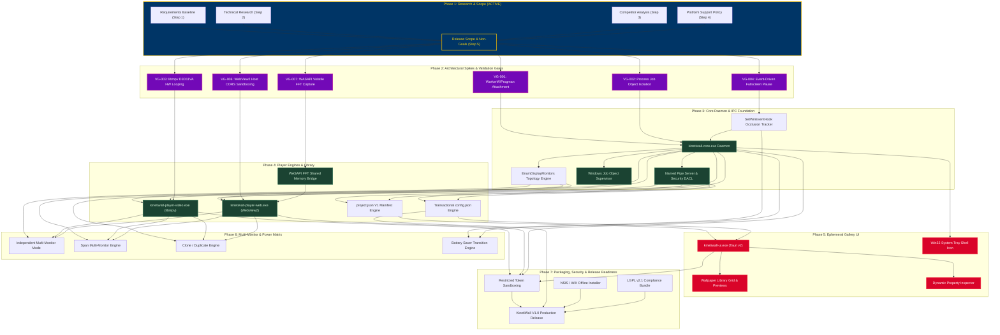

# KinetiWall — Priority and Dependency Register
**Document ID:** `KW-SCP-003`  
**Deliverable:** Deliverable C — Priority and Dependency Register  
**Phase:** 1 — Project Research, Requirements & Feasibility  
**Step:** 5 of 90 — Release Scope, Non-Goals & Feature Prioritization  
**Status:** COMPLETE (Auditable Framework)  
**Authority:** Technical Program Management & Systems Architecture  
**Date:** 2026-11-10  

---

## 1. Prioritization Framework & Multi-Factor Scoring Methodology

To prevent arbitrary or subjective priority assignments, KinetiWall utilizes a transparent **12-Factor Prioritization Model**. 

Each capability is evaluated against 12 weighted dimensions on a 1-to-5 integer scale (1 = Lowest / Least Critical, 5 = Highest / Most Critical).

### 1.1 The 12 Evaluation Dimensions

| Dimension Code | Evaluation Factor | Weight | Evaluation Criteria & Scoring Standard |
|:---|:---|:---:|:---|
| **`DIM-01`** | **Explicit User Alignment** | **15%** | **5:** Explicitly mandated in user brief (`USER-REQUIRED`). **3:** Derived architectural necessity. **1:** Speculative idea. |
| **`DIM-02`** | **Core Experience Centrality** | **15%** | **5:** Fundamental to live wallpaper operation (desktop attachment, video playback). **1:** Niche edge-case. |
| **`DIM-03`** | **Dependency Centrality** | **12%** | **5:** Critical blocker for 5+ downstream subsystems (IPC, WorkerW). **1:** Terminal leaf node. |
| **`DIM-04`** | **Direct User Value** | **10%** | **5:** High-impact visible feature (smooth looping, gallery). **1:** Invisible background housekeeping. |
| **`DIM-05`** | **Technical Feasibility** | **8%** | **5:** Documented standard Win32 API. **3:** Undocumented API with established precedents. **1:** High research uncertainty. |
| **`DIM-06`** | **Risk & Uncertainty Reduction** | **8%** | **5:** Resolving this eliminates major architectural hazard early. **1:** Standard boilerplate implementation. |
| **`DIM-07`** | **Security & Sandboxing** | **8%** | **5:** Critical defense against arbitrary code execution (CORS, DACL). **1:** Minimal security exposure. |
| **`DIM-08`** | **Performance & Resource Impact**| **8%** | **5:** Direct determinant of CPU/RAM/battery performance targets. **1:** Negligible performance footprint. |
| **`DIM-09`** | **Testing & Verification Complexity**| **6%** | **5:** Deterministic unit/integration test. **1:** Non-deterministic multi-monitor hardware timing test. |
| **`DIM-10`** | **Long-Term Maintenance Cost** | **6%** | **5:** Simple pure-Rust abstraction with zero API churn. **1:** Brittle external dependency prone to breaking. |
| **`DIM-11`** | **Release Readiness Velocity** | **6%** | **5:** Ready for immediate implementation. **1:** Blocked on unverified technical spike. |
| **`DIM-12`** | **Cost of Deferral** | **6%** | **5:** Deferral breaks the product definition. **1:** Easily added in post-V1 patch without breaking changes. |

### 1.2 Composite Score Thresholds & Priority Mapping

$$\text{Composite Priority Score (CPS)} = \sum_{i=1}^{12} \left( \text{Score}_i \times \text{Weight}_i \right)$$

- **`P0 — Core Foundation` (CPS: 4.20 – 5.00):** Foundational architecture, security boundaries, and crash-resilient IPC. Must be completed in the earliest implementation phases.
- **`P1 — Required Product Capability` (CPS: 3.40 – 4.19):** Essential user-facing capabilities forming the core value proposition of Version 1.0.
- **`P2 — Secondary Capability` (CPS: 2.60 – 3.39):** Valuable capabilities scheduled for late V1.0 or eligible for initial V1.1 update if schedule demands.
- **`P3 — Enhancement` (CPS: 1.00 – 2.59):** Post-V1 roadmap items and future opportunities.

---

## 2. Priority & Implementation Order Separation

A critical systems engineering principle governs KinetiWall: **Product Importance does NOT equal Implementation Order.**

```
┌─────────────────────────────────────────────────────────────────────────────┐
│                 PRIORITY VS IMPLEMENTATION ORDER MATRIX                     │
├─────────────────────┬───────────────────────────────────────────────────────┤
│ Concept             │ Engineering Meaning & Operational Rule                │
├─────────────────────┼───────────────────────────────────────────────────────┤
│ Product Importance  │ How vital the feature is to the user (e.g. Gallery).   │
│ Implementation Order│ The topological sequence dictated by dependencies.     │
│ Risk-Reduction Order│ High-risk spikes implemented early to de-risk design. │
│ Release Inclusion   │ Whether the capability ships in V1.0 or V1.x.         │
│ Approval Status     │ Whether authority is granted or awaiting user review. │
└─────────────────────┴───────────────────────────────────────────────────────┘
```

*Example:* The **Gallery UI** is a top-tier user-facing feature (`P1`), but its implementation order is **Phase 4** because it depends completely on the Core Daemon (`Phase 3`), Named Pipe IPC (`Phase 3`), and Manifest Parser (`Phase 3`). Conversely, the **WorkerW Desktop Spike** has no direct user UI, but its implementation order is **Phase 2 (Milestone 1)** because an attachment failure would invalidate the entire product architecture.

---

## 3. Critical Path Technical Dependency Graph

The following Mermaid graph visualizes the end-to-end technical dependency pipeline from Phase 1 through Version 1.0 Release.



---

## 4. Subsystem Dependency Breakdown Register

The table below catalogs every critical dependency relationship across KinetiWall's architecture:

| Dep ID | Upstream Prerequisite | Downstream Capability | Nature | Parallelizable? | Verification & Validation Method | Failure Impact & Recovery Fallback | Target Milestone |
|:---|:---|:---|:---:|:---:|:---|:---|:---:|
| **`DEP-01`** | **`KW-SCP-001` Scope Baseline** | Phase 2 Architectural Spikes | Mandatory | No | Formal stakeholder sign-off on V1.0 boundaries. | Ambiguous scope causes wasted prototyping cycles. | Milestone 1 (Day 1) |
| **`DEP-02`** | **`VG-001` Desktop Host Spike** | Production Desktop Integration (`KW-F-001`) | Mandatory | No | Direct execution of dual-mode WorkerW/Progman attachment on Win 11 24H2. | Critical: If WorkerW attachment fails, fallback to Progman child blitting required. | Milestone 2 |
| **`DEP-03`** | **`VG-002` Job Object Spike** | Player Supervisor (`KW-F-006`, `KW-F-007`) | Mandatory | Yes | Verify `JOB_OBJECT_LIMIT_KILL_ON_JOB_CLOSE` terminates orphaned child processes. | Memory/process leaks; manual process tree tracking fallback required. | Milestone 2 |
| **`DEP-04`** | **`VG-003` libmpv D3D11VA Spike** | Video Player Subsystem (`KW-F-009`) | Mandatory | Yes | Verify hardware video decoding and sub-16.6ms gapless looping via `loop-file=inf`. | Fallback to Windows Media Foundation (WMF) D3D11 player engine. | Milestone 2 |
| **`DEP-05`** | **`VG-006` WebView2 CORS Spike** | Web Player Subsystem (`KW-F-014`, `KW-F-016`)| Mandatory | Yes | Confirm virtual host directory mapping blocks remote CORS requests and disk traversal. | Local web server binding fallback with random token auth. | Milestone 2 |
| **`DEP-06`** | **`VG-007` WASAPI Capture Spike** | Audio Reactive Subsystem (`KW-F-039`) | Mandatory | Yes | Capture loopback PCM stream without audio stutter; calculate 1024-point FFT in <2ms. | Defer audio visualizer to V1.1; video/web wallpapers remain fully functional. | Milestone 2 |
| **`DEP-07`** | **Named Pipe IPC Server (`KW-NF-003`)**| Gallery UI & Players IPC Bridge | Mandatory | No | Integration test passing JSON-RPC messages over pipe with security DACL. | Unusable UI; controller cannot instruct player processes. | Milestone 3 |
| **`DEP-08`** | **Display Enumeration (`KW-F-020`)**| Multi-Monitor Engine (`KW-F-021`..`023`) | Mandatory | Yes | Plug/unplug secondary display; verify topology array updates accurately. | Multi-monitor disabled; engine operates in primary display single mode. | Milestone 3 |
| **`DEP-09`** | **Occlusion Engine (`KW-F-026`)**| Battery & Game Pause (`KW-F-029`, `KW-F-030`)| Mandatory | Yes | Launch 3D application; verify `EVENT_SYSTEM_FOREGROUND` fires within 50ms. | Fallback to 500ms timer-based `GetForegroundWindow` polling. | Milestone 3 |
| **`DEP-10`** | **Manifest Engine (`KW-F-033`)**| Gallery Grid & Property Editor (`KW-F-036`) | Mandatory | Yes | Unit test parsing malformed and valid `project.json` schemas. | UI cannot display custom property sliders; default values applied. | Milestone 4 |
| **`DEP-11`** | **Core Daemon (`KW-F-005`)** | Ephemeral Gallery UI (`KW-NF-002`) | Mandatory | No | Launch Tauri v2 UI; verify it connects to active daemon, executes, and exits to 0 MB. | Monolithic application fallback (violates `KW-NG-001`). | Milestone 4 |
| **`DEP-12`** | **LGPL Dynamic Linkage (`KW-F-046`)**| Packaging & Installer (`KW-F-043`) | Mandatory | No | Verify installer places `libmpv-2.dll` alongside executable without static linkage. | Legal risk: GPL/LGPL copyright violation if statically linked. | Milestone 5 |

---

## 5. Critical Technical Risk: Windows Desktop Integration

The most critical technical dependency in the entire application is **Desktop Shell Attachment (`DEP-02` / `VG-001`)**.

Because message `0x052C` to `Progman` is an undocumented Windows API technique, its behavior across Windows updates poses an asymmetric risk:
1. **Windows 11 24H2 Anomaly:** Step 4 platform research revealed that unchecking "Show desktop icons" causes `WorkerW` to detach, blacking out the wallpaper.
2. **Mitigation Strategy:** The Dual-Mode Attachment Engine (`DEC-PLT-001`) actively inspects icon visibility. If icons are hidden, it anchors directly to `Progman` behind `SHELLDLL_DefView`.
3. **Validation Milestone:** Prototype spike `VG-001` must execute immediately at the start of Phase 2 across clean Windows 11 24H2 and Windows 10 22H2 virtual environments. If both modes achieve stable attachment, downstream player development is authorized. If unresolvable defects arise, the fallback architecture (layered borderless desktop window) must be presented for user review.

