# KinetiWall — Release Scope, Non-Goals & Feature Prioritization Suite
**Document ID:** `KW-SCP-000`  
**Phase:** 1 — Project Research, Requirements & Feasibility  
**Step:** 5 of 90 — Release Scope, Non-Goals & Feature Prioritization  
**Status:** COMPLETE (Proposed Working Baseline)  
**Classification:** Product Scope Definition & Release Governance  
**Date:** 2026-11-10  
**Authority:** Step 5 Engineering Specification  

---

## 1. Executive Summary

This documentation suite establishes the authoritative, evidence-based release scope proposal, complete feature inventory, dependency graph, non-goals register, optional feature roadmap, risk-reduction validation gates, and release acceptance criteria for **KinetiWall** — an ultra-lightweight, hardware-accelerated Windows desktop live wallpaper engine written in pure Rust with isolated multi-process players.

Following the thorough investigations in:
- [Step 1: Project Requirements Inventory & Traceability](file:///e:/Projects/All%20working%20projects/App%20projects%20working/KinetiWall%20Engine%20(working)/docs/requirements/README.md) (`KW-F-001`..`046`, `KW-NF-001`..`027`, `KW-NG-001`..`006`, `OFF-001`..`012`, `UDR-001`..`013`)
- [Step 2: Technical Research & Source Verification](file:///e:/Projects/All%20working%20projects/App%20projects%20working/KinetiWall%20Engine%20(working)/docs/research/README.md) (`SR-001`..`010`, `TR-001`..`008`, `RC-001`..`020`)
- [Step 3: Competitor Analysis & Product Differentiation](file:///e:/Projects/All%20working%20projects/App%20projects%20working/KinetiWall%20Engine%20(working)/docs/competitive_analysis/README.md) (`GAP-01`..`08`, `OPP-A01`..`C05`, `CSR-001`..`005`)
- [Step 4: Windows Compatibility & Platform Support Policy](file:///e:/Projects/All%20working%20projects/App%20projects%20working/KinetiWall%20Engine%20(working)/docs/platform_support/README.md) (`CT-001`..`020`, `DEC-PLT-001`..`012`, `PSR-001`..`008`)

Step 5 answers the central engineering question: **How do we sequence, prioritize, and bound the approved requirements into a reliable, rock-solid Version 1.0 product without scope creep, without technical debt, and without silently dropping or inflating any user commitments?**

```
┌─────────────────────────────────────────────────────────────────────────────┐
│                       KINETIWALL SCOPE TAXONOMY                             │
├─────────────────────────────────────┬───────────────────────────────────────┤
│          VERSION 1.0 (PROPOSED)     │          FUTURE HORIZON (ROADMAP)     │
├─────────────────────────────────────┼───────────────────────────────────────┤
│ • Pure Rust Core Daemon (8-12 MB)   │ • Interactive Scene Node Graph Editor │
│ • Ephemeral Gallery UI (0 MB closed)│ • Community Cloud Workshop / Store    │
│ • WorkerW / Progman Dual-Mode Host  │ • Native 3D Engine Executable Bridge  │
│ • HW-Accelerated Video (libmpv LGPL)│ • Dynamic OS Accent Color Harmonizer  │
│ • Sandboxed HTML5/WebGL (WebView2)  │ • Local LLM / AI Image Generation     │
│ • Multi-Monitor (Separate/Span/Clone│ • Shadertoy Direct URL Import Engine  │
│ • Occlusion & Fullscreen Pause Engine│ • Cross-Device State Synchronization │
│ • Transient WASAPI Audio Visualizer │ • Linux (Wayland) / macOS Engine Port │
│ • Local Library & Manifest V1 Parser│ • RGB Hardware Peripheral Sync (Razer)│
└─────────────────────────────────────┴───────────────────────────────────────┘
```

---

## 2. Release Scope Governance & Classification Principles

To ensure complete transparency and prevent ambiguity, all product capabilities are evaluated against four independent dimensions:

### 2.1 Requirement Authority
1. **`USER-REQUIRED`**: Explicitly mandated by the user in the foundational specification.
2. **`APPROVED-DECISION`**: Explicitly approved architectural decision resolving an architectural fork.
3. **`RESEARCH-RECOMMENDATION`**: Proven by technical research (Step 2–4) as superior, but awaiting explicit user sign-off for release inclusion.
4. **`OPTIONAL-ENHANCEMENT`**: Desirable feature explicitly classified as optional (`OFF-001`..`012`).
5. **`FUTURE-OPPORTUNITY`**: Market-differentiating capability identified during competitor analysis (`OPP-A01`..`C05`).
6. **`UNRESOLVED`**: Technical trade-off or boundary requiring formal resolution (`UDR-001`..`013`).
7. **`NON-GOAL`**: Explicitly forbidden behavior or architecture.

### 2.2 Feature Priority
- **`P0 — Core Foundation`**: Critical runtime plumbing, security boundaries, and crash-resilient IPC. Application cannot function safely without it.
- **`P1 — Required Product Capability`**: Core user-facing feature required for a usable live wallpaper experience.
- **`P2 — Secondary Capability`**: Enhances user experience or convenience, but system remains viable if temporarily deferred to V1.x.
- **`P3 — Enhancement`**: Nice-to-have visual, workflow, or advanced integration capability.
- **`UNASSIGNED`**: Priority cannot be determined until an upstream technical spike succeeds.

### 2.3 Release Assignment
- **`V1.0 PROPOSED`**: Targeted for the initial production launch.
- **`V1.0 DEPENDENCY`**: Prerequisite architectural spike, IPC schema, or build foundation required for V1.0.
- **`V1.x CANDIDATE`**: Targeted for minor feature releases following V1.0 stability.
- **`V2.0+ CANDIDATE`**: Targeted for major architectural revisions (e.g., custom rendering engines, external game engine bridges).
- **`EXPLORATION ONLY`**: Prototype spike conducted in Phase 2 to determine feasibility without release commitment.
- **`AWAITING APPROVAL`**: Cannot be scheduled into a release until user resolves decision.
- **`UNASSIGNED`**: Blocked on upstream research.

### 2.4 Evidence-Based Confidence
- **`HIGH`**: Supported by official Microsoft MSDN documentation, validated open-source implementations, or deterministic win32 APIs.
- **`MEDIUM`**: Supported by standard platform behavior but subject to edge cases (e.g., Windows 11 24H2 Explorer icon toggles).
- **`LOW`**: Complex external dependency interaction or heuristic behavior requiring dedicated instrumentation.
- **`UNVERIFIED`**: Undocumented API, reverse-engineered shell message, or unbenchmarked subsystem.

---

## 3. Documentation Suite Index

| Document ID | Deliverable | File Path | Scope & Focus |
|:---|:---|:---|:---|
| **`KW-SCP-001`** | **Deliverable A** | [RELEASE_SCOPE_PROPOSAL.md](file:///e:/Projects/All%20working%20projects/App%20projects%20working/KinetiWall%20Engine%20(working)/docs/release_scope/RELEASE_SCOPE_PROPOSAL.md) | V1.0 Core Release Contract, boundaries, minimum viable release criteria, release governance rules. |
| **`KW-SCP-002`** | **Deliverable B** | [COMPLETE_FEATURE_INVENTORY.md](file:///e:/Projects/All%20working%20projects/App%20projects%20working/KinetiWall%20Engine%20(working)/docs/release_scope/COMPLETE_FEATURE_INVENTORY.md) | Comprehensive 10-domain feature inventory mapping all 79 requirements, priorities, release targets, and acceptance criteria. |
| **`KW-SCP-003`** | **Deliverable C** | [PRIORITY_AND_DEPENDENCY_REGISTER.md](file:///e:/Projects/All%20working%20projects/App%20projects%20working/KinetiWall%20Engine%20(working)/docs/release_scope/PRIORITY_AND_DEPENDENCY_REGISTER.md) | 12-factor prioritization framework, critical path dependency graph, and implementation sequencing. |
| **`KW-SCP-004`** | **Deliverable D** | [NON_GOALS_REGISTER.md](file:///e:/Projects/All%20working%20projects/App%20projects%20working/KinetiWall%20Engine%20(working)/docs/release_scope/NON_GOALS_REGISTER.md) | Permanent anti-goals (`KW-NG-001`..`006`) vs temporary release exclusions (`V1-EXCL-001`..`010`). |
| **`KW-SCP-005`** | **Deliverable E** | [OPTIONAL_AND_FUTURE_FEATURE_REGISTER.md](file:///e:/Projects/All%20working%20projects/App%20projects%20working/KinetiWall%20Engine%20(working)/docs/release_scope/OPTIONAL_AND_FUTURE_FEATURE_REGISTER.md) | Formal catalog of candidate enhancements (`OFF-001`..`012`, `OPP-A01`..`C05`) with risk and approval gates. |
| **`KW-SCP-006`** | **Deliverable F** | [VALIDATION_GATES_REGISTER.md](file:///e:/Projects/All%20working%20projects/App%20projects%20working/KinetiWall%20Engine%20(working)/docs/release_scope/VALIDATION_GATES_REGISTER.md) | 10 technical prototype spikes (`VG-001`..`VG-010`) with pass/fail criteria and architectural triggers. |
| **`KW-SCP-007`** | **Deliverable G** | [RELEASE_ACCEPTANCE_CHECKLIST.md](file:///e:/Projects/All%20working%20projects/App%20projects%20working/KinetiWall%20Engine%20(working)/docs/release_scope/RELEASE_ACCEPTANCE_CHECKLIST.md) | 15-area auditable release readiness gate covering functionality, performance, licensing, and crash recovery. |

---

## 4. Phase 1 Roadmap Progress & Step Transition Protocol

```mermaid
flowchart LR
    S1["Step 1: Requirements Inventory\n(COMPLETE)"] --> S2["Step 2: Technical Research\n(COMPLETE)"]
    S2 --> S3["Step 3: Competitor Analysis\n(COMPLETE)"]
    S3 --> S4["Step 4: Platform Support\n(COMPLETE)"]
    S4 --> S5["Step 5: Release Scope & Non-Goals\n(ACTIVE / CURRENT)"]
    S5 -.->|User Authorization Gate| S6["Step 6: Risk Register & Failure Analysis\n(PENDING)"]

    classDef done fill:#1b4332,stroke:#2d6a4f,stroke-width:2px,color:#d8f3dc;
    classDef active fill:#003566,stroke:#ffc300,stroke-width:2px,color:#ffd60a;
    classDef pending fill:#212529,stroke:#495057,stroke-width:1px,color:#ced4da;

    class S1,S2,S3,S4 done;
    class S5 active;
    class S6 pending;
```



### Transition Protocol to Step 6
Under strict project governance:
1. **Zero Code Modification:** No application code or project configuration has been created or modified in Step 5.
2. **Preservation of Normative Baseline:** All 46 functional, 27 non-functional, and 6 non-goal requirements retain their original authority and IDs.
3. **Stop Boundary:** Upon generating and validating this documentation suite, the agent will present the completion report and **STOP**, awaiting explicit user instruction before initiating Step 6 (`Step 6 of 90: Technical Risk Register & Failure Mode Analysis`).

