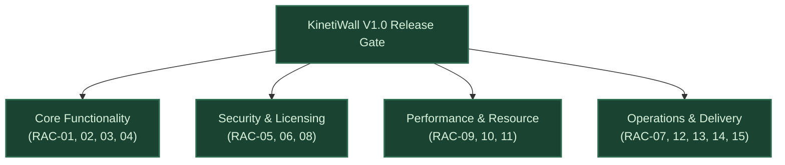

# KinetiWall — Release Acceptance Checklist & Quality Gates
**Document ID:** `KW-SCP-007`  
**Deliverable:** Deliverable G — Release Acceptance Checklist  
**Phase:** 1 — Project Research, Requirements & Feasibility  
**Step:** 5 of 90 — Release Scope, Non-Goals & Feature Prioritization  
**Status:** COMPLETE (Auditable Governance Gate)  
**Authority:** Technical Program Management & Senior QA Engineering  
**Date:** 2026-11-10  

---

## 1. Release Acceptance Philosophy & Gate Rules

A software release is a legal, architectural, and operational commitment. **KinetiWall Version 1.0 cannot be declared release-ready merely because implementation tasks are checked off.**

A production release candidate (RC) is authorized for release only when all **15 Release Acceptance Criteria (RAC)** achieve formal sign-off backed by auditable test evidence.

### Release Decision Matrix
- **`APPROVED FOR RELEASE`:** All 15 acceptance areas pass with 100% compliance.
- **`CONDITIONAL RELEASE (LIMITATIONS)`:** Non-critical secondary items (`P2`) have documented limitations approved in writing by the product owner; zero critical defects.
- **`RELEASE BLOCKED`:** Any failure in P0 core capabilities, security sandboxing, licensing compliance, crash recovery, or system stability halts release immediately. Waivers for P0 requirements are strictly prohibited.

---

## 2. The 15 Release Acceptance Criteria (RAC)

### `RAC-01`: Approved Functional Requirements Verification
- **Criteria Statement:** 100% of approved Version 1.0 functional requirements (`KW-F-001` through `KW-F-046` scoped to V1.0) must be implemented and verified via automated or manual test cases.
- **Auditable Evidence Required:** Complete test execution report linking every requirement ID to a passing test log in `tests/acceptance/`.
- **Failure Disposition:** `RELEASE BLOCKED`. Unimplemented mandatory requirements cannot be bypassed without written user scope change authorization.

### `RAC-02`: Critical Desktop Shell Attachment Verification
- **Criteria Statement:** Desktop attachment must be verified across Windows 11 24H2, 23H2, 22H2, and Windows 10 22H2. Both primary `WorkerW` and fallback hidden-icons `Progman` attachment must operate flawlessly with zero desktop icon interference.
- **Auditable Evidence Required:** Test execution logs for test scenarios `CT-001` through `CT-005` in [Platform Test Matrix](file:///e:/Projects/All%20working%20projects/App%20projects%20working/KinetiWall%20Engine%20(working)/docs/platform_support/TEST_MATRIX.md).
- **Failure Disposition:** `RELEASE BLOCKED`. Shell attachment is the core foundation of KinetiWall.

### `RAC-03`: Process Isolation, Crash Recovery & Teardown Verification
- **Criteria Statement:** Killing any child wallpaper player (`kinetiwall-player-video.exe`, `kinetiwall-player-web.exe`) must not crash the core daemon (`kinetiwall-core.exe`). The daemon must auto-restart the player up to 3 times before graceful fallback. Abruptly terminating the core daemon must leave zero orphan child processes.
- **Auditable Evidence Required:** Stress test logs executing 50 automated process crash/kill cycles via PowerShell test harness; process tree audit confirming 100% child cleanup.
- **Failure Disposition:** `RELEASE BLOCKED`. Process leaks or core daemon crashes violate core architecture.

### `RAC-04`: Multi-Monitor Topology & Explorer Restart Resilience
- **Criteria Statement:** Application must survive: (a) killing `explorer.exe` and re-attaching within 2.5s, (b) plugging/unplugging external displays, (c) changing DPI scaling (100% to 200%), and (d) workstation lock/unlock, without crash or visual distortion.
- **Auditable Evidence Required:** Test execution logs for scenarios `CT-007`, `CT-008`, `CT-012`, and `CT-013`.
- **Failure Disposition:** `RELEASE BLOCKED`.

### `RAC-05`: Security Sandboxing & Origin Isolation Sign-Off
- **Criteria Statement:** Interactive web wallpapers hosted in WebView2 must have zero external network egress, denied camera/microphone/geolocation access, and zero directory traversal access outside `%LOCALAPPDATA%\KinetiWall\wallpapers\`. Named Pipe IPC must enforce strict local logon SID DACL.
- **Auditable Evidence Required:** Security penetration report from test spike `VG-006` and Named Pipe DACL inspection logs confirming `ERROR_ACCESS_DENIED` on foreign token connection.
- **Failure Disposition:** `RELEASE BLOCKED`. Zero tolerance for security vulnerabilities.

### `RAC-06`: LGPL v2.1+ Licensing & Open Source Compliance
- **Criteria Statement:** `libmpv-2.dll` must be dynamically linked under LGPL v2.1+. Installer and application must bundle complete license texts, copyright notices, and clear instructions enabling users to replace the shared library with their own build.
- **Auditable Evidence Required:** PE header audit showing dynamic import of `libmpv-2.dll`; successful execution of DLL replacement test (`VG-010`); legal compliance review of `LICENSE` and `NOTICE` files.
- **Failure Disposition:** `RELEASE BLOCKED`. Copyleft copyright infringement poses legal risk.

### `RAC-07`: Offline Installation & Clean Uninstallation Verification
- **Criteria Statement:** Standalone installer must install, configure, and launch KinetiWall on an air-gapped clean Windows installation with zero network connectivity. Uninstaller must cleanly remove all binaries, registry keys, and shortcuts.
- **Auditable Evidence Required:** Automated VM installation logs from offline test scenario `CT-018`.
- **Failure Disposition:** `RELEASE BLOCKED`. Offline installation is a foundational product promise (`KW-NG-003`).

### `RAC-08`: Zero-Telemetry & Zero-Recording Verification
- **Criteria Statement:** Process monitor and network sniffer audit must verify that KinetiWall performs zero remote network requests and writes zero audio data to disk during continuous execution.
- **Auditable Evidence Required:** 48-hour WireShark network packet log (0 packets) and Process Monitor file write log confirming zero audio serialization (`KW-NG-002`, `KW-NG-005`).
- **Failure Disposition:** `RELEASE BLOCKED`.

### `RAC-09`: Resource Consumption & Performance Benchmarks
- **Criteria Statement:** Measured resource consumption must satisfy all non-functional performance baselines:
  - Core Daemon Idle Memory: ≤15 MB private working set.
  - Ephemeral Gallery UI: 0 MB private working set when closed.
  - 4K Video Playback CPU: <2.5% on modern quad-core CPU.
  - Paused State CPU/GPU: Exactly 0.00% CPU and 0.00% GPU load.
  - Gaming Impact: <0.5% frame-time variance during fullscreen 3D gaming.
- **Auditable Evidence Required:** Windows Performance Recorder (WPR) and CapFrameX benchmark reports attached to the release manifest.
- **Failure Disposition:** `CONDITIONAL` if minor variance (<10%); `BLOCKED` if gaming impact >1.0% or daemon RAM >20 MB.

### `RAC-10`: Supported Windows Compatibility Matrix Verification
- **Criteria Statement:** Full test pass achieved across all Tier A supported Windows platforms: Windows 11 24H2, 23H2, 22H2, and Windows 10 22H2 (Build 19045).
- **Auditable Evidence Required:** 100% pass rate across all 20 test cases in `docs/platform_support/TEST_MATRIX.md`.
- **Failure Disposition:** `RELEASE BLOCKED` if Tier A fails; `CONDITIONAL` with documented errata if Tier B (Win 10 1903) has minor cosmetic limitation.

### `RAC-11`: 72-Hour Continuous Burn-In & Stability Stress Test
- **Criteria Statement:** The engine must execute continuously for 72 hours across 2 physical displays (1 video wallpaper, 1 interactive web wallpaper) with zero crashes, zero memory leaks (<1 MB drift), zero GDI handle leaks, and zero thread deadlocks.
- **Auditable Evidence Required:** VMMap memory timeline chart and Windows Event Viewer logs over the 72-hour test duration.
- **Failure Disposition:** `RELEASE BLOCKED`. Memory leaks are unacceptable in a 24/7 background utility.

### `RAC-12`: Complete Documentation & Release Notes
- **Criteria Statement:** User documentation, installation guide, troubleshooting FAQ, wallpaper authoring specification (`project.json` manifest schema V1), and comprehensive release notes must be complete and up-to-date.
- **Auditable Evidence Required:** Documentation review sign-off in `docs/user_guide/` and `CHANGELOG.md`.
- **Failure Disposition:** `CONDITIONAL` (Documentation can be refined during RC release stabilization).

### `RAC-13`: User-Facing Limitations & Errata Documentation
- **Criteria Statement:** All known minor issues, unverified platform edge cases, and post-V1 roadmap exclusions must be accurately and prominently described in the release notes so users are never misled.
- **Auditable Evidence Required:** Published `KNOWN_ISSUES.md` and `RELEASE_NOTES.md` documents.
- **Failure Disposition:** `RELEASE BLOCKED` if known bugs are concealed or misrepresented.

### `RAC-14`: Automated Regression Test Suite Execution
- **Criteria Statement:** 100% pass rate across all unit tests, integration tests, and IPC protocol verification suites in the Rust test harness (`cargo test --workspace`).
- **Auditable Evidence Required:** CI/CD automated build and test log confirming zero test failures.
- **Failure Disposition:** `RELEASE BLOCKED`.

### `RAC-15`: Release Rollback & Emergency Recovery Protocol
- **Criteria Statement:** A documented, tested procedure for rolling back an update, restoring corrupt user configurations (`config.json.bak`), or cleanly uninstalling a damaged build must be verified.
- **Auditable Evidence Required:** Verification test where `config.json` is artificially corrupted with random bytes; engine automatically restores from `.bak` and logs warning without crashing.
- **Failure Disposition:** `RELEASE BLOCKED`.

---

## 3. Release Readiness Audit & Sign-Off Workflow

Before declaring KinetiWall Version 1.0 General Availability (GA), the following multi-role sign-off table must be executed:

| Gate Area | Responsible Role | Verification Artifact | Decision Sign-Off |
|:---|:---|:---|:---:|
| **Functional Requirements (`RAC-01`..`04`)** | Lead Systems Architect | `tests/acceptance/` Matrix | `PENDING EXECUTION` |
| **Security & Privacy (`RAC-05`, `08`)** | Security Research Engineer | Penetration & Network Audit | `PENDING EXECUTION` |
| **Legal & Licensing (`RAC-06`)** | Open Source Compliance Lead | LGPL PeHeader & License Audit| `PENDING EXECUTION` |
| **Packaging & Offline (`RAC-07`)** | DevOps & Release Engineer | Clean VM Offline Install Log | `PENDING EXECUTION` |
| **Performance & Stability (`RAC-09`, `11`)**| Performance QA Engineer | 72-hr Burn-In & WPR Logs | `PENDING EXECUTION` |
| **Platform Compatibility (`RAC-010`)** | Windows Compatibility Lead | `TEST_MATRIX.md` 20-Scenario Run | `PENDING EXECUTION` |
| **Documentation & Safety (`RAC-12`..`15`)** | Technical Program Manager | Release Notes & Config Recovery| `PENDING EXECUTION` |

