# KinetiWall — Release Scope Proposal (Version 1.0 & Post-V1 Horizons)
**Document ID:** `KW-SCP-001`  
**Deliverable:** Deliverable A — Release Scope Proposal  
**Phase:** 1 — Project Research, Requirements & Feasibility  
**Step:** 5 of 90 — Release Scope, Non-Goals & Feature Prioritization  
**Status:** PROPOSED WORKING BASELINE  
**Authority:** Technical Program Management & Systems Architecture  
**Date:** 2026-11-10  

---

## 1. Executive Charter & Purpose

The purpose of this document is to establish a rigorous, defensible, and evidence-based product release boundary for **KinetiWall Version 1.0 (MVP/Core Release)** while charting an orderly path for subsequent minor updates (V1.x) and major feature expansions (V2.0+).

KinetiWall must satisfy a dual mandate:
1. **Uncompromised Quality & Performance:** Deliver a rock-solid, crash-resilient Windows live wallpaper engine written in pure Rust that maintains an ephemeral UI footprint (0 MB RAM closed), deterministic sub-1% CPU idle usage, zero audio leakage, and instant pause on fullscreen gaming.
2. **Requirements Integrity:** Honor every single user-approved requirement established in [Step 1 Requirements Inventory](file:///e:/Projects/All%20working%20projects/App%20projects%20working/KinetiWall%20Engine%20(working)/docs/requirements/REQUIREMENTS_INVENTORY.md) without silently demoting or omitting capabilities to make implementation convenient.

---

## 2. Release Horizon Definitions

To prevent "scope creep" while guaranteeing architectural extensibility, KinetiWall partitions all capabilities into four distinct release horizons:

```
┌────────────────────────────────────────────────────────────────────────────────────────┐
│                                 KINETIWALL RELEASE HORIZONS                            │
├─────────────────────┬────────────────────┬────────────────────┬────────────────────────┤
│   V1.0 CORE LAUNCH  │   V1.1 - V1.3      │     V2.0 MAJOR     │      OUT OF SCOPE      │
│     (The Engine)    │ (Quality of Life)  │(Platform Expansion)│ (Permanent Non-Goals)  │
├─────────────────────┼────────────────────┼────────────────────┼────────────────────────┤
│ • Pure Rust Daemon  │ • Dynamic OS Accent│ • Scene Node Graph │ • Resident UI Tray RAM │
│ • Dual WorkerW Host │   Color Sync       │   Editor (Visual)  │ • Explorer Shell Hooks │
│ • libmpv Video (HW) │ • Quick Switcher   │ • Native 3D Engine │ • Cloud Account Mandate│
│ • WebView2 Sandbox  │   Keyboard HUD     │   Bridge (Unity/   │ • Background Telemetry │
│ • Multi-Monitor V1  │ • Time-of-Day Day/ │   Godot / Custom)  │ • Audio Recording Disk │
│ • Fullscreen Pause  │   Night Playlists  │ • Shadertoy Direct │ • Unsandboxed Remote   │
│ • Local V1 Library  │ • Hardware Sensory │   Parser & WebGL   │   Code Execution       │
│ • WASAPI FFT Visual │   Telemetry OSD    │ • Community Cloud  │ • Unthrottled Polling  │
│ • Offline Installer │ • Video In-App Trim│   Workshop Sync    │ • Kernel Mode Drivers  │
└─────────────────────┴────────────────────┴────────────────────┴────────────────────────┘
```

### Horizon 1: Version 1.0 — Core Launch (Production Baseline)
- **Goal:** Deliver an ultra-reliable, performant desktop engine supporting local video, interactive web, multi-monitor configurations, occlusion-aware pausing, transient audio reactivity, and a local management gallery.
- **Inclusion Standard:** All mandatory functional requirements (`KW-F-001` through `KW-F-046`) and non-functional requirements (`KW-NF-001` through `KW-NF-027`), with complex sub-items scoped to clean, testable MVP implementations.
- **Platform Scope:** Windows 11 (24H2, 23H2, 22H2) and Windows 10 (Build 19041+ / 22H2..2004) on x86-64 (Tier A), with ARM64 verified under Prism emulation (Tier B).

### Horizon 2: Version 1.x — Quality-of-Life Enhancements (Post-V1 Minor Cadence)
- **Goal:** Deepen usability, desktop harmonization, and enthusiast features without altering core IPC or stability boundaries.
- **Candidates:** Dynamic Windows accent-color synchronization (`OFF-001`), quick-switcher HUD (`OFF-002`), time-of-day playlist scheduling (`OFF-003`), in-app video trimming (`OFF-004`), and sensory telemetry overlays (`OFF-006`).

### Horizon 3: Version 2.0+ — Platform Expansion & Community Ecosystem
- **Goal:** Expand into content authoring, community sharing, and high-performance native executable embedding.
- **Candidates:** Visual scene-graph wallpaper editor (`GAP-02`), direct Shadertoy URL conversion (`OFF-005`), native 3D engine executable bridging (`KW-F-019`, `UDR-003`), community cloud workshop (`OFF-008`), and RGB hardware peripheral synchronization (`OFF-010`).

### Horizon 4: Permanent Non-Goals & Prohibitions
- **Goal:** Explicit engineering boundaries that protect user trust, privacy, and system stability across all versions (`KW-NG-001` through `KW-NG-006`).

---

## 3. Version 1.0 Minimum Viable Release (MVR) Criteria

For KinetiWall Version 1.0 to be declared release-ready, all 12 of the following core functional domains must achieve 100% verification against their defined acceptance criteria:

```mermaid
graph TD
    MVR["KinetiWall V1.0 Minimum Viable Release"]
    
    MVR --> D1["1. Desktop Attachment\nDual WorkerW/Progman Engine"]
    MVR --> D2["2. Process Isolation\nCrash-Safe Daemon + IPC"]
    MVR --> D3["3. Ephemeral Gallery\n0 MB RAM Closed (std::process::exit)"]
    MVR --> D4["4. Video Player\nlibmpv D3D11VA HW Looping"]
    MVR --> D5["5. Web Player\nWebView2 Sandboxed Virtual Host"]
    MVR --> D6["6. Multi-Monitor\nIndependent, Span & Clone Modes"]
    MVR --> D7["7. Resource Control\nFullscreen & Occlusion Pause"]
    MVR --> D8["8. Power Management\nBattery Disconnect Rules"]
    MVR --> D9["9. Local Library\nOffline Manifests & Custom Props"]
    MVR --> D10["10. WASAPI Audio\nTransient FFT (Volatile Only)"]
    MVR --> D11["11. Zero Leakage\nJob Objects & Clean Teardown"]
    MVR --> D12["12. Distribution\nOffline Installer & LGPL v2.1 Compliance"]

    classDef core fill:#003566,stroke:#ffc300,stroke-width:2px,color:#ffd60a;
    class D1,D2,D3,D4,D5,D6,D7,D8,D9,D10,D11,D12 core;
```



---

## 4. Domain-by-Domain V1.0 Scope Commitments

Each domain reflects the baseline requirements from Step 1, platform findings from Step 4, and technical boundaries established in Steps 2 and 3.

### 4.1 Domain 1: Desktop Shell Integration (`KW-F-001` – `KW-F-004`)
- **Authority:** `USER-REQUIRED` (P0)
- **Included in V1.0:**
  - Automated message broadcast (`0x052C` to `Progman`) to spawn `WorkerW` beneath desktop icon listview (`SHELLDLL_DefView`).
  - Dual-mode desktop attachment algorithm: primary attachment to `WorkerW` when desktop icons are visible; fallback attachment beneath `SHELLDLL_DefView` when icons are hidden on Windows 11 24H2 (`DEC-PLT-001`).
  - Active detection of `explorer.exe` termination and automatic shell re-attachment upon restart within 2.5 seconds (`KW-F-003`).
  - Clean desktop restoration upon graceful exit, terminating child surfaces and restoring original Windows static wallpaper (`KW-F-004`).
- **Deferred to Post-V1:** Windows 10X/Core OS niche container desktop shells (officially cancelled by Microsoft).
- **Scope Change Authority:** User approval required to modify attachment fallback algorithm.

### 4.2 Domain 2: Core Controller & Process Lifecycle (`KW-F-005` – `KW-F-008`, `KW-NF-001` – `KW-NF-004`)
- **Authority:** `USER-REQUIRED` / `APPROVED-DECISION` (P0)
- **Included in V1.0:**
  - Headless pure-Rust core controller (`kinetiwall-core.exe`) running as a background session daemon consuming 8–12 MB private working set.
  - Minimalist Windows Notification Area (System Tray) icon with tray context menu (Pause/Resume, Open Gallery, Next Wallpaper, Mute Audio, Exit Engine).
  - Out-of-process wallpaper players (`kinetiwall-player-video.exe`, `kinetiwall-player-web.exe`) sandboxed inside Windows Job Objects with `JOB_OBJECT_LIMIT_KILL_ON_JOB_CLOSE`.
  - Local Named Pipe IPC (`\\.\pipe\kinetiwall-ipc-{SessionId}`) with strict binary protocol and length-prefixed JSON payloads.
  - Ephemeral Gallery UI (`kinetiwall-ui.exe` built with Tauri v2) that completely terminates (`std::process::exit(0)`) upon window close, releasing all 70–120 MB RAM back to the operating system (`KW-NG-001`).
  - Automatic restart of crashed wallpaper players up to 3 attempts with exponential backoff before disabling the failing profile (`KW-F-007`).
- **Deferred to Post-V1:** Headless remote IPC daemon control over TCP/gRPC (violates local security profile).

### 4.3 Domain 3: Video Wallpaper Player Subsystem (`KW-F-009` – `KW-F-013`)
- **Authority:** `USER-REQUIRED` (P1)
- **Included in V1.0:**
  - Video engine powered by dynamically linked `libmpv-2.dll` under LGPL v2.1+ compliance (`DEC-PLT-004`).
  - Direct3D 11 video acceleration (`vo=gpu-next`, `hwdec=d3d11va`, `d3d11-exclusive-fs=no`).
  - Native container support: MP4, MKV, WebM with H.264, HEVC (H.265), VP9, and AV1 video codecs.
  - Sub-16.6ms gapless video looping using libmpv infinite looping (`loop-file=inf`) and dual-frame pre-roll buffering (`KW-F-011`).
  - Discrete per-player audio controls: volume slider (0–100%), per-monitor mute, global mute toggle, and auto-mute on foreground audio focus (`KW-F-012`).
  - Instant pause/freeze on last decoded frame with Direct3D swapchain presentation halt (`KW-F-010`).
- **Deferred to Post-V1:** Real-time AI video frame interpolation (e.g., RIFE 30fps->60fps), HDR10 tone-mapping curve customization tools.

### 4.4 Domain 4: Interactive Web & WebGL Player Subsystem (`KW-F-014` – `KW-F-018`)
- **Authority:** `USER-REQUIRED` (P1)
- **Included in V1.0:**
  - Isolated web engine host powered by Microsoft Edge WebView2 (`WebView2Loader.dll`).
  - Full support for HTML5, Canvas 2D, WebGL 1.0/2.0, CSS3 animations, and JavaScript interaction (`KW-F-014`).
  - Virtual Host Folder Mapping (`https://kinetiwall.local/`) with strict origin isolation (`KW-F-016`).
  - Security hardening: JavaScript `window.open`, camera, microphone, geolocation, and clipboard access denied; CORS requests to external hosts blocked (`COREWEBVIEW2_HOST_RESOURCE_ACCESS_KIND_DENY_CORS`).
  - Bidirectional property communication bridge: HTML wallpapers define dynamic parameters in `project.json` which are rendered in the Gallery UI and injected via `postMessage`.
  - Mouse and keyboard event forwarding: synthetic input pass-through when desktop receives user focus, automatically suspended when normal applications cover the desktop (`KW-F-017`).
- **Deferred to Post-V1:** WebXR / WebGPU experimental flags (pending stable WebView2 W3C stabilization), external web scraping wallpapers.

### 4.5 Domain 5: Native 3D & Executable Integration (`KW-F-019`, `UDR-003`)
- **Authority:** `USER-REQUIRED` (Subject to Architectural Resolution `UDR-003`)
- **V1.0 Resolution & Proposed Scope:**
  - *Context:* The initial user brief mentions "support for 3D/Unity/Godot wallpapers". Technical research (`TR-004`) confirmed that embedding arbitrary compiled external game executables inside `WorkerW` creates severe window-focus stealing, mouse-trapping, security injection risks, and uncontrolled GPU crashes.
  - *V1.0 Scope Proposal:* Native 3D rendering in V1.0 is delivered via high-performance **WebGL 2.0 and Three.js / Babylon.js / WebGL-exported Godot 4 web packages** hosted inside the sandboxed WebView2 player.
  - *V1.x / V2.0 Exploration:* A dedicated window-reparenting container spike (`VG-009`) will prototype embedding standalone compiled Godot/Unity executables running with restricted child window styles (`WS_CHILD | WS_CLIPSIBLINGS`). Standalone executable embedding will only be released once window capture and safety sandboxing are 100% verified.
- **Scope Change Authority:** User approval required to confirm WebGL/HTML5 packaging as the primary V1.0 3D delivery mechanism.

### 4.6 Domain 6: Multi-Monitor & Topology Management (`KW-F-020` – `KW-F-025`)
- **Authority:** `USER-REQUIRED` (P1)
- **Included in V1.0:**
  - Automated enumeration of active displays via Win32 `EnumDisplayMonitors` with per-monitor DPI awareness (V2 awareness context).
  - Three distinct multi-monitor presentation modes:
    1. **Independent Mode:** Separate, independent wallpaper profile running per physical monitor (`KW-F-021`).
    2. **Span Mode:** Single high-resolution video or web canvas spanning the virtual desktop rectangle across all monitors (`KW-F-022`).
    3. **Clone / Duplicate Mode:** Synchronized frame presentation duplicated across target displays (`KW-F-023`).
  - Dynamic display change listener (`WM_DISPLAYCHANGE`, `WM_DPICHANGED`) with automated player re-positioning, aspect-ratio re-calculation, and zero crash on monitor connect/disconnect (`KW-F-024`).
  - Mixed-DPI scaling: independent rendering surface scaling matching each monitor's native scale factor (100%, 125%, 150%, 200%).
- **Deferred to Post-V1:** Cross-network multi-monitor synchronization (e.g., controlling a secondary desktop on another PC).

### 4.7 Domain 7: Performance & Power Management (`KW-F-026` – `KW-F-031`, `KW-NF-005` – `KW-NF-009`)
- **Authority:** `USER-REQUIRED` / `APPROVED-DECISION` (P0)
- **Included in V1.0:**
  - Real-time foreground application detector using event-driven Win32 hooks (`SetWinEventHook` listening to `EVENT_SYSTEM_FOREGROUND` and `EVENT_OBJECT_LOCATIONCHANGE`).
  - Occlusion detection: evaluates whether the foreground window bounds match or cover the monitor rect, triggering player pause within 50ms (`KW-F-026`).
  - Per-monitor pause isolation: if a game is fullscreen on Monitor 1, Monitor 1's player halts completely while Monitor 2 continues playing (configurable).
  - Battery awareness: monitors `GetSystemPowerStatus`; automatically pauses playback or falls back to static wallpaper when AC power is disconnected (`KW-F-029`).
  - Low Power / Battery Saver mode detection (`PowerRegisterSuspendResumeNotification`).
  - Sub-16.6ms resume latency upon desktop re-exposure with zero black-frame flicker.
  - Strict target verification: <1.0% CPU usage and <3% GPU load during 4K video playback on baseline modern hardware; 0% CPU and 0% GPU load during paused state.
- **Deferred to Post-V1:** Advanced per-process application whitelist/blacklist rules engine with user-defined overrides (`OFF-007`).

### 4.8 Domain 8: Local Wallpaper Library & Customization (`KW-F-032` – `KW-F-038`)
- **Authority:** `USER-REQUIRED` (P1)
- **Included in V1.0:**
  - Local filesystem storage (`%LOCALAPPDATA%\KinetiWall\wallpapers\`) organized into isolated wallpaper directories.
  - Declarative wallpaper manifest parser supporting `project.json` schemas (title, author, type, preview, custom properties).
  - Auto-generation and disk caching of high-resolution thumbnail previews (WebP/PNG) for video and web wallpapers (`KW-F-034`).
  - Local drag-and-drop import for standard video files (.mp4, .mkv, .webm) and packaged web wallpaper archives (.zip, .kwall).
  - Dynamic Property Editor in Gallery UI: sliders, color pickers, checkboxes, text fields, and dropdowns mapped directly to wallpaper parameters (`KW-F-036`).
  - Persistent user configuration saved in transactional JSON (`config.json`) with automated atomic backup (`config.json.bak`).
  - Instant wallpaper switching (<500ms) from gallery click to desktop surface swap.
- **Deferred to Post-V1:** In-app visual scene-graph particle editor, audio spectrum equalizer authoring tool.

### 4.9 Domain 9: WASAPI Audio Reactive Visualization (`KW-F-039` – `KW-F-042`)
- **Authority:** `USER-REQUIRED` (P1)
- **Included in V1.0:**
  - Loopback audio capture of active Windows default playback device using native Windows WASAPI (`IAudioClient` loopback mode).
  - Transient PCM buffer processing: 1024-point Fast Fourier Transform (FFT) calculated in pure Rust, binning audio frequencies into 16, 32, or 64 frequency bands.
  - High-performance inter-process audio bridge pushing 60 FPS frequency arrays to active web players via shared memory or local IPC (`KW-F-040`).
  - Strict privacy enforcement: audio data processed exclusively in volatile memory; zero disk serialization, zero network transmission (`KW-NG-005`).
  - Graceful audio device transition: automated recovery when headphones are unplugged or audio output device changes (`WM_DEVICECHANGE`).
  - User master opt-in toggle: audio reactivity disabled by default until user enables it or selects an audio-reactive wallpaper.
- **Deferred to Post-V1:** Dedicated multi-channel microphone input analyzer, VST plugin host integration.

### 4.10 Domain 10: Packaging, Distribution & System Security (`KW-F-043` – `KW-F-046`, `KW-NF-010` – `KW-NF-027`)
- **Authority:** `USER-REQUIRED` / `APPROVED-DECISION` (P0)
- **Included in V1.0:**
  - Self-contained, offline-first NSIS / WiX Windows Installer package (`KinetiWall-Setup-v1.0.0-x64.exe`).
  - Pre-flight runtime dependency verification: checks for Microsoft Visual C++ 2015–2022 Redistributable and Microsoft Edge WebView2 Evergreen Runtime.
  - Silent/Unattended installation switch support (`/S`) for enterprise deployment.
  - Clean uninstaller: removes all engine binaries, registry keys, and shortcuts; offers user prompt to preserve or delete local custom wallpapers.
  - LGPL v2.1+ compliance: dynamic linking of `libmpv-2.dll`, inclusion of license texts, and clear user documentation on replacing the DLL with custom builds (`DEC-PLT-004`).
  - Zero-telemetry, zero-cloud commitment: zero background telemetry, zero analytics beacons, zero mandatory accounts (`KW-NG-002`, `KW-NG-003`).
- **Deferred to Post-V1:** Microsoft Store (MSIX) packaged submission, Chocolatey / Winget automatic repository publishing.

---

## 5. Scope Boundaries: V1.0 MVP vs Post-V1 Expansion

To preserve engineering velocity while honoring user intent, the following boundary distinctions are formalized:

| Subsystem Domain | In V1.0 Scope (Baseline MVP) | Deferred to V1.x / V2.0+ (Expansion) |
|:---|:---|:---|
| **Fullscreen Detection** | Global fullscreen window detection via Win32 hooks & boundary checks. | Per-executable custom policy matrix & rule editor GUI (`OFF-007`). |
| **Interactive 3D** | High-performance WebGL 2.0 / WebGL-exported Godot 4 engines in WebView2. | Standalone Win32 executable window reparenting container (`UDR-003`). |
| **Wallpaper Library** | Local folder imports, ZIP extraction, `.kwall` manifest parsing. | Centralized online community workshop / marketplace (`OFF-008`). |
| **Audio Reactivity** | System loopback WASAPI FFT with 16/32/64 frequency bands. | Advanced parametric audio filter designer & microphone input selector. |
| **Display Topologies** | Independent, Span, and Clone across local physical monitors. | Networked multi-PC wallpaper synchronization over LAN. |
| **Visual Customization** | Dynamic properties editor (sliders, colors, text, toggles). | Visual particle system / node-graph scene editor (`GAP-02`). |
| **Scheduling** | Manual profile switching and system tray selection. | Time-of-day circadian rhythm playlist scheduling (`OFF-003`). |

---

## 6. Scope Change Governance & Authorization Rules

1. **Immutable Baseline:** No requirement in `docs/requirements/` may be removed, deleted, or weakened without explicit written approval from the user.
2. **Phase 1 Boundary:** Step 5 defines proposed release horizons. Implementation of these capabilities begins only in Phase 3 after architectural specifications (Phase 2) are completed and approved.
3. **Escalation Protocol:** If prototype validation gates (defined in `KW-SCP-006`) reveal technical blocks in Windows desktop attachment or video presentation, the issue must be documented in `docs/research/` and escalated directly to the user with actionable alternatives.

