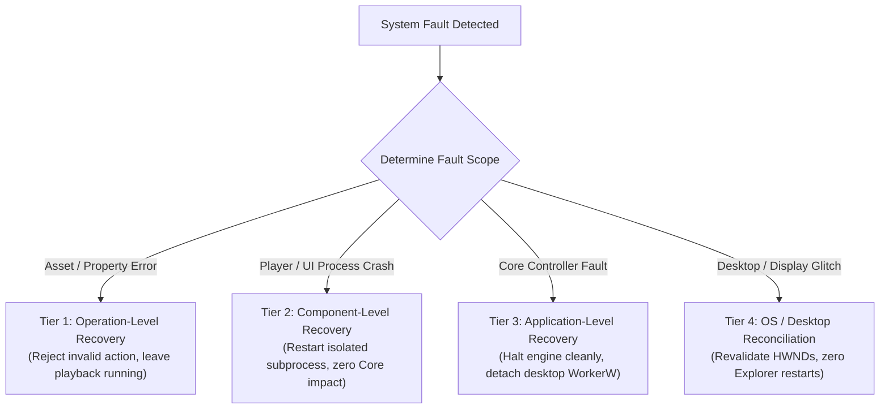
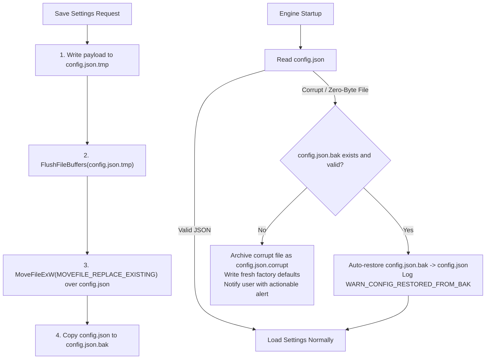

# ERROR-HANDLING & RECOVERY POLICY
## Document ID: KW-RCV-001 | Phase 3: Observability, Diagnostics & Operational Reliability

---

### 1. Comprehensive 16-Category Error Taxonomy

KinetiWall establishes a standardized, 16-category error taxonomy to classify failures across all subsystems. Every error in the engine maps to a specific category, determining whether the failure is transient (retry eligible), deterministic (fail immediately), or security-sensitive:

```
+--------------------------------------------------------------------------------------------------------------------------+
|                                           KINETIWALL ERROR TAXONOMY (16 CATEGORIES)                                      |
+-----+-----------------------+---------------+-----------------+------------------+-----------------+---------------------+
| CAT | CATEGORY NAME         | PREFIX        | SEVERITY        | NATURE           | RETRY ELIGIBLE? | FALLBACK STRATEGY   |
+-----+-----------------------+---------------+-----------------+------------------+-----------------+---------------------+
| 01  | Validation            | ERR_VAL_xxx   | WARN            | Deterministic    | NO              | Reject invalid data |
| 02  | Configuration         | ERR_CFG_xxx   | ERROR           | Transient/Det.   | YES (via .bak)  | Auto-restore .bak   |
| 03  | Filesystem            | ERR_FS_xxx    | ERROR           | Deterministic    | NO              | Safe detach/alert   |
| 04  | Media Decoding        | ERR_MED_xxx   | ERROR           | Deterministic    | NO              | Software / Static   |
| 05  | Renderer              | ERR_RND_xxx   | ERROR           | Transient/Fatal  | YES (Bounded)   | Respawn player      |
| 06  | Runtime Dependency    | ERR_RNT_xxx   | WARN / ERROR    | Deterministic    | NO              | Graceful disable    |
| 07  | IPC Communication     | ERR_IPC_xxx   | WARN / ERROR    | Transient        | YES (Max 3)     | Re-open Named Pipe  |
| 08  | Process Lifecycle     | ERR_PRC_xxx   | ERROR           | Transient        | YES (Backoff)   | Supervisory respawn |
| 09  | Windows Integration   | ERR_WIN_xxx   | ERROR / FATAL   | Deterministic    | NO              | WorkerW/Progman alt |
| 10  | Display Configuration | ERR_DSP_xxx   | INFO / WARN     | Transient        | YES (Debounce)  | Reconcile topology  |
| 11  | Power & Session       | ERR_PWR_xxx   | INFO            | Transient        | YES             | Revalidate state    |
| 12  | Resource Exhaustion   | ERR_RES_xxx   | ERROR           | Transient        | NO              | Throttle / Drop     |
| 13  | Permission & Security | ERR_SEC_xxx   | FATAL (Security)| Deterministic    | NO              | Immediate reject    |
| 14  | Logging & Diagnostics | ERR_LOG_xxx   | WARN            | Transient        | NO              | In-memory buffer    |
| 15  | Shutdown & Teardown   | ERR_SHT_xxx   | WARN            | Terminal         | NO              | Forced Job kill     |
| 16  | Internal State        | ERR_INT_xxx   | FATAL           | Invariant Breach | NO              | Safe engine halt    |
+-----+-----------------------+---------------+-----------------+------------------+-----------------+---------------------+
```

---

### 2. Four-Tier Recovery Scope & Component Ownership

Recovery actions are strictly isolated to the narrowest architectural boundary capable of resolving the fault:



#### 2.1 Tier 1: Operation-Level Recovery (Narrowest Scope)
- **Applicability**: User attempts to apply a missing video file, corrupt web wallpaper, or invalid property slider value.
- **Handling**: Reject the specific operation, preserve the currently playing wallpaper on all monitors, log `ERR_VAL_INVALID_INPUT`, and present an actionable banner in the Gallery UI.
- **Invariant**: A corrupt wallpaper package NEVER disrupts unrelated active wallpapers.

#### 2.2 Tier 2: Component-Level Recovery (Subprocess Isolation)
- **Applicability**: `kinetiwall-player-video.exe` crashes due to a graphics driver timeout (`TDR`), or `kinetiwall-ui.exe` terminates unexpectedly.
- **Handling**: The Core Controller's `LifecycleSupervisor` captures the exit code, logs `PLAYER_CRASH_DETECTED`, waits for the exponential backoff window, and respawns the player subprocess with identical parameters.
- **UI Independence**: If `kinetiwall-ui.exe` crashes, live wallpaper playback on all monitors continues completely uninterrupted.

#### 2.3 Tier 3: Application-Level Recovery (Core Controller Fault)
- **Applicability**: Unhandled panic or fatal state corruption in `kinetiwall-core.exe`.
- **Handling**: The native panic hook flushes logs to disk within 100ms and invokes `std::process::exit(2)`. The Windows Job Object (`JOB_OBJECT_LIMIT_KILL_ON_JOB_CLOSE`) terminates all child player processes, releasing all Direct3D swapchains and cleanly exposing the native Windows desktop.
- **Prohibition**: KinetiWall Core NEVER attempts self-resurrection without user initiation.

#### 2.4 Tier 4: Operating System & Desktop Recovery (Zero Shell Disruption)
- **Applicability**: DWM restart, display resolution change, or monitor detachment.
- **Handling**: Core detects Win32 `WM_DISPLAYCHANGE`, pauses affected players, queries new monitor bounds, and re-attaches render surfaces without shell tampering.
- **Strict Invariant**: KinetiWall **MUST NEVER restart `explorer.exe` or modify Windows system files** as a recovery mechanism.

---

### 3. Retry, Timeout & Bounded Exponential Backoff Policies

Uncontrolled retries cause CPU thrashing, battery drain, and desktop freezes. KinetiWall strictly classifies errors before deciding retry eligibility:

#### 3.1 Failure Classification for Retries
1. **Transient Failures (Retry Eligible)**: Named Pipe connection timeout on startup, graphics driver transient reset, temporary file lock.
2. **Deterministic Failures (Zero Retries)**: Missing file, invalid JSON manifest, unsupported video codec, corrupt archive.
3. **Security Violations (Zero Retries)**: Path traversal attempt (Zip Slip), unauthenticated IPC PID, banned executable extension.
4. **User-Cancelled Operations (Immediate Halt)**: User clicked stop, switched wallpaper, or initiated shutdown during an active recovery cycle.

#### 3.2 Bounded Exponential Backoff Algorithm with Jitter
For transient player crashes or IPC reconnects, delay is calculated as:

$$T_{\text{delay}} = \min\left(T_{\text{max}}, T_{\text{base}} \times 2^{(\text{attempt} - 1)}\right) \pm \text{Jitter}$$

- **Base Delay ($T_{\text{base}}$)**: $1,000\text{ ms}$ (1.0 second).
- **Max Delay ($T_{\text{max}}$)**: $4,000\text{ ms}$ (4.0 seconds).
- **Jitter ($\text{Jitter}$)**: Uniform random offset between $\pm 150\text{ ms}$ to prevent synchronized thread stampedes.
- **Max Consecutive Attempts**: Exactly **3 attempts** within a 60-second sliding window.
- **Circuit Breaker Action**: On failure of attempt 3, auto-recovery is permanently aborted (`RECOVERY_EXHAUSTED`).

#### 3.3 Operation Timeout Thresholds

| Operation Category | Maximum Timeout Threshold | Detection Mechanism | Action on Timeout Expiry |
| :--- | :--- | :--- | :--- |
| **Player Process Spawn & Handshake**| **$3,000\text{ ms}$ (3 seconds)** | Tokio Async Timeout | Terminate PID, log `ERR_PRC_LAUNCH_TIMEOUT`, retry once. |
| **IPC Synchronous Request / Reply** | **$2,000\text{ ms}$ (2 seconds)** | Named Pipe Read Deadline | Sever pipe, reconnect, re-query status (`CTR-01`). |
| **Direct3D Swapchain Frame Presentation**| **$1,000\text{ ms}$ (1 second)** | PresentMon / Watchdog | Mark player unresponsive, trigger graceful reload. |
| **Application Shutdown Flush** | **$250\text{ ms}$ (0.25 seconds)** | Hard Thread Timer | Abort flush, terminate process immediately. |
| **Package Decompression & Import** | **$30,000\text{ ms}$ (30 seconds)**| Staging Task Timeout | Cancel decompression, purge staging folder (`KW-DAT-005`). |

---

### 4. Configuration & State Resilience (Zero Data Loss)

Configuration persistence failures must never destroy user settings or result in zero-byte corrupted files:



#### 4.1 Invariants for Configuration Recovery
1. **Never Overwrite Without Backup**: The engine never touches `config.json` without verifying that `config.json.bak` exists or is updated atomically.
2. **Preserve Malformed Sources**: Corrupted configuration files are preserved on disk with timestamped suffixes (`config.json.corrupt_20261111`) for support analysis.
3. **Memory State Transparency**: If an in-memory setting fails to save to disk due to a filesystem write lock, the UI status is updated to *"Unsaved Changes - Disk Write Failed"*; the engine never pretends an unsaved change is durable.

---

### 5. Graceful Degradation Matrix

When an optional subsystem or hardware capability fails, KinetiWall degrades gracefully rather than aborting playback:

| Subsystem / Capability | Dependency / Prerequisite | Failure Mode | Graceful Degradation Action | User Impact |
| :--- | :--- | :--- | :--- | :--- |
| **Hardware Video Decoding** | GPU ASIC (D3D11VA / NVDEC) | GPU driver crash or unsupported profile | Fall back to software CPU decoding via FFmpeg (if CPU $\le 10\%$). | Minor CPU increase; playback continues. |
| **Web Interactive Wallpaper** | Microsoft Edge WebView2 | WebView2 runtime missing on legacy Win10 | Disable web wallpapers; display link to Evergreen installer. | Web wallpapers disabled; video works 100%. |
| **Audio-Reactive Spectrum** | Windows WASAPI Loopback | Audio endpoint detached or exclusive lock | Disable FFT analysis; wallpaper switches to static visual mode. | Visualizer stops dancing; zero audio mute. |
| **Thumbnail Generation** | Image decoder / GPU pipe | Corrupted video keyframe in package | Display generic video icon thumbnail in Gallery UI. | Visual placeholder; library remains usable. |
| **Secondary Display Output** | Multi-Monitor GPU Pipe | Monitor 2 disconnected or HDMI sleep | Suspend Player 2; preserve Monitor 1 playback uninterrupted. | Primary display unaffected. |
| **Diagnostic File Logging** | Local Disk I/O | Disk full or `%LOCALAPPDATA%` read-only | Route log events to 256-event in-memory ring buffer. | Zero disk writes; playback unaffected. |

---

### 6. User-Facing Error Reporting & Notification Policy

User notifications adhere strictly to actionable, human-centered communication standards:

1. **Structured Human Messages**:
   - *Technical Log Record*: `{"error_code": "ERR_MED_UNSUPPORTED_CODEC", "details": "hevc_main10_profile_not_supported"}`
   - *User-Facing Toast*: `"Cannot play video wallpaper: The video format (HEVC Main 10) is not supported by your graphics card. Try converting to H.264 MP4."`
2. **Stable Error Codes**: All UI notifications include a stable identifier (e.g. `[KW-ERR-304]`) for knowledge base searchability.
3. **No Focus-Stealing Modals**: Warnings and recoverable errors are presented as non-modal status banners in the Gallery UI or subtle Windows Action Center notifications. Modal popups are strictly banned during live playback.
4. **Direct Remediation Shortcut**: Error notifications provide one-click actions: *"Select Different Wallpaper"*, *"Copy Diagnostic Code"*, or *"Restore Default Settings"*.

