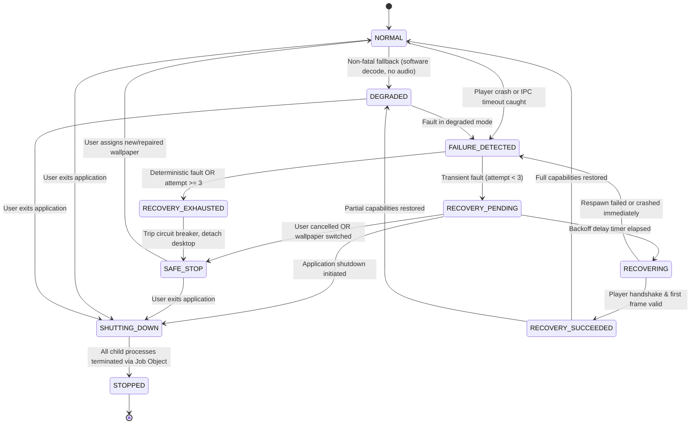

# RECOVERY STATE MACHINE SPECIFICATION
## Document ID: KW-RCV-002 | Phase 3: Observability, Diagnostics & Operational Reliability

---

### 1. Ten-State Formal Recovery Model

To guarantee deterministic, predictable error containment, KinetiWall formalizes its supervisory lifecycle into ten discrete operational states:

---

### 2. State Definitions & Operational Boundaries

| State Name | Operational Meaning | Allowed Engine Operations | Forbidden Operations | Responsible Component |
| :--- | :--- | :--- | :--- | :--- |
| **`NORMAL`** | All active monitors playing or idle cleanly at full capabilities. | Play, Pause, Assign, Configure, UI browsing. | Automatic recovery triggers. | `LifecycleSupervisor` |
| **`DEGRADED`** | Operational with fallback (software decode, audio disabled). | Play, Pause, Reconfigure, UI browsing. | Demanding unavailable hardware. | `LifecycleSupervisor` |
| **`FAILURE_DETECTED`** | Subprocess exit or IPC timeout intercepted; triage underway. | Process handle inspection, exit code query. | Spawning new processes immediately. | `LifecycleSupervisor` |
| **`RECOVERY_PENDING`** | Bounded exponential backoff delay active (1s, 2s, or 4s). | User cancellation, shutdown, UI state sync. | Spawning player before timer expires. | Tokio Timer Task |
| **`RECOVERING`** | Player subprocess spawn and handshake in progress. | IPC handshake, surface reparenting. | Concurrent wallpaper assignments. | `LifecycleSupervisor` |
| **`RECOVERY_SUCCEEDED`**| First frame presented and verified; state reconciliation. | Resetting backoff counters, logging success. | Entering recovery without fresh fault. | `LifecycleSupervisor` |
| **`RECOVERY_EXHAUSTED`**| Circuit breaker tripped; automated attempts permanently halted. | Emitting user toast, quarantining package. | Auto-retrying failed wallpaper. | `LifecycleSupervisor` |
| **`SAFE_STOP`** | Wallpaper detached; display shows clean Windows desktop. | Manual wallpaper assignment by user. | Automated background playback. | Core Controller |
| **`SHUTTING_DOWN`** | Application termination sequence in progress (250ms budget).| Process termination, log flushing. | Any recovery or respawn attempts. | Core Controller |
| **`STOPPED`** | Terminal state; all child processes dead, desktop clean. | None. Process exit. | Execution of any further code. | Operating System |

---

### 3. Comprehensive State Transition Table

| Current State | Trigger / Stimulus | Guard Conditions | Action Executed | Next State | Diagnostic Event Emitted |
| :--- | :--- | :--- | :--- | :--- | :--- |
| **`NORMAL`** | Player exit code $\ne 0$ | Exit was not requested by user | Log crash, compute backoff attempt | **`FAILURE_DETECTED`** | `PLAYER_CRASH_DETECTED` |
| **`NORMAL`** | Hardware decode fails | Software fallback supported | Switch to software decoder pipeline | **`DEGRADED`** | `RENDERER_HW_ACCEL_FALLBACK` |
| **`FAILURE_DETECTED`** | Triage completed | Crashes in 60s window $< 3$ | Start backoff timer ($1\text{s} \times 2^{\text{attempt}}$) | **`RECOVERY_PENDING`** | `RECOVERY_CYCLE_STARTED` |
| **`FAILURE_DETECTED`** | Triage completed | Crashes in 60s window $\ge 3$ | Trip circuit breaker, quarantine wallpaper | **`RECOVERY_EXHAUSTED`** | `SUPERVISOR_CRASH_LOOP_TRIPPED` |
| **`FAILURE_DETECTED`** | Deterministic error | Codec unsupported or file missing | Trip circuit breaker immediately | **`RECOVERY_EXHAUSTED`** | `WALLPAPER_SWITCH_FAILED` |
| **`RECOVERY_PENDING`** | Timer expires | User did not cancel or exit | Spawn player subprocess with same UUID | **`RECOVERING`** | `PLAYER_SPAWN_REQUESTED` |
| **`RECOVERY_PENDING`** | User switches wallpaper| New wallpaper UUID requested | Cancel timer, purge pending task | **`NORMAL`** (Assign) | `WALLPAPER_SELECTION_REQUESTED` |
| **`RECOVERY_PENDING`** | User stops playback | Stop button clicked | Cancel timer, detach desktop surface | **`SAFE_STOP`** | `WALLPAPER_STOPPED` |
| **`RECOVERY_PENDING`** | App shutdown signal | Exit clicked or OS shutdown | Cancel timer, initiate teardown | **`SHUTTING_DOWN`** | `APP_SHUTDOWN_INITIATED` |
| **`RECOVERING`** | First frame presented | Frame presented within $3,000\text{ ms}$ | Reset crash counter after 60s stability | **`RECOVERY_SUCCEEDED`** | `RECOVERY_CYCLE_COMPLETED` |
| **`RECOVERING`** | Handshake timeout | $3,000\text{ ms}$ elapsed with no ACK | Kill unresponsive PID, increment counter | **`FAILURE_DETECTED`** | `PLAYER_STARTUP_TIMED_OUT` |
| **`RECOVERY_EXHAUSTED`**| Immediate transition | Automatic recovery halted | Reset display to native static desktop | **`SAFE_STOP`** | `WALLPAPER_STOPPED` |
| **`SAFE_STOP`** | User assigns wallpaper | Valid wallpaper selected | Spawn fresh player instance | **`RECOVERING`** | `PLAYER_SPAWN_REQUESTED` |
| **`ANY STATE`** | User exits application | Exit signal received | Terminate all child PIDs via Job Object | **`SHUTTING_DOWN`** | `APP_SHUTDOWN_INITIATED` |
| **`SHUTTING_DOWN`** | 250ms flush complete | Child processes terminated | Flush logger, close handles, exit process| **`STOPPED`** | `APP_SHUTDOWN_COMPLETED` |

---

### 4. Critical State Machine Invariants

1. **User Stop Overrides Recovery Task**: If a user stops playback while `RECOVERY_PENDING` is sleeping on an exponential backoff timer, the timer token is immediately cancelled. A stale timer callback MUST NEVER resurrect playback.
2. **Single Active Player Instance Invariant**: Exactly **one player subprocess** may exist per physical monitor. The supervisor MUST confirm the previous PID is dead (`GetExitCodeProcess != STILL_ACTIVE`) before launching a replacement.
3. **Shutdown Absolute Precedence**: When `SHUTTING_DOWN` is entered, all recovery state machines are invalidated instantly. No child process may be spawned under any circumstance.
4. **Crash Window Reset Rule**: The consecutive crash counter resets to zero ($0$) ONLY after a player maintains continuous, stable playback in `NORMAL` state for **60 consecutive seconds**.
5. **Job Object Teardown Guarantee (`DEC-PRF-08`)**: All player subprocesses are bound to a Windows Job Object configured with `JOB_OBJECT_LIMIT_KILL_ON_JOB_CLOSE`. Even if the Core Controller crashes with an unhandled access violation, the Windows kernel terminates all child processes instantly, preventing zombie renderers.

