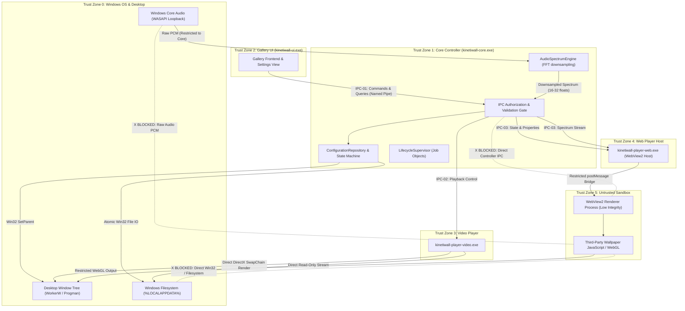

# AUTHORIZATION & TRUST BOUNDARY SPECIFICATION
## Document ID: KW-SEC-003 | Phase 2: System Architecture & Technical Decisions

---

### 1. Trust Hierarchy & Security Zones

KinetiWall establishes six distinct **Security Trust Zones**. Trust does not flow transitively: an operation originating in a lower trust zone cannot execute actions in a higher zone without passing through an explicit validation and authorization boundary in the Core Controller.

```
+--------------------------------------------------------------------------------------------------------------------+
|                                             KINETIWALL TRUST HIERARCHY                                             |
+--------+------------------------------------+--------------------------+-------------------------------------------+
| ZONE   | ENTITY                             | INTEGRITY / PRIVILEGE    | SECURITY DESCRIPTION                      |
+--------+------------------------------------+--------------------------+-------------------------------------------+
| Zone 0 | Windows Kernel & Win32 Desktop     | System / Native Win32    | Host OS, Desktop Manager, WorkerW tree    |
| Zone 1 | Core Controller (kinetiwall-core)  | Medium Integrity (Native)| Sole authoritative state writer & manager |
| Zone 2 | Gallery UI (kinetiwall-ui)         | Medium Integrity (Tauri) | User-facing control plane & viewer        |
| Zone 3 | Video Player (player-video)        | Medium Integrity (Media) | Isolated mpv/MediaFoundation renderer     |
| Zone 4 | Web Player (player-web)            | Medium Integrity Host    | WebView2 host supervisor                  |
| Zone 5 | Web Renderer & Wallpaper Script    | Low Integrity / Sandbox  | Untrusted third-party HTML/JS/WebGL code  |
+--------+------------------------------------+--------------------------+-------------------------------------------+
```

---

### 2. Trust-Boundary and Data-Flow Diagram



---

### 3. Comprehensive Command Authorization Matrix

Every operation in the system is evaluated against the authenticated caller's security identity. The Core Controller serves as the reference monitor; it strictly denies any request not explicitly permitted in this matrix.

| Operation / System Capability | Zone 1: Core Controller | Zone 2: Gallery UI | Zone 3: Video Player | Zone 4: Web Player Host | Zone 5: Wallpaper Script | Unauthenticated Local Process |
| :--- | :--- | :--- | :--- | :--- | :--- | :--- |
| **Read Engine State & Telemetry** | `ALLOW` | `ALLOW` | `DENY` | `DENY` | `DENY` | `DENY` |
| **Browse Wallpaper Library Metadata** | `ALLOW` | `ALLOW` | `DENY` | `DENY` | `DENY` | `DENY` |
| **Import / Unpack New Wallpaper** | `ALLOW` | `REQ_FORWARD`* | `DENY` | `DENY` | `DENY` | `DENY` |
| **Modify Application Settings (`config.json`)** | `ALLOW` | `ALLOW WITH VALIDATION` | `DENY` | `DENY` | `DENY` | `DENY` |
| **Assign Wallpaper to Monitor** | `ALLOW` | `ALLOW WITH VALIDATION` | `DENY` | `DENY` | `DENY` | `DENY` |
| **Reparent Window to Desktop (`WorkerW`)** | `ALLOW` | `DENY` | `DENY` | `DENY` | `DENY` | `DENY` |
| **Play / Pause / Stop Playback** | `ALLOW` | `ALLOW WITH VALIDATION` | `DENY` (Receive only) | `DENY` (Receive only) | `DENY` | `DENY` |
| **Update Dynamic Properties** | `ALLOW` | `ALLOW WITH VALIDATION` | `DENY` | `DENY` | `DENY` | `DENY` |
| **Report Player Health / Crash** | `ALLOW` | `DENY` | `ALLOW` | `ALLOW` | `DENY` | `DENY` |
| **Read Raw Audio Stream (WASAPI PCM)** | `ALLOW` | `DENY` | `DENY` | `DENY` | `DENY` | `DENY` |
| **Receive Frequency Spectrum Buckets** | `ALLOW` | `ALLOW` | `DENY` | `ALLOW` | `ALLOW (via postMessage)` | `DENY` |
| **Read Package Local Assets** | `ALLOW` | `ALLOW (Thumbnails)` | `ALLOW (Own Assets)` | `ALLOW (Own Assets)` | `ALLOW (Virtual Host)` | `DENY` |
| **Read Arbitrary Filesystem Paths** | `DENY` | `DENY` | `DENY` | `DENY` | `DENY` | `DENY` |
| **Execute Native Processes (`cmd/powershell`)** | `ALLOW (Job Object Only)` | `DENY` | `DENY` | `DENY` | `DENY` | `DENY` |
| **Access Inbound / Outbound Network** | `DENY (Local Engine)` | `DENY` | `DENY` | `DENY` | `DENY (Local Default)`** | `DENY` |
| **Terminate / Kill Process** | `ALLOW` | `DENY` | `DENY` | `DENY` | `DENY` | `DENY` |
| **Trigger Application Shutdown** | `ALLOW` | `ALLOW WITH VALIDATION` | `DENY` | `DENY` | `DENY` | `DENY` |

*\*Note on Import*: The Gallery UI does not extract archives directly. It transmits a `REQ_IMPORT_WALLPAPER` containing the archive file path to the Core Controller. The Core conducts all staging, Zip Slip mitigation, decompression bomb scanning, and atomic folder placement.  
*\*\*Note on Web Wallpaper Network*: Interactive wallpapers are strictly blocked from outbound network access by default. Web views load assets exclusively from `https://kinetiwall.local/` (virtual host mapping).

---

### 4. Critical Security Enforcement Invariants

1. **No Client-Side Authorization Trust**:
   The Core Controller never accepts a message field claiming caller identity (e.g., `{"sender": "gallery_ui"}`). Caller identity is derived exclusively by the operating system kernel via `GetNamedPipeClientProcessId` and verified against the registered process handle table.
2. **Untrusted Wallpaper Script Containment**:
   Wallpaper scripts running in Zone 5 have zero access to the Named Pipe. They cannot see, open, or write to pipe handles. Their only channel of communication is the WebView2 `window.chrome.webview.postMessage` bridge, which is handled by the Web Player host (Zone 4) and strictly limited to receiving property updates and emitting rendering errors.
3. **Desktop Window Reparenting Monopoly**:
   Only `kinetiwall-core.exe` is authorized to invoke Win32 `SetParent` against Windows shell desktop handles (`WorkerW` / `Progman`). Player processes create top-level frameless borderless windows and pass their `HWND` to the Core via IPC; the Core performs the reparenting and z-order adjustment to prevent window hierarchy tampering.

