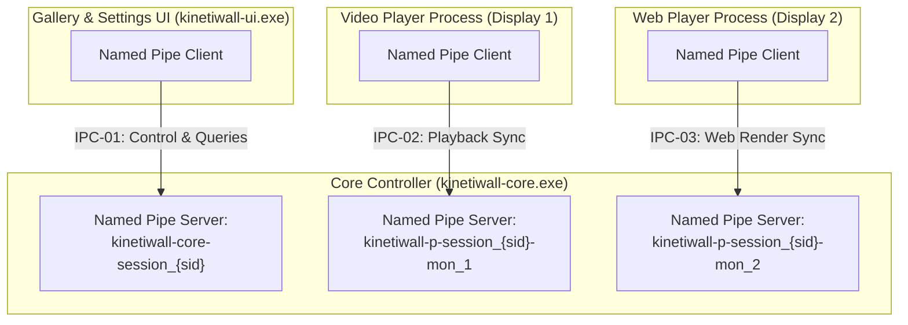

# IPC ARCHITECTURE AND ENDPOINT SPECIFICATION
## Document ID: KW-SEC-001 | Phase 2: System Architecture & Technical Decisions

---

### 1. IPC Transport Evaluation and Justification

The choice of Inter-Process Communication (IPC) transport dictates KinetiWall's latency, resource footprint, platform compatibility, and security boundary. Five candidate transport mechanisms were rigorously evaluated against Windows desktop operational constraints:

| Evaluation Criterion | Candidate A: Windows Named Pipes | Candidate B: Local TCP Loopback (`127.0.0.1`) | Candidate C: Unix Domain Sockets (`AF_UNIX`) | Candidate D: Win32 Shared Memory + Events | Candidate E: `WM_COPYDATA` |
| :--- | :--- | :--- | :--- | :--- | :--- |
| **Security & Access Control** | **Optimal**: Win32 DACLs, SDDL, process SID restriction. | **Poor**: Any local process can connect; zero native ACLs. | Good: File ACLs, but uneven on older Win10 builds. | Complex: Requires custom ring buffer and mutexes. | Weak: UIPI rules apply, but vulnerable to window message spoofing. |
| **Firewall Warnings** | **Zero**: No network stack involved. | **High Risk**: Windows Defender Firewall triggers warning prompt. | Zero. | Zero. | Zero. |
| **Throughput & Latency** | **Sub-millisecond** (<0.2ms for 64KB message). | Low (~0.5ms), but socket stack overhead. | Low (~0.3ms). | **Ultra-low** (shared memory page swap). | High latency; UI thread message pump bound. |
| **Framing & Streaming** | Duplex byte-stream or message-mode framing. | Stream only (requires custom length framing). | Stream only. | Manual buffer management required. | Size capped, synchronous blocking. |
| **Process Verification** | **Native**: `GetNamedPipeClientProcessId`. | None (TCP connection doesn't expose peer PID safely). | `SO_PEERCRED` on Linux, incomplete on Windows. | Requires custom handshake. | Sender HWND can be spoofed or reused. |
| **Tokio Async Support** | **First-class**: `tokio::net::windows::named_pipe`. | First-class (`tokio::net::TcpStream`). | Experimental on Windows. | Requires manual synchronization. | Synchronous Win32 event loop only. |

#### Definitive Architectural Decision: Candidate A (Windows Named Pipes)
KinetiWall standardizes on **Windows Named Pipes** in duplex byte-stream mode, wrapped with length-prefixed frame encoding and managed via `tokio::net::windows::named_pipe`.

---

### 2. Named Pipe Endpoint Topology

To avoid bottle-necking all communications into a single contended pipe, KinetiWall deploys a **Hub-and-Spoke Endpoint Topology** managed authoritatively by the Core Controller:



#### 2.1 Endpoint Catalog

| Endpoint ID | Pipe Name Pattern | Server Process | Authorized Client | Protocol Contract | Purpose |
| :--- | :--- | :--- | :--- | :--- | :--- |
| **EP-CORE-UI** | `\\.\pipe\kinetiwall-core-s{sid}` | `kinetiwall-core.exe` | `kinetiwall-ui.exe` | `CTR-01` (Core-UI) | UI commands, settings updates, wallpaper library queries, monitor assignment. |
| **EP-PLAYER-V** | `\\.\pipe\kinetiwall-p-s{sid}-{uuid}` | `kinetiwall-core.exe` | `kinetiwall-player-video.exe` | `CTR-02` (Core-VideoPlayer) | Video playback states (play, pause, mute), frame timing, dynamic video properties. |
| **EP-PLAYER-W** | `\\.\pipe\kinetiwall-w-s{sid}-{uuid}` | `kinetiwall-core.exe` | `kinetiwall-player-web.exe` | `CTR-03` (Core-WebPlayer) | Web render states, dynamic property sync, audio spectrum buckets, interaction events. |

---

### 3. Session Scoping and Collision Prevention

On Windows workstations with multi-user sessions (Fast User Switching or Remote Desktop Multi-Session), multiple instances of KinetiWall could execute concurrently under different user accounts.

#### 3.1 Session Scoping Rule
All pipe names MUST incorporate the active Windows Logon Session ID (`ProcessIdToSessionId`).
- A pipe created by User A in Session 1 will be named `\\.\pipe\kinetiwall-core-s1`.
- A pipe created by User B in Session 2 will be named `\\.\pipe\kinetiwall-core-s2`.
- Cross-session connections are structurally prevented by Windows kernel object namespace boundaries and explicit DACLs.

#### 3.2 Stale Endpoint Detection & Recovery
If `kinetiwall-core.exe` crashes or is forcefully terminated via Task Manager, the Windows kernel automatically closes all pipe instances associated with the terminated process handles. 
When a new `kinetiwall-core.exe` starts:
1. It attempts to create the pipe with `FILE_FLAG_FIRST_PIPE_INSTANCE`.
2. If `ERROR_ALREADY_EXISTS` is returned:
   - The new core connects as a client and issues a `PING` command.
   - If a valid response is received, a running core is already active; the secondary core sends a signal to bring the existing UI to focus and terminates itself cleanly (single-instance invariant).
   - If the connection times out or fails (stale orphaned handle), the core waits 500ms for OS handle cleanup, retries creation, and logs a recovery warning.

---

### 4. Windows Security Descriptors (DACLs) and Access Control

Relying on default Windows security descriptors for Named Pipes is a severe vulnerability: by default, any process running in the same logon session (or with Network Access rights) can connect to the pipe.

#### 4.1 Strict Discretionary Access Control List (DACL) Specification
Every KinetiWall pipe server MUST be created with an explicit Windows Security Descriptor constructed via SDDL (Security Descriptor Definition Language):

```
D:(A;;GRGW;;;WD) -> REJECTED (Too permissive: grants Everyone read/write)
D:(A;;GA;;;OW)(A;;GA;;;BA) -> APPROVED
```

**Approved SDDL String**:
`"D:P(A;;GA;;;PS)(A;;GA;;;OW)(A;;GA;;;BA)"`
- `D:P`: Discretionary ACL, Protected (prevents inheritance from container).
- `(A;;GA;;;PS)`: Allow Generic All to Principal Self / Current User SID (`GetCurrentUserSid()`).
- `(A;;GA;;;OW)`: Allow Generic All to Owner Rights.
- `(A;;GA;;;BA)`: Allow Generic All to Built-in Administrators.
- **Explicit Omission**: `WD` (Everyone), `AN` (Anonymous), `BU` (Builtin Users), `IU` (Interactive Users). Only the exact user SID running the core process is granted access.

#### 4.2 Mandatory Integrity Control (MIC)
KinetiWall pipe endpoints enforce a Mandatory Label of Medium Integrity (`S:(ML;;NW;;;ME)`):
- Processes running at Low Integrity (e.g. sandboxed Edge/Chrome renderer tabs or restricted browser sandboxes) are denied write access (`NW` = No Write Up), preventing a compromised renderer from injecting commands into the pipe.

---

### 5. Client Process Identification and Impersonation Defense

#### 5.1 Client Process Identification (`GetNamedPipeClientProcessId`)
When a client connects to an endpoint:
1. The server calls Win32 `GetNamedPipeClientProcessId(pipe_handle, &client_pid)`.
2. The server queries its internal `ProcessRegistry` (managed by `LifecycleSupervisor` in `kinetiwall-core.exe`):
   - For `EP-PLAYER-*`: The `client_pid` MUST exactly match the `child_process.id()` spawned for that specific player instance. If an unexpected process connects, the pipe is immediately disconnected via `DisconnectNamedPipe` and `WARN_UNAUTHORIZED_CLIENT_PID` is logged.
   - For `EP-CORE-UI`: The `client_pid` MUST belong to the current user's session and match an executable signed by KinetiWall (`kinetiwall-ui.exe`).

#### 5.2 Named Pipe Impersonation Defense
A notorious Windows security issue is Named Pipe impersonation (`ImpersonateNamedPipeClient`), where a malicious server can impersonate an elevated client, or a malicious client tricking a server.

**Defensive Safeguards Enforced**:
1. **Server Prohibition**: `kinetiwall-core.exe` and player processes NEVER call `ImpersonateNamedPipeClient`. The API is completely banned from the codebase.
2. **Client Security Quality of Service (SQOS)**:
   When any KinetiWall client connects to a server pipe using `CreateFileW`, it MUST specify the `SECURITY_SQOS_PRESENT | SECURITY_IDENTIFICATION` flags:
   ```rust
   use windows::Win32::Storage::FileSystem::SECURITY_SQOS_PRESENT;
   use windows::Win32::Security::SECURITY_IDENTIFICATION;

   // Flags passed to CreateFileW:
   // Prevents the pipe server from impersonating the client's Windows token.
   let flags = SECURITY_SQOS_PRESENT | SECURITY_IDENTIFICATION.0;
   ```
   Under `SECURITY_IDENTIFICATION`, the server can only query the client's SID and token privileges; it is cryptographically barred by the Windows kernel from impersonating the client to access files or perform administrative actions.

