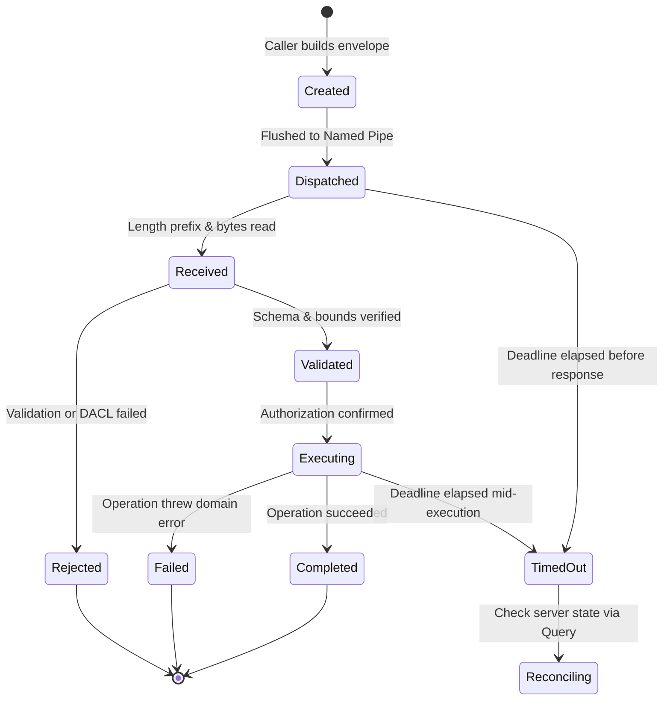

# VALIDATION & FAILURE SEMANTICS POLICY
## Document ID: KW-SEC-005 | Phase 2: System Architecture & Technical Decisions

---

### 1. Rigorous Message Validation and Bounded Resource Limits

To defend against Denial of Service (DoS) attacks and buffer/memory exhaustion, every incoming message over Windows Named Pipes is subjected to deterministic size and schema constraints prior to JSON deserialization.

#### 1.1 Numerical Resource Thresholds

| Validation Metric | Hard Upper Bound | Enforcement Mechanism | Action on Violation |
| :--- | :--- | :--- | :--- |
| **Max IPC Message Length** | **4,194,304 bytes (4 MB)** | Inspected on 4-byte length prefix. | **Immediate Socket Severing** (`DisconnectNamedPipe`). Zero buffer allocation. |
| **Max JSON Object Depth** | **16 levels** | Monitored during serde stream parse. | Immediate parse abort (`ERR_EXCESSIVE_DEPTH`). |
| **Max String Field Length** | **4,096 characters** (Standard)<br/>**65,536 characters** (Descriptions) | Deserializer string visitor check. | Payload rejected (`ERR_STRING_TOO_LONG`). |
| **Max Array Elements** | **1,024 elements** | Array length check. | Payload rejected (`ERR_ARRAY_EXCEEDED`). |
| **Volume Range** | **$0.0 \le v \le 1.0$** | Floating-point clamp. | Value automatically clamped or rejected. |
| **Framerate Cap** | **$15 \le fps \le 240$** | Integer interval validation. | Clamped to nearest valid threshold. |
| **Identifier Formats** | **Valid RFC 4122 UUIDv4** | RegEx / `Uuid::parse_str`. | Rejected with `ERR_INVALID_IDENTIFIER`. |
| **Monitor Device Path** | `^\\\\\.\\DISPLAY[0-9]{1,2}$` | Format assertion. | Rejected with `ERR_INVALID_MONITOR_PATH`. |

---

### 2. Request Lifecycle & Concurrency States

An IPC request progresses through eight discrete operational states. The architecture strictly distinguishes between client-side timeouts and server execution status.



#### 2.1 Timeout Semantics & State Ambiguity
A client-side timeout (e.g. 3000ms elapsed waiting for `RESP_ASSIGN_WALLPAPER`) **MUST NEVER be assumed to mean the operation failed**. The server may have already committed the assignment to disk and spawned the player.
- **Handling Protocol**:
  1. The client marks the request as `TimedOut`.
  2. The client MUST NOT automatically retry a non-idempotent request.
  3. The client issues a read-only query (`REQ_GET_APP_STATE`) with the previous `correlation_id` to reconcile observed reality with intended state.

---

### 3. Idempotency & Automated Retry Rules

Operations are classified by their idempotency characteristics to prevent unintended duplicate side effects:

| Command Category | Examples | Idempotency | Auto-Retry Policy |
| :--- | :--- | :--- | :--- |
| **Read Queries** | `REQ_GET_APP_STATE`, `REQ_GET_CONFIG` | **Strictly Idempotent** | Safe to retry up to 3 times with exponential backoff. |
| **Target State Control** | `CMD_PLAY`, `CMD_PAUSE`, `CMD_SET_MUTE` | **Idempotent** | Safe to retry immediately. Repeated execution converges on target state. |
| **Property Sync** | `CMD_SYNC_PROPERTIES` | **Idempotent** | Safe to retry. Highest timestamp wins; stale timestamps ignored. |
| **State Modifications** | `REQ_SET_CONFIG`, `REQ_ASSIGN_WALLPAPER` | **Conditionally Idempotent** | Safe only if accompanied by identical `correlation_id` within 5s deduplication window. |
| **Destructive Actions** | `REQ_IMPORT_WALLPAPER`, `REQ_DELETE_WALLPAPER` | **Non-Idempotent** | **Zero Automatic Retries**. Requires explicit user re-trigger or Core deduplication confirmation. |

#### 3.1 Server-Side Deduplication Cache
The Core Controller maintains a sliding-window cache of recently executed request IDs:
- **Cache Size**: 256 entries.
- **TTL**: 5,000 milliseconds.
- **Deduplication Rule**: If a request arrives with a `message_id` currently in the cache, the Core does not re-execute side effects. It re-emits the cached response payload immediately.

---

### 4. Cancellation Protocol for Long-Running Operations

Operations that involve prolonged execution (such as unpacking multi-gigabyte video wallpapers or compiling complex WebGL shaders) support deterministic cancellation.

1. **Cancellation Request**:
   The caller transmits `CMD_CANCEL_OPERATION`:
   ```json
   {
     "target_message_id": "8889c614-7253-4f13-8954-00004e51caff",
     "reason": "user_cancelled"
   }
   ```
2. **Execution Teardown**:
   - The worker task monitors an atomic cancellation token (`tokio_util::sync::CancellationToken`).
   - On trigger, the worker aborts decompression, closes file handles, and completely purges the associated staging folder (`cache/tmp/import_{uuid}/`).
   - The Core returns `ERR_OPERATION_CANCELLED` to the original caller.

---

### 5. Race Conditions and Concurrency Conflict Reconciliation

| Race Condition Scenario | Architectural Hazard | Reconciliation Protocol |
| :--- | :--- | :--- |
| **Pause Arrives During Media Load** | Player receives pause before it finishes opening video stream. | **State Queuing**: The player registers the desired state as `Paused`. As soon as the video stream finishes initialization, it immediately enters pause without rendering a single frame. |
| **Rapid Property Slider Adjustments** | 50 property updates sent per second, saturating IPC pipe. | **UI Debouncing & Frame Clamping**: UI throttles emissions to 60 Hz (16.6ms intervals). The Core drops intermediate updates if a newer value for the same property key is already in the channel buffer. |
| **Display Unplugged During Assignment** | Wallpaper is being applied to a monitor whose HWND/display is being destroyed. | **Pre-Commit Verification**: Core re-queries `EnumDisplayMonitors` immediately before reparenting. If the display handle is invalid, the assignment is aborted cleanly without crashing. |
| **Duplicate Player Termination** | Core and user trigger close at the same time. | **Idempotent Exit**: The supervisor marks the player `Terminating`. Secondary termination signals are discarded as no-ops. |

