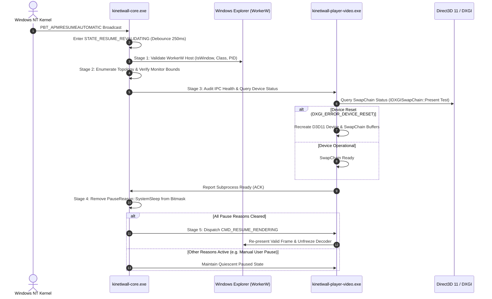

# Sleep, Resume & Display Wake Recovery Policy
**Document ID:** `KW-LCE-002`  
**Deliverable:** B (Sleep, Resume, and Display Wake Recovery Policy)  
**Parent Document:** [README.md](file:///e:/Projects/All%20working%20projects/App%20projects%20working/KinetiWall%20Engine%20(working)/docs/session_and_power_management/README.md)  
**Classification:** Core System Architecture / Operational Reliability Standard  

---

## 1. Pre-Sleep Preparation Protocol (`PBT_APMSUSPEND`)

When Windows prepares to enter sleep, modern power management architectures (ACPI S3, S4 Hibernate, and Windows 10/11 Modern Standby) allocate a strictly bounded time budget (typically $< 2000\text{ ms}$) for desktop applications to complete teardown before power is cut.

KinetiWall executes an unyielding 4-step preparation sequence within a strict **$150\text{ ms}$ internal budget**:

```
[PBT_APMSUSPEND Received by Core]
                |
                v  (Step 1: 10 ms)
   Set SystemLifecycleState = STATE_SUSPEND_PREPARING
   Add PauseReason::SystemSleep to PauseReasonSet
                |
                v  (Step 2: 30 ms)
   Broadcast CMD_PAUSE_RENDERING over Named Pipes to all Players
   - Players stop swapchain Present calls
   - Players freeze mpv decoder / WebView2 rAF loops
   - Players call WASAPI IAudioClient::Stop()
                |
                v  (Step 3: 50 ms)
   Flush In-Memory Configuration State to Disk via MoveFileExW
   Flush SQLite WAL via PRAGMA wal_checkpoint(TRUNCATE)
                |
                v  (Step 4: 10 ms)
   Return TRUE to Windows OS; Enter Quiescent Quota State
```

---

## 2. Staged Post-Resume Revalidation Pipeline (`PBT_APMRESUMEAUTOMATIC`)

When Windows wakes from sleep, peripheral buses, GPU display controllers, and audio endpoints power up asynchronously. Assuming the system is ready immediately upon `PBT_APMRESUMEAUTOMATIC` causes black rectangles, device-loss panics, and audio distortion.

KinetiWall enforces a staged, validated 5-stage revalidation pipeline:



### 2.1 Revalidation Stages & Failure Responses

| Stage | Operation | Verification Target | Failure Response / Fallback |
| :---: | :--- | :--- | :--- |
| **Stage 1** | **Host Revalidation** | Verify `WorkerW` HWND is still valid and owned by `explorer.exe`. | If invalid: Core triggers `discover_behind_icon_workerw()`. If recovery fails: enters `STATE_LIFECYCLE_DEGRADED`. |
| **Stage 2** | **Topology Re-audit** | Query `EnumDisplayMonitors`; compare against previous layout. | If monitors changed: triggers `handle_display_change()` with 500 ms debounce. Resizes or spawns players as needed. |
| **Stage 3** | **Graphics Device Audit** | Subprocess tests Direct3D 11 device for `DXGI_ERROR_DEVICE_REMOVED` / `RESET`. | If device lost: player cleanly destroys swapchain and reinitializes D3D11 device context. |
| **Stage 4** | **Audio Endpoint Audit** | Query WASAPI default audio endpoint availability. | If endpoint lost: player mutes audio and retries reconnection asynchronously without halting video. |
| **Stage 5** | **Policy Gate Evaluation** | Check `PauseReasonSet.is_empty()`. | If other pause reasons active (e.g. `UserManual`): remains paused. If empty: unfreezes rendering. |

---

## 3. Display Sleep vs System Sleep Handling

Operating systems frequently power off computer monitors after 5 to 10 minutes of user inactivity while the CPU and background tasks continue executing.

* **Detection:** Observed via `RegisterPowerSettingNotification` with `GUID_MONITOR_POWER_ON`:
  - `Data == 0` (Display Off): Core dispatches `CMD_PAUSE_RENDERING`. Swapchain `Present` is halted, media decoders are frozen, and audio capture stops. **Background CPU overhead drops to $< 0.05\%$**.
  - `Data == 1` (Display On): Core dispatches `CMD_RESUME_RENDERING` (if no other pause reasons are active). Playback resumes instantly with zero frame stutter.
* **Non-Destructive Invariant:** Display power-off **never terminates player processes** or releases GPU swapchains. The presentation pipeline remains memory-resident, enabling instant ($\le 50\text{ ms}$) resume when the user moves the mouse.

