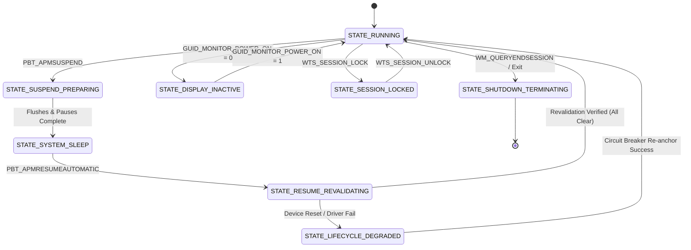

# Windows Session & Power Integration Architecture
**Document ID:** `KW-LCE-001`  
**Deliverable:** A (Windows Session and Power Integration Architecture)  
**Parent Document:** [README.md](file:///e:/Projects/All%20working%20projects/App%20projects%20working/KinetiWall%20Engine%20(working)/docs/session_and_power_management/README.md)  
**Classification:** Windows Platform Integration / Lifecycle Standard  

---

## 1. Native Windows Notification Mechanisms & Subscriptions

Windows provides specialized APIs for observing session, power, and desktop transitions. KinetiWall registers for these notifications through its long-lived, unprivileged supervisor daemon:

```
+---------------------------------------------------------------------------------+
|                             WINDOWS NT KERNEL & USER32                          |
+---------------------------------------------------------------------------------+
           |                                                |
           | WM_POWERBROADCAST                              | WM_WTSSESSION_CHANGE
           | RegisterPowerSettingNotification               | WTSRegisterSessionNotification
           v                                                v
+---------------------------------------------------------------------------------+
|                         kinetiwall-core.exe (Supervisor)                         |
|                                                                                 |
|  +---------------------------------------------------------------------------+  |
|  |           Hidden Win32 Message Window ("KinetiWall_Core_MessageLoop")     |  |
|  | - Sole receiver of native OS power and session broadcast messages         |  |
|  | - Evaluates Composable Pause Reason Bitmask (PauseReasonSet)              |  |
|  | - Dispatches coordinated IPC commands to dedicated player subprocesses     |  |
|  +---------------------------------------------------------------------------+  |
+---------------------------------------------------------------------------------+
          |                                               |
          | IPC: CMD_PAUSE_RENDERING                      | IPC: CMD_RESUME_RENDERING
          v                                               v
+-------------------------------+              +----------------------------------+
| kinetiwall-player-video.exe   |              | kinetiwall-player-web.exe        |
| Display: \\.\DISPLAY1         |              | Display: \\.\DISPLAY2            |
| - Halts swapchain Present     |              | - Freezes rAF animation loops    |
| - Freezes mpv media decoders  |              | - Halts WebGL shader execution   |
+-------------------------------+              +----------------------------------+
```

### 1.1 Native Notification Specifications

1. **Power Setting Notifications (`RegisterPowerSettingNotification`):**
   * Registered against GUID `GUID_MONITOR_POWER_ON` to observe display power states ($0 = \text{Off}, 1 = \text{On}, 2 = \text{Dimmed}$).
   * Registered against GUID `GUID_ACDC_POWER_SOURCE` to observe AC vs Battery power transitions.
   * Registered against GUID `GUID_BATTERY_PERCENTAGE_REMAINING` to enforce low-battery pause policies.
2. **System Power Broadcasts (`WM_POWERBROADCAST`):**
   * `PBT_APMSUSPEND`: System is preparing to enter S3/S4/Modern Standby sleep.
   * `PBT_APMRESUMEAUTOMATIC`: System has resumed from sleep (may wake without user presence).
   * `PBT_APMRESUMESUSPEND`: System has resumed due to explicit user interaction.
3. **Terminal Services Session Notifications (`WTSRegisterSessionNotification`):**
   * `WTS_SESSION_LOCK`: Workstation locked (`Win + L` or screensaver timeout).
   * `WTS_SESSION_UNLOCK`: Workstation unlocked; credentials accepted.
   * `WTS_SESSION_LOGOFF`: User session terminating; initiates fast engine shutdown.
   * `WTS_REMOTE_CONNECT` / `WTS_REMOTE_DISCONNECT`: Remote Desktop connection changes.

---

## 2. Event Ownership & Multi-Process Boundary Architecture

In conformance with `ADR-0002` and `PROC-01..04`:

* **`kinetiwall-core.exe` (Authoritative Policy Supervisor):**
  - Sole owner of native Win32 power and session subscriptions.
  - Maintains the authoritative `SystemLifecycleState` and `PauseReasonSet`.
  - Translates raw Windows messages into typed application events and coordinates child renderers over Named Pipe IPC.
* **`kinetiwall-ui.exe` (Ephemeral GUI Process):**
  - Registers **zero** native OS power or session notifications.
  - When the user closes the settings window, the UI process exits completely ($0.0\text{ MB}$ footprint) without impacting lifecycle monitoring (`KW-NG-001`).
* **`kinetiwall-player-*.exe` (Per-Display Renderers):**
  - Registers **zero** global power or session notifications.
  - Receives high-level pause/resume commands from Core via IPC (`CMD_PAUSE_RENDERING`, `CMD_RESUME_RENDERING`).
  - Freezes local render loops, swapchains, and media decoders upon command.

---

## 3. Canonical Lifecycle State Model

The operating system and engine lifecycle is modeled as an 8-state deterministic state machine:



### 3.1 State Definitions & Action Semantics

1. **`STATE_RUNNING`**: Normal operation. Hardware-accelerated wallpaper playback active at 60 FPS on all assigned displays.
2. **`STATE_SUSPEND_PREPARING`**: System sleep notification received. IPC pause commands dispatched; in-memory settings committed to disk. Timeout budget: $150\text{ ms}$.
3. **`STATE_SYSTEM_SLEEP`**: Host is suspended. Renderers frozen, audio sessions released, zero CPU/GPU cycles consumed.
4. **`STATE_RESUME_REVALIDATING`**: Host waking from sleep. Staged verification pipeline actively re-auditing graphics devices, display topology, and WorkerW handles.
5. **`STATE_DISPLAY_INACTIVE`**: Monitors powered down while system remains awake. Swapchains halted, decoders frozen; CPU overhead $\le 0.05\%$.
6. **`STATE_SESSION_LOCKED`**: Desktop locked. Rendering paused, audio loopbacks detached. Resumes immediately on unlock.
7. **`STATE_LIFECYCLE_DEGRADED`**: Graphics device reset (`DXGI_ERROR_DEVICE_RESET`) or host window loss detected post-resume. Renderer safely restarts or falls back to static desktop wallpaper.
8. **`STATE_SHUTDOWN_TERMINATING`**: User logoff or system shutdown in progress. Unyielding $250\text{ ms}$ teardown executed.

